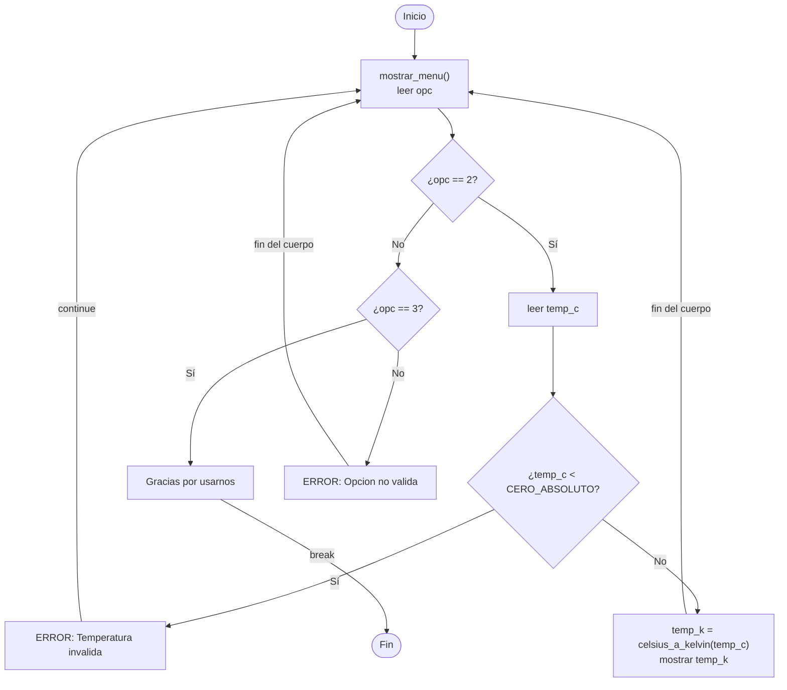

# Sesion magistral 24

* **Tipo**: Presencial
* **Fecha**: 13/10/2026
* **Parte**: Primer bloque de clase (14-16)

## Resumen

Primera sesión de la [clase 10](../README.md). Se retoma el programa de conversión de temperaturas escrito en la [sesión 23](../../9/sesion_magistral-23/README.md) y se mejora **paso a paso**, en vivo, sin cambiar lo que hace: solo cambia **cómo está escrito y cómo se prueba**. Se eligió un programa ya conocido para que la atención quede en el procedimiento y no en un problema nuevo. Ese procedimiento es el que, al final, lleva un programa de **un solo archivo** a **varios archivos**.

| Paso | Archivo escrito en clase | Archivo de esta página | Qué enseña |
|---|---|---|---|
| 0 | `temperaturas.py` (sesión 23) | [`temperaturas.py`](../../9/sesion_magistral-23/temperaturas.py) | El mínimo funcional: el programa sirve, pero se prueba con `print` y los nombres no dicen qué hace cada cosa |
| 1 | `temperaturas_v1.py` | [`paso1_pruebas_assert.py`](codigo/paso1_pruebas_assert.py) | Las pruebas con `print` se reemplazan por pruebas con `assert`, que se revisan solas |
| 2 | `test_funciones.py` | [`paso2_funciones_y_pruebas.py`](codigo/paso2_funciones_y_pruebas.py) | Las funciones van con sus pruebas, y la interacción con el usuario irá en otro archivo |
| 3 | `temperaturas_v2.py` | [`paso3_especificacion.py`](codigo/paso3_especificacion.py) | Buenas prácticas, la especificación como contrato y la validación del dato antes de llamar a la función |

> [!TIP]
> **Si no asistió a clase**, siga esta ruta:
> 1. Abra [`temperaturas.py`](../../9/sesion_magistral-23/temperaturas.py) en Spyder y ejecútelo. Es el punto de partida.
> 2. Recorra los pasos en orden. En cada uno: lea la sección, ejecute el archivo de ese paso y compárelo con el anterior. La lista **Qué cambia** al inicio de cada paso le dice qué buscar.
> 3. Resuelva los [ejercicios de práctica](#ejercicios-de-práctica) antes de ver las soluciones.
> 4. Revise [lo que quedó pendiente](#lo-que-quedó-pendiente-de-un-archivo-a-varios): es el tema con el que sigue la clase.

**Contenido de esta página:**

* [Paso 0 — El punto de partida: pruebas con `print`](#paso-0--el-punto-de-partida-pruebas-con-print)
* [Paso 1 — Pruebas con `assert`](#paso-1--pruebas-con-assert)
* [Paso 2 — Separar las funciones y sus pruebas de la interacción](#paso-2--separar-las-funciones-y-sus-pruebas-de-la-interacción)
* [Paso 3 — Buenas prácticas y especificación](#paso-3--buenas-prácticas-y-especificación)
* [Para explorar por su cuenta](#para-explorar-por-su-cuenta)
* [Ejercicios de práctica](#ejercicios-de-práctica)
* [Lo que quedó pendiente: de un archivo a varios](#lo-que-quedó-pendiente-de-un-archivo-a-varios)
* [Archivos](#archivos)

## Paso 0 — El punto de partida: pruebas con `print`

El programa de partida es [`temperaturas.py`](../../9/sesion_magistral-23/temperaturas.py), escrito en la sesión 23. Muestra un menú, lee una temperatura en grados Celsius y la convierte a Fahrenheit o a Kelvin con dos funciones: `c_to_f(c)` y `c_to_k(c)`. Es el **mínimo funcional**: resuelve el problema y ya usa funciones. Pero tiene dos debilidades:

* **Los nombres no dicen qué hace cada cosa**: `menu`, `c_to_f`, `Tc`.
* **Las pruebas se hacen con `print`**, y además quedaron comentadas entre `"""`, así que no se ejecutan.

### Casos de prueba

Antes de escribir una prueba se define el caso: qué se le entrega a la función y qué debería devolver. Con `print`, la comparación entre lo esperado y lo obtenido la hace **quien lee la pantalla**.

| Prueba | Llamada | Resultado esperado | Lo que imprime |
|---|---|---|---|
| `T1` | `c_to_f(5)` | `41` | `T1 = 5°C = 41.0°F` |
| `T2` | `c_to_f(1)` | `33.8` | `T2 = 1°C = 33.8°F` |
| `T1k` | `c_to_k(10)` | `283.15` | `T1c = 10°C = 283.15°F` |
| `T2k` | `c_to_k(-20)` | `253.15` | `T2c = -20°C = 253.15°F` |

```python
# Test de c_to_f
T1 = c_to_f(5)
T1c = 1
T2 = c_to_f(T1c)
print(f"T1 = 5°C = {T1}°F")
print(f"T2 = {T1c}°C = {T2}°F")

# Test de c_to_k
T1k = c_to_k(10)
T2c = -20
T2k = c_to_k(T2c)
print(f"T1c = 10°C = {T1k}°F")
print(f"T2c = {T2c}°C = {T2k:.2f}°F")
```

Observe la última columna de la tabla: los resultados de Kelvin se imprimen con la unidad `°F` y con las etiquetas `T1c`/`T2c`. Los números son correctos, pero las etiquetas no. Es un error fácil de pasar por alto cuando las pruebas se revisan **a ojo**, y es justo la debilidad que corrige el paso 1.

## Paso 1 — Pruebas con `assert`

**Qué cambia respecto al paso 0:**

* Las pruebas con `print`, que estaban comentadas, se reemplazan por pruebas con `assert`, que se ejecutan siempre.
* Se agregan cinco casos de prueba nuevos.
* Las funciones y el programa principal **no cambian**.

Una verificación se escribe con la palabra clave `assert`, seguida de una condición y, opcionalmente, un mensaje:

```python
assert condición [, "Mensaje opcional"]
```

* Si la condición es **verdadera**, el programa continúa **sin mostrar nada**.
* Si es **falsa**, Python se detiene con `AssertionError` e indica la línea que falló, o muestra el mensaje si se escribió uno.

| | Con `print` | Con `assert` |
|---|---|---|
| ¿Quién compara lo esperado con lo obtenido? | Quien lee la pantalla | Python |
| Si todo está bien | Muestra los resultados | No muestra nada |
| Si algo está mal | Hay que notarlo | El programa se detiene y señala la prueba que falló |
| ¿Cuándo se ejecutan? | Solo si se quitan los comentarios | En cada ejecución del archivo |

> [!IMPORTANT]
> De aquí en adelante, en el curso las funciones se prueban con `assert`, no con `print`.

### Casos de prueba

Son los mismos cuatro casos del paso 0 más otros cinco. Cada caso tiene un **tipo**:

* **Típico**: un uso habitual de la función.
* **Límite**: un valor en el extremo del rango válido.
* **Especial**: un valor atípico o con una propiedad particular.

| Llamada | Resultado esperado | Python devuelve | Tipo |
|---|---|---|---|
| `c_to_f(5)` | `41` | `41.0` | Típico |
| `c_to_f(1)` | `33.8` | `33.8` | Típico |
| `c_to_f(1.5)` | `34.7` | `34.7` | Típico (dato decimal) |
| `c_to_f(100)` | `212.00` | `212.0` | Típico (punto de ebullición) |
| `c_to_f(0)` | `32.00` | `32.0` | Típico (punto de congelación) |
| `c_to_f(37)` | `98.60` | `98.60000000000001` | Típico (temperatura corporal) |
| `c_to_f(-40)` | `-40.00` | `-40.0` | Especial (las dos escalas coinciden) |
| `c_to_k(10)` | `283.15` | `283.15` | Típico |
| `c_to_k(-20)` | `253.15` | `253.14999999999998` | Típico (temperatura negativa) |

> [!TIP]
> Los números reales (`float`) no siempre se representan de forma exacta: `c_to_f(37)` devuelve `98.60000000000001`, no `98.6`. Por eso, al comparar resultados con decimales, se redondea con `round()` antes de usar `==`.
>
> ¿Y por qué la primera prueba no usa `round()`? Porque `c_to_f(5)` da exactamente `41.0`, y en Python `41.0 == 41` es `True`. Cuando no se sabe si el resultado saldrá exacto, lo seguro es redondear.

```python
############ Test ################

# assert condición [, "Mensaje opcional"]

# c_to_f
assert c_to_f(5) == 41                                          # tipico
assert round(c_to_f(1), 1) == 33.8, "El resultado es 33.8"      # tipico
assert round(c_to_f(1.5), 1) == 34.7, "El resultado es 34.7"    # tipico (dato decimal)
assert round(c_to_f(100), 2) == 212.00                          # tipico (ebullicion)
assert round(c_to_f(0), 2) == 32.00                             # tipico (congelacion)
assert round(c_to_f(37), 2) == 98.60                            # tipico (temperatura corporal)
assert round(c_to_f(-40), 2) == -40.00                          # especial (las escalas coinciden)

# c_to_k
assert round(c_to_k(10), 2) == 283.15, "El resultado es 283.15"   # tipico
assert round(c_to_k(-20), 2) == 253.15, "El resultado es 253.15"  # tipico (negativa)

print("Todas las pruebas pasaron")
```

### Qué se ve al ejecutarlo

Las pruebas corren primero. Si todas pasan, aparece el mensaje y enseguida el menú:

```text
Todas las pruebas pasaron
Programa de conversion de °C a °F y °K
--------------------------------
1. °C a °F
2. °C a °K
3. Salir

Elija una opcion:
```

> [!NOTE]
> El mensaje `Todas las pruebas pasaron` no se escribió en clase; se agregó a los archivos de esta página. Sin él, unas pruebas que pasan no muestran nada, y quien ejecuta el archivo no sabe si de verdad se revisaron.

### ¿Qué pasa cuando una prueba falla?

Si, por ejemplo, el resultado esperado de `c_to_f(1.5)` se escribiera mal (`34.6` en lugar de `34.7`), el programa se detendría antes de mostrar el menú:

```text
Traceback (most recent call last):
  File "paso1_pruebas_assert.py", line 35, in <module>
    assert round(c_to_f(1.5), 1) == 34.6, "El resultado es 34.7"    # tipico (dato decimal)
           ^^^^^^^^^^^^^^^^^^^^^^^^^^^^^
AssertionError: El resultado es 34.7
```

Sin mensaje, Python solo muestra `AssertionError` y la línea de la prueba que falló.

**Ejecutar no es lo mismo que probar.** *Ejecutar* es correr el programa completo, como lo usaría el usuario. *Probar* es verificar que cada función da el resultado esperado. Como las pruebas están en el mismo archivo, cada ejecución también las corre: si pasan, el programa arranca normalmente y muestra el menú; si alguna falla, el programa no arranca.

> [!TIP]
> Dos errores frecuentes al escribir un `assert`:
> * Escribir una sola condición por `assert`. Si se unen varias con `and`, cuando falle no se sabrá cuál fue.
> * No poner la condición y el mensaje entre paréntesis: `assert (condición, "mensaje")` **nunca falla**, porque Python lo lee como una tupla, que siempre es verdadera.

El programa todavía tiene los nombres del paso 0 (`menu`, `c_to_f`, `Tc`). Eso se corrige en el paso 3.

## Paso 2 — Separar las funciones y sus pruebas de la interacción

**Qué cambia respecto al paso 1:**

* Se quita el programa principal: ya no hay menú, `input()` ni ciclo.
* Quedan solo las funciones y sus pruebas (los cinco casos del paso 0 y uno nuevo).

En el paso 1, cada vez que se ejecuta el archivo para revisar las pruebas, también arranca el menú y hay que responderlo para salir. Las pruebas y la interacción con el usuario están mezcladas.

La idea de este paso es que **las funciones vayan acompañadas de sus pruebas**, y que **la interacción con el usuario** (menú, `input()` y resultados en pantalla) **quede para otro archivo**. El archivo [`paso2_funciones_y_pruebas.py`](codigo/paso2_funciones_y_pruebas.py) tiene solo eso: las funciones y los `assert`, sin programa principal. Al ejecutarlo, las pruebas corren y el archivo termina de inmediato. En clase no se llegó a escribir el otro archivo; cómo se hace se explica en [Lo que quedó pendiente](#lo-que-quedó-pendiente-de-un-archivo-a-varios).

| Llamada | Resultado esperado | Python devuelve | Tipo |
|---|---|---|---|
| `c_to_f(5)` | `41` | `41.0` | Típico |
| `c_to_f(1)` | `33.8` | `33.8` | Típico |
| `c_to_f(1.5)` | `34.7` | `34.7` | Típico (dato decimal) |
| `c_to_k(10)` | `283.15` | `283.15` | Típico |
| `c_to_k(-20)` | `253.15` | `253.14999999999998` | Típico (temperatura negativa) |

```python
############ Funciones ############
# Despliegue
def menu():
    ...

# Conversion de temperatura
def c_to_f(c):
    ...

def c_to_k(c):
    ...

############ Test ################
assert c_to_f(5) == 41
assert round(c_to_f(1), 1) == 33.8, "El resultado es 33.8"
assert round(c_to_f(1.5), 1) == 34.7, "El resultado es 34.7"
assert round(c_to_k(10), 2) == 283.15, "El resultado es 283.15"
assert round(c_to_k(-20), 2) == 253.15, "El resultado es 253.15"

print("Todas las pruebas pasaron")
# Aqui termina el archivo: no hay menu ni input()
```

Al ejecutarlo, esto es **todo** lo que aparece en pantalla:

```text
Todas las pruebas pasaron
```

Note que `menu()` no tiene pruebas. `assert` solo puede revisar el valor que **devuelve** una función, no lo que imprime en pantalla.

> [!NOTE]
> En clase, este archivo se llamó `test_funciones.py`. En el resto del curso, un archivo `test_<nombre>.py` es otra cosa: un archivo que solo tiene pruebas y que **importa** las funciones desde otro archivo. Este paso es el primer movimiento hacia esa organización.

## Paso 3 — Buenas prácticas y especificación

El paso 2 mostró hacia dónde va la separación en archivos. El paso 3 continúa el programa completo del paso 1, en un solo archivo, y se concentra en tres mejoras. El programa sigue haciendo lo mismo con los datos válidos.

**Qué cambia respecto al paso 1** ([`paso3_especificacion.py`](codigo/paso3_especificacion.py)):

* Las funciones y las variables cambian de nombre.
* Cada función de conversión tiene su **especificación**.
* El programa principal **valida la temperatura** antes de llamar a la función, con una constante `CERO_ABSOLUTO` y la instrucción `continue`.
* Se agrega la prueba del cero absoluto.

### Nombres que dicen qué hace cada cosa

| Antes | Después | Regla |
|---|---|---|
| `menu()` | `mostrar_menu()` | El nombre de una función empieza con un verbo y dice qué hace |
| `c_to_f(c)` | `celsius_a_fahrenheit(temp_c)` | Nombres completos, no abreviaturas crípticas |
| `c_to_k(c)` | `celsius_a_kelvin(temp_c)` | Nombres completos, no abreviaturas crípticas |
| `Tc`, `Tf`, `Tk` | `temp_c`, `temp_f`, `temp_k` | Variables en minúscula con guion bajo (*snake_case*) |

Los dos programas hacen lo mismo, pero el segundo se entiende sin necesidad de explicarlo.

### La especificación: un contrato

¿Cómo sabe alguien usar una función que no escribió? Leyendo su **especificación**. La especificación es un contrato entre dos personas:

| | Quién | Compromiso |
|---|---|---|
| **Supone** | Quien usa la función | Entregar datos válidos |
| **Garantiza** | Quien escribe la función | Devolver el resultado correcto, si los datos son válidos |

En Python, la especificación se escribe como un *docstring*: un texto entre `"""` justo debajo del `def`.

```python
def celsius_a_kelvin(temp_c):
    """
    Convierte una temperatura de grados Celsius a Kelvin.

    Supone:
        temp_c es un número (int o float) mayor o igual a -273.15
        (el cero absoluto).
    Garantiza:
        Retorna la temperatura equivalente en Kelvin (float),
        mayor o igual a 0.
    """
    temp_k = temp_c + 273.15
    return temp_k
```

Con la especificación, se puede usar una función sin leer su código. Para consultarla se usa `help()`:

```text
>>> help(celsius_a_kelvin)
Help on function celsius_a_kelvin in module __main__:

celsius_a_kelvin(temp_c)
    Convierte una temperatura de grados Celsius a Kelvin.

    Supone:
        temp_c es un número (int o float) mayor o igual a -273.15
        (el cero absoluto).
    Garantiza:
        Retorna la temperatura equivalente en Kelvin (float),
        mayor o igual a 0.
```

### ¿De quién es la culpa?

En las versiones anteriores nada impide llamar a la función con un dato que no cumple lo que supone. Con el programa del paso 1:

```text
Elija una opcion: 2
Digite la temperatura en °C: -300
-300.0°C = -26.85°K
```

El programa no da error, pero el resultado no tiene sentido: no existen temperaturas en Kelvin negativas. La culpa es de **quien llamó** a la función con `-300`, porque no cumplió lo que la función supone. La función cumplió su parte.

> [!NOTE]
> El programa escribe `°K`, como se hizo en clase, pero la forma correcta es `K`, sin el símbolo de grado. El Kelvin es una escala absoluta y no se escribe con `°`, a diferencia de `°C` y `°F`.

### Validar el dato antes de llamar a la función

Por eso, en el paso 3, el **programa principal** se encarga de cumplir el contrato: lee la temperatura y la valida **antes de invocar** la función. El límite se guarda en una **constante global**, escrita en MAYÚSCULA porque su valor nunca cambia. Las funciones pueden leer una constante global, pero no deben modificarla.

```python
############ Constantes ############
CERO_ABSOLUTO = -273.15  # °C

...

    elif opc == 2:
        # C --> K
        temp_c = float(input("Digite la temperatura en °C: "))
        if temp_c < CERO_ABSOLUTO:
            print("ERROR: Temperatura invalida")
            continue
        temp_k = celsius_a_kelvin(temp_c)
        print(f"{temp_c}°C = {temp_k:.2f}°K\n")
```

Si el dato no es válido, `continue` **salta al inicio del ciclo** `while True` sin ejecutar el resto del cuerpo: la función no se llama y el menú vuelve a aparecer, sin romper el ciclo. Es la misma instrucción que se usó en la [clase 8](../../8/teoria/README.md) para descartar notas fuera de rango. Si necesita repasar la diferencia con `break`, vea las pruebas de escritorio de la sección 1.4 del [taller 2](../../../talleres/condicionales-ciclos/README.md#14-break-y-continue).

El diagrama muestra las tres formas en que termina una vuelta del ciclo. Para no repetir, omite la opción 1, que sigue el mismo camino que la opción 2 con `celsius_a_fahrenheit`.



| Instrucción | Qué hace | ¿Sigue el ciclo? |
|---|---|---|
| `continue` | Salta el resto del cuerpo y vuelve al inicio del `while` | Sí |
| `break` | Sale del ciclo | No |
| (ninguna) | El cuerpo termina normalmente y se vuelve al inicio del `while` | Sí |

#### Prueba de escritorio

Entradas, en orden: `2`, `-300`, `2`, `25`, `3`.

| Vuelta | `opc` | `temp_c` | ¿`temp_c < CERO_ABSOLUTO`? | Qué pasa | En pantalla |
|---|---|---|---|---|---|
| 1 | `2` | `-300.0` | Sí | `continue`: se vuelve al `while True` **sin llamar** a `celsius_a_kelvin` | `ERROR: Temperatura invalida` |
| 2 | `2` | `25.0` | No | Se llama `celsius_a_kelvin(25.0)`, que devuelve `298.15` | `25.0°C = 298.15°K` |
| 3 | `3` | — | — | `break`: termina el ciclo | `Gracias por usarnos` |

Así se ve la ejecución completa:

```text
Todas las pruebas pasaron
Programa de conversion de °C a °F y °K
--------------------------------
1. °C a °F
2. °C a °K
3. Salir

Elija una opcion: 2
Digite la temperatura en °C: -300
ERROR: Temperatura invalida
--------------------------------
1. °C a °F
2. °C a °K
3. Salir

Elija una opcion: 2
Digite la temperatura en °C: 25
25.0°C = 298.15°K

--------------------------------
1. °C a °F
2. °C a °K
3. Salir

Elija una opcion: 3
Gracias por usarnos
```

### Casos de prueba

**Pruebas de las funciones.** Se conservan las del paso 1, con los nombres nuevos, y se agrega el caso límite del contrato: el cero absoluto, el menor valor que la función supone.

| Llamada | Resultado esperado | Python devuelve | Tipo |
|---|---|---|---|
| `celsius_a_kelvin(-273.15)` | `0.00` | `0.0` | Límite (cero absoluto) |

**Pruebas del programa principal.** Estas no se pueden automatizar con `assert`, porque dependen de lo que escribe el usuario. Se revisan ejecutando el programa.

| Opción | Entrada (°C) | Salida esperada | Tipo |
|---|---|---|---|
| 1 | `100` | `100.0°C = 212.00°F` | Típico |
| 2 | `25` | `25.0°C = 298.15°K` | Típico |
| 2 | `-273.15` | `-273.15°C = 0.00°K` | Límite (cero absoluto) |
| 2 | `-300` | `ERROR: Temperatura invalida` y vuelve el menú | Especial (no cumple el contrato) |
| 7 | — | `ERROR: Opcion no valida` | Especial (opción inexistente) |
| 3 | — | `Gracias por usarnos` | Salida del programa |

## Para explorar por su cuenta

Esta sección no se vio en clase.

### Volver a pedir solo la temperatura

Con `continue`, un dato inválido obliga a elegir otra vez la opción del menú. Si se quiere volver a pedir **solo la temperatura**, la lectura se puede repetir con un **ciclo anidado** dentro del `while True`, hasta que el dato cumpla el contrato. Así está en [`paso3b_ciclo_anidado.py`](codigo/paso3b_ciclo_anidado.py):

```python
    elif opc == 2:
        # C --> K
        temp_c = float(input("Digite la temperatura en °C: "))
        # Ciclo anidado: se repite la lectura hasta que cumpla el contrato
        while temp_c < CERO_ABSOLUTO:
            print("ERROR: Temperatura invalida")
            temp_c = float(input("Digite la temperatura en °C: "))
        temp_k = celsius_a_kelvin(temp_c)
        print(f"{temp_c}°C = {temp_k:.2f}°K\n")
```

```text
Elija una opcion: 2
Digite la temperatura en °C: -300
ERROR: Temperatura invalida
Digite la temperatura en °C: -274
ERROR: Temperatura invalida
Digite la temperatura en °C: 25
25.0°C = 298.15°K
```

| | Con `continue` (paso 3) | Con ciclo anidado (paso 3b) |
|---|---|---|
| ¿Qué se repite si el dato no es válido? | Todo: el menú, la opción y la temperatura | Solo la lectura de la temperatura |
| ¿Cuándo se llama a la función? | Solo si el dato es válido | Solo si el dato es válido |

La lectura con validación aparece dos veces, una en cada opción. El [ejercicio 3](#ejercicio-3-una-función-para-leer-la-temperatura) propone una función para no repetirla.

### Probar una función a mano desde la consola

Además del botón del IDE (▶ en Spyder) y de la terminal (`python paso3_especificacion.py`), un programa se puede ejecutar con `python -i paso3_especificacion.py`. Al salir del menú, la consola queda abierta con las funciones ya definidas, y se pueden llamar a mano: `celsius_a_fahrenheit(100)`.

### Referencias

* CS50P, Lecture 5: Unit Tests, sección [`assert`](https://cs50.harvard.edu/python/notes/5/#assert).

## Ejercicios de práctica

Intente cada ejercicio antes de abrir la solución.

### Ejercicio 1: hacer fallar una prueba

En una copia de [`paso1_pruebas_assert.py`](codigo/paso1_pruebas_assert.py):

1. Cambie la primera prueba por `assert c_to_f(5) == 42` y ejecute. ¿Qué muestra Python? ¿Aparece el menú?
2. Devuélvala a `41` y cambie la de `c_to_f(1.5)` por `34.6`, que sí tiene mensaje. ¿Qué cambia en el error?
3. Escriba `assert (c_to_f(5) == 42, "Falla")`, con paréntesis. ¿Falla? ¿Por qué?

<details>
<summary>Solución</summary>

1. El programa se detiene antes del menú. Como esa prueba no tiene mensaje, la última línea dice solo `AssertionError`. La línea anterior muestra la prueba que falló:

   ```text
       assert c_to_f(5) == 42                                          # tipico
              ^^^^^^^^^^^^^^^
   AssertionError
   ```

2. Ahora la última línea es `AssertionError: El resultado es 34.7`: el mensaje dice cuál era el valor esperado.
3. No falla, aunque `41 == 42` es falso. Con paréntesis, Python lee una tupla de dos elementos, y una tupla con elementos siempre es verdadera. Python avisa con un `SyntaxWarning: assertion is always true`, pero el programa sigue. Por eso la condición y el mensaje van **sin** paréntesis.

</details>

### Ejercicio 2: una función nueva con su contrato

Escriba la función `fahrenheit_a_celsius(temp_f)` con:

* su especificación (*Supone* / *Garantiza*). ¿Cuál es el menor valor válido en grados Fahrenheit?
* una tabla de casos de prueba con al menos un caso típico, uno límite y uno especial;
* los `assert` de esos casos.

Fórmula: $C = (F - 32) \cdot \frac{5}{9}$.

<details>
<summary>Solución</summary>

El cero absoluto en grados Fahrenheit es $-273.15 \cdot \frac{9}{5} + 32 = -459.67$.

```python
def fahrenheit_a_celsius(temp_f):
    """
    Convierte una temperatura de grados Fahrenheit a grados Celsius.

    Supone:
        temp_f es un número (int o float) mayor o igual a -459.67
        (el cero absoluto).
    Garantiza:
        Retorna la temperatura equivalente en grados Celsius (float),
        mayor o igual a -273.15.
    """
    temp_c = (temp_f - 32) * 5/9
    return temp_c


assert round(fahrenheit_a_celsius(212), 2) == 100.00       # tipico (ebullicion)
assert round(fahrenheit_a_celsius(32), 2) == 0.00          # tipico (congelacion)
assert round(fahrenheit_a_celsius(98.6), 2) == 37.00       # tipico (temperatura corporal)
assert round(fahrenheit_a_celsius(-459.67), 2) == -273.15  # limite (cero absoluto)
assert round(fahrenheit_a_celsius(-40), 2) == -40.00       # especial (las escalas coinciden)

print("Todas las pruebas pasaron")
```

| Llamada | Resultado esperado | Tipo |
|---|---|---|
| `fahrenheit_a_celsius(212)` | `100.00` | Típico (ebullición) |
| `fahrenheit_a_celsius(32)` | `0.00` | Típico (congelación) |
| `fahrenheit_a_celsius(98.6)` | `37.00` | Típico (temperatura corporal) |
| `fahrenheit_a_celsius(-459.67)` | `-273.15` | Límite (cero absoluto) |
| `fahrenheit_a_celsius(-40)` | `-40.00` | Especial (las escalas coinciden) |

Observe que los casos son los mismos de `celsius_a_fahrenheit`, pero al revés: una buena forma de encontrar casos de prueba para una función inversa.

</details>

### Ejercicio 3: una función para leer la temperatura

En [`paso3b_ciclo_anidado.py`](codigo/paso3b_ciclo_anidado.py), la lectura con validación aparece dos veces, una en cada opción. Escriba una función que la reemplace. Antes de programarla, responda: ¿recibe algún dato? ¿Qué devuelve? ¿Se puede probar con `assert`?

<details>
<summary>Solución</summary>

No recibe datos: los pide al usuario. Devuelve la temperatura ya validada.

```python
def leer_temperatura_valida():
    """
    Pide una temperatura en grados Celsius hasta que sea válida.

    Supone:
        El usuario escribe un número.
    Garantiza:
        Retorna una temperatura en °C (float) mayor o igual a -273.15.
    """
    temp_c = float(input("Digite la temperatura en °C: "))
    while temp_c < CERO_ABSOLUTO:
        print("ERROR: Temperatura invalida")
        temp_c = float(input("Digite la temperatura en °C: "))
    return temp_c
```

Cada opción del menú queda en dos líneas:

```python
    elif opc == 2:
        temp_c = leer_temperatura_valida()
        print(f"{temp_c}°C = {celsius_a_kelvin(temp_c):.2f}°K\n")
```

No se puede probar con `assert`, porque su resultado depende de lo que escriba el usuario. Se prueba ejecutando el programa, como las pruebas del programa principal del paso 3.

</details>

## Lo que quedó pendiente: de un archivo a varios

En clase, el código avanzó hasta el paso 2: se mostró que las funciones deben ir con sus pruebas y la interacción con el usuario en otro archivo. Pero esa separación no se completó: el paso 3 siguió en un solo archivo para concentrarse en el contrato. Para terminar de pasar de un archivo a varios faltaron estos temas:

| Tema | Idea |
|---|---|
| Módulo e `import` | Un archivo `.py` cuyas funciones se usan desde otro archivo se llama **módulo**. Se importa con el nombre del archivo sin `.py` (`import conversiones`), y sus funciones se llaman con el prefijo del módulo (`conversiones.celsius_a_fahrenheit(...)`), igual que `math.sqrt(...)` |
| Qué pasa al importar | `import` ejecuta **todo** el archivo, de arriba hacia abajo: si las pruebas están en el módulo, también corren cuando otro archivo lo importa |
| La variable `__name__` | Vale `"__main__"` si el archivo se ejecutó directamente, y el nombre del módulo si fue importado |
| Opción 1: pruebas con guarda | Las pruebas van dentro de `if __name__ == "__main__":` en el mismo módulo, y solo corren si el módulo se ejecuta directamente |
| Opción 2: archivo de pruebas aparte | Las pruebas se trasladan a `test_<modulo>.py`, que importa el módulo. El módulo queda solo con funciones |
| `def main()` y la guarda | El programa principal se agrupa en una función `main()`, que se llama dentro de `if __name__ == "__main__":` |
| Errores frecuentes | Archivos en carpetas distintas, `import conversiones.py` con la extensión, olvidar el prefijo del módulo, o nombrar un archivo propio igual que una librería (`random.py`) |

Estos temas están resueltos, con este mismo programa, en [`temperaturas_modulos/`](../teoria/codigo/temperaturas_modulos/). La organización final, con un módulo de funciones, un `test_<modulo>.py` y un `main.py`, es la que se usa en el [laboratorio 4](../../../laboratorios/4/) y en el ejercicio guiado [adivina el número](../teoria/codigo/adivina_numero/README.md#7-organizar-el-programa-en-varios-archivos).

> [!TIP]
> **Antes de la próxima sesión**, recorra las cuatro carpetas de `temperaturas_modulos/` en orden. En cada una, ejecute el archivo indicado y observe qué se muestra en pantalla:
>
> | Carpeta | Ejecute | Qué observar |
> |---|---|---|
> | [`0_name`](../teoria/codigo/temperaturas_modulos/0_name/) | `saludo.py` y luego `principal.py` | El valor de `__name__` cambia según cómo se ejecute el archivo |
> | [`1_sin_guarda`](../teoria/codigo/temperaturas_modulos/1_sin_guarda/) | `main.py` | Las pruebas del módulo corren al importarlo |
> | [`2_con_guarda`](../teoria/codigo/temperaturas_modulos/2_con_guarda/) | `conversiones.py` y luego `main.py` | Con la guarda, las pruebas solo corren al ejecutar el módulo directamente |
> | [`3_archivo_pruebas`](../teoria/codigo/temperaturas_modulos/3_archivo_pruebas/) | `test_conversiones.py` y luego `main.py` | Las pruebas viven en su propio archivo; el módulo solo tiene funciones |

## Archivos

| Archivo | Descripción |
|---|---|
| [`codigo/paso1_pruebas_assert.py`](codigo/paso1_pruebas_assert.py) | Paso 1: pruebas con `assert` |
| [`codigo/paso2_funciones_y_pruebas.py`](codigo/paso2_funciones_y_pruebas.py) | Paso 2: las funciones y sus pruebas, sin programa principal |
| [`codigo/paso3_especificacion.py`](codigo/paso3_especificacion.py) | Paso 3: buenas prácticas, especificación y validación |
| [`codigo/paso3b_ciclo_anidado.py`](codigo/paso3b_ciclo_anidado.py) | Complemento del paso 3, no visto en clase: volver a pedir solo la temperatura |
| [`codigo_sin_editar/`](codigo_sin_editar/) | Los archivos tal como se escribieron en clase: `temperaturas.py` (paso 0, copia del de la sesión 23), `temperaturas_v1.py` (paso 1), `test_funciones.py` (paso 2) y `temperaturas_v2.py` (paso 3) |

> [!NOTE]
> Los archivos de `codigo/` son versiones revisadas de los escritos en clase. En los cuatro se quitaron los encabezados automáticos de Spyder, se agregó un comentario inicial que describe el paso, se alinearon los comentarios de las pruebas y se agregó `print("Todas las pruebas pasaron")` al final de las pruebas. En el paso 3, además, la constante se llama `CERO_ABSOLUTO` (en clase, `ZERO_ABSOLUTO`), los parámetros y variables de las funciones se llaman `temp_c`, `temp_f` y `temp_k` (en clase seguían llamándose `c`, `f` y `k`, aunque la especificación ya hablaba de `temp_c`), y se agregó la prueba del cero absoluto. Los archivos de `codigo_sin_editar/` se conservan como referencia.

> [!Important]
> Se usó IA generativa para redactar y organizar este contenido a partir del código escrito en clase y de las diapositivas de la clase 10. El docente revisó y validó la versión final.
