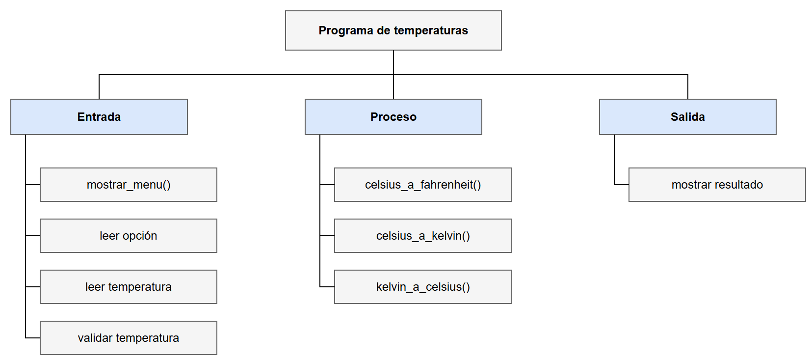
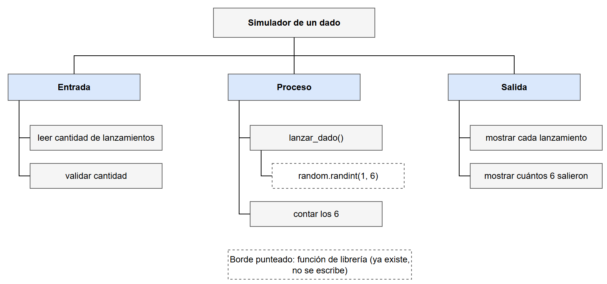
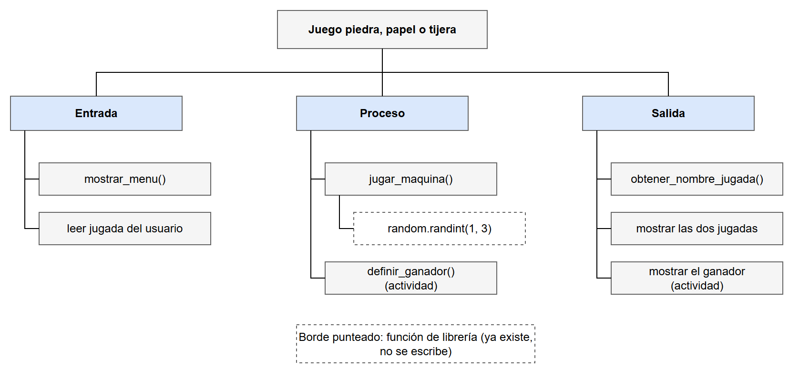

# Sesion magistral 27

* **Tipo**: Presencial
* **Fecha**: 20/10/2026
* **Parte**: Segundo bloque de clase (16-18)

## Resumen

Cuarta sesión de la [clase 10](../README.md), continuación de la [sesión 26](../sesion_magistral-26/README.md). Hasta ahora, cada función que se usaba en el curso la habíamos escrito nosotros. Esta sesión trata de las funciones que **ya existen**: las integradas de Python y las de los módulos `math` y `random`. Para usarlas no hace falta leer su código, basta con su **especificación**. Además, se le pone nombre a una forma de diseñar que ya veníamos usando, el **diseño top-down**, y se empieza un programa que reúne todo: el juego piedra, papel o tijera.

A diferencia de la sesión 26, aquí no se hace evolucionar un solo programa: la sesión recorre cuatro temas, en el orden de la clase.

| Parte | Tema | Archivos de esta página |
|---|---|---|
| 1 | Usar funciones que ya existen: integradas, `math`, la especificación y las formas de importar | [`parte1_integradas.py`](codigo/parte1_integradas.py), [`parte1_math.py`](codigo/parte1_math.py), [`parte1_formas_importar.py`](codigo/parte1_formas_importar.py) |
| 2 | Diseño top-down, con el programa de temperaturas de la sesión 26 | [`arbol_temperaturas_modulos.png`](images/arbol_temperaturas_modulos.png) |
| 3 | Números aleatorios: el módulo `random`, la semilla y un simulador de un dado | [`parte3_dado/`](codigo/parte3_dado/) |
| 4 | El juego piedra, papel o tijera (quedó a medias: terminarlo es la actividad) | [`parte4_juego/`](codigo/parte4_juego/), [`arbol_juego.png`](images/arbol_juego.png) |

> [!TIP]
> **Si no asistió a clase**, siga esta ruta:
> 1. Si no vio la sesión 26, lea al menos su [paso 3](../sesion_magistral-26/README.md#paso-3--de-un-archivo-a-varios): ahí se explican los módulos propios y el `import`, que esta sesión da por conocidos.
> 2. Recorra las partes en orden. En cada una, ejecute los archivos y compare lo que aparece en pantalla con lo que muestra esta página.
> 3. Las carpetas `parte3_dado/` y `parte4_juego/` son programas de varios archivos: al descargarlas, conserve la estructura de carpetas que muestra el diagrama de cada parte.
> 4. Haga la [actividad](#actividad-terminar-el-juego) y el [ejercicio](#ejercicio-de-práctica) antes de ver las soluciones.

**Contenido de esta página:**

* [Parte 1 — Usar funciones que ya existen](#parte-1--usar-funciones-que-ya-existen)
* [Parte 2 — Diseño top-down](#parte-2--diseño-top-down)
* [Parte 3 — Números aleatorios: el módulo `random`](#parte-3--números-aleatorios-el-módulo-random)
* [Parte 4 — El juego piedra, papel o tijera](#parte-4--el-juego-piedra-papel-o-tijera)
* [Ejercicio de práctica](#ejercicio-de-práctica)
* [Recomendaciones de otros cursos](#recomendaciones-de-otros-cursos)
* [Para explorar por su cuenta](#para-explorar-por-su-cuenta)
* [Archivos](#archivos)

## Parte 1 — Usar funciones que ya existen

Muchas funciones ya existen, escritas y probadas por otras personas. Usarlas evita **reinventar la rueda**. Para usarlas no hace falta leer su código: basta con saber **qué hacen**, es decir, con su **especificación**.

### Funciones integradas

`print()`, `input()`, `int()` y `float()` son funciones que nunca escribimos: vienen con Python y se usan sin importar nada. Se llaman **funciones integradas** (*built-in*). Como cualquier función, reciben argumentos y retornan un valor. Otras integradas útiles, en [`parte1_integradas.py`](codigo/parte1_integradas.py):

| Función | Qué retorna | Ejemplo | Resultado |
|---|---|---|---|
| `abs(x)` | El valor absoluto de `x` | `abs(-7)` | `7` |
| `round(x)` | `x` redondeado al entero más cercano | `round(2.38)` | `2` |
| `round(x, n)` | `x` redondeado a `n` decimales | `round(2.38, 1)` | `2.4` |
| `max(a, b, ...)` | El mayor de los valores | `max(2, 3, 10, 6)` | `10` |
| `min(a, b, ...)` | El menor de los valores | `min(2, 3, 10, 6)` | `2` |

> [!NOTE]
> `max()` y `min()` también reciben una **lista**: con `notas = [2.0, 3.5, 4.8, 3.0]`, `max(notas)` retorna `4.8` y `min(notas)` retorna `2.0`. Las listas se estudian en la [clase 11](../../11/README.md).

### El módulo `math` y la especificación

Otras funciones vienen agrupadas en **módulos** que hay que **importar** antes de usar. El módulo `math` reúne funciones matemáticas. Por ejemplo, para calcular el seno de 90° ([`parte1_math.py`](codigo/parte1_math.py)):

```python
import math

print(f"math.sin(90) = {math.sin(90)}")
```

```text
math.sin(90) = 0.8939966636005579
```

El seno de 90° es 1, no 0.89, y Python no mostró ningún error. ¿Qué pasó? La especificación lo explica:

```text
>>> help(math.sin)
Help on built-in function sin in module math:

sin(x, /)
    Return the sine of x (measured in radians).
```

`math.sin` **supone** que el ángulo está en **radianes**, así que interpretó `90` como 90 radianes. Para entregarle grados, primero hay que convertirlos, y para eso `math` ya tiene otra función, `math.radians`:

```python
x = 90
x_rad = math.radians(x)
y = math.sin(x_rad)
print(f"math.sin(math.radians(90)) = {y}")

# Lo mismo en una sola línea: una función invocada dentro de otra
y = math.sin(math.radians(x))
print(f"y = {y}")

# La constante pi del módulo math: pi/2 radianes son 90 grados
print(f"math.pi = {math.pi}")
z = math.sin(math.pi / 2)
print(f"z = {z}")
```

```text
math.sin(math.radians(90)) = 1.0
y = 1.0
math.pi = 3.141592653589793
z = 1.0
```

Es el mismo contrato de la [sesión 24](../sesion_magistral-24/README.md#la-especificación-un-contrato): si quien usa la función no cumple lo que ella supone, el resultado no sirve, **aunque no haya error**. Python detecta los errores de escritura, pero no los de razonamiento.

**¿Dónde se consulta la especificación de una función?**

* **Con `help(nombre_funcion)`** en la consola de Python, como arriba. Para una función de un módulo, primero se importa el módulo.
* **En la documentación de [CodeSkulptor](https://py3.codeskulptor.org/docs.html)**, que explica cada función de forma sencilla y con ejemplos. Las funciones integradas como `abs`, `round` y `max` están en la pestaña *Types & Operations*; las de `math` y `random`, en *Standard Modules*.
* **En la documentación oficial de Python**, por ejemplo la del [módulo `math`](https://docs.python.org/es/3/library/math.html). Es más completa, pero más técnica.

### Formas de importar

Las formas de importar de la [sesión 26](../sesion_magistral-26/README.md#paso-3--de-un-archivo-a-varios) sirven igual para un módulo de Python, como `math`. En [`parte1_formas_importar.py`](codigo/parte1_formas_importar.py), las tres usan la misma función, `math.sqrt`:

| Forma | Cómo se llama la función | Comentario |
|---|---|---|
| `import math` | `math.sqrt(16)` | **Recomendada**: el prefijo dice de dónde viene la función |
| `from math import sqrt, pi` | `sqrt(16)` | Útil cuando se usan pocas funciones, muchas veces |
| `import math as m` | `m.sqrt(16)` | Útil para abreviar el nombre de un módulo largo |
| `from math import *` | `sqrt(16)` | **No se recomienda**: trae todo sin decir qué, y puede reemplazar sin aviso una función con el mismo nombre |

```text
4.0
4.0 3.141592653589793
4.0
```

## Parte 2 — Diseño top-down

Un problema grande se resuelve dividiéndolo en problemas más pequeños, y estos en otros más simples, hasta que cada uno sea fácil de resolver: **divide y vencerás**. En el **diseño top-down** (de arriba hacia abajo) se parte del problema completo y se baja, nivel por nivel, hasta las piezas más pequeñas.

El ejemplo es el programa de temperaturas en su versión final, el del [paso 4 de la sesión 26](../sesion_magistral-26/README.md#paso-4--main-y-la-guarda-en-el-programa-de-temperaturas), con tres conversiones. Ese programa ya estaba diseñado así sin decirlo; ahora el método tiene nombre. En clase, el árbol se dibujó como un bosquejo en el tablero; esta es su versión en limpio:



**Cómo se lee el árbol:**

* **El primer nivel** casi siempre es el mismo: Entrada → Proceso → Salida.
* **Cada caja con `()`** es un subproblema que se convirtió en una función.
* **Las cajas sin `()`** ocupan una o dos líneas de código, así que quedaron como instrucciones dentro de `main()`. No todo subproblema necesita ser una función.
* **¿Hasta dónde dividir?** Hasta que cada pieza haga una sola cosa y su nombre lo diga.

"Validar temperatura" está en **Entrada** porque validar es parte de *obtener un dato válido*: el programa lee la temperatura y, si no sirve, la rechaza antes de procesarla. Así, el Proceso solo recibe datos que cumplen lo que las funciones suponen.

**De cada caja a un archivo.** El diseño top-down y los módulos de la sesión 26 son la misma idea vista desde dos lados. Cada caja quedó en un lugar:

| Caja del árbol | Dónde quedó en el paso 4 de la sesión 26 |
|---|---|
| `mostrar_menu()` | Función en `pantalla.py` |
| `celsius_a_fahrenheit()`, `celsius_a_kelvin()`, `kelvin_a_celsius()` | Funciones en `conversion.py` |
| leer opción, leer temperatura, validar temperatura, mostrar resultado | Instrucciones dentro de `main()`, en `main.py` |

Las funciones de una misma rama están relacionadas entre sí, y por eso viven en el mismo módulo: es la **cohesión** de la sesión 26.

**¿Por dónde se empieza a programar?** Por arriba: el programa principal, con las funciones como *stubs*. Es lo que se hizo en el [paso 1 de la sesión 26](../sesion_magistral-26/README.md#paso-1--empezar-con-stubs).

## Parte 3 — Números aleatorios: el módulo `random`

Muchos programas necesitan resultados al azar: un juego, un sorteo, una simulación. El módulo `random` genera números que **parecen** aleatorios, pero que en realidad salen de una fórmula; por eso se llaman **pseudoaleatorios**.

La función que se usó en clase es `random.randint(a, b)`, que retorna un entero al azar entre `a` y `b`, **incluidos los dos extremos**. Así lo dice su especificación en la [documentación oficial](https://docs.python.org/es/3/library/random.html#random.randint): "Retorna un entero aleatorio N tal que `a <= N <= b`". Desde la consola de Python (los valores que usted obtenga serán otros):

```text
>>> import random
>>> random.randint(1, 6)
4
>>> random.randint(1, 6)
2
```

> [!WARNING]
> `random.randint(1, 6)` puede retornar el 6, pero `range(1, 6)` no llega al 6. Las dos reciben un inicio y un final, pero no tratan el final igual. Es otra razón para leer la especificación antes de usar una función.

### ¿Qué es la semilla?

Una computadora no lanza dados: sigue instrucciones. Para producir números que **parezcan** al azar, `random` usa una fórmula que, a partir de un número inicial, calcula el siguiente; de ese, el siguiente, y así sucesivamente. Ese número inicial es la **semilla** (*seed*).

Una forma de imaginarlo: la fórmula produce una lista larguísima de números ya mezclados, y la semilla dice **en qué punto de la lista se empieza a leer**.

* **Si el programa no fija la semilla**, Python la toma de una fuente que cambia en cada ejecución, como la hora del sistema. Por eso cada ejecución da resultados distintos.
* **Si se fija con `random.seed(n)`**, la secuencia es **siempre la misma**:

```text
>>> random.seed(10)
>>> random.randint(1, 6), random.randint(1, 6), random.randint(1, 6)
(5, 1, 4)
>>> random.seed(10)
>>> random.randint(1, 6), random.randint(1, 6), random.randint(1, 6)
(5, 1, 4)
>>> random.seed(7)
>>> random.randint(1, 6), random.randint(1, 6), random.randint(1, 6)
(3, 2, 4)
```

| Sin semilla fija | Con `random.seed(n)` |
|---|---|
| Resultados distintos en cada ejecución | La misma secuencia en cada ejecución |
| Lo que se quiere al **usar** el programa: un juego predecible no sirve | Lo que se quiere al **probar** el programa: los resultados se pueden repetir y comparar |

### El programa del dado

> [!NOTE]
> Este programa **no se hizo en clase**: en clase solo se explicó la idea. Se agrega para ver `random` dentro de un programa completo, organizado en varios archivos como en la sesión 26.

**Enunciado:** simular el lanzamiento de un dado de seis caras tantas veces como el usuario indique, mostrar el resultado de cada lanzamiento y contar cuántas veces salió el 6.



El árbol tiene un tercer nivel: `lanzar_dado()` no implementa su propio generador de números al azar, sino que **invoca** a `random.randint(1, 6)`, una función de librería que ya existe y está probada. Por eso esa caja tiene borde punteado: no hay que escribirla.

```text
📁 parte3_dado/
├── 📄 dados.py — módulo: lanzar_dado()
├── 📄 test_dados.py — se ejecuta para PROBAR
└── 📄 main.py — se ejecuta para USAR el programa
```

```python
import random

CARAS = 6


def lanzar_dado():
    """
    Simula el lanzamiento de un dado de seis caras.

    Supone:
        Nada: no recibe datos.
    Garantiza:
        Retorna un entero al azar entre 1 y 6, incluidos los extremos.
    """
    return random.randint(1, CARAS)
```

**¿Cómo se prueba algo que da un resultado distinto cada vez?** No se puede comparar con un valor fijo. Se prueba lo que la especificación **garantiza**:

| Caso | Qué se espera | Prueba en Python |
|---|---|---|
| 1000 lanzamientos | Cada resultado está entre 1 y 6 | `assert 1 <= cara <= 6`, dentro de un ciclo `for` |
| La misma semilla, dos veces | El mismo resultado | `random.seed(10)`, guardar el resultado, `random.seed(10)` otra vez y comparar |

```python
# El resultado siempre esta en el rango 1..6 (se prueba muchas veces)
for i in range(1000):
    cara = lanzar_dado()
    assert 1 <= cara <= 6, "El dado debe dar un valor entre 1 y 6"

# Con la misma semilla se obtiene el mismo resultado
random.seed(10)
primer_lanzamiento = lanzar_dado()
random.seed(10)
assert lanzar_dado() == primer_lanzamiento, "La misma semilla debe repetir el resultado"

print("Pruebas de dados: todas pasaron")
```

Por eso `random.seed` aparece en `test_dados.py`, pero **no** en `main.py`. Una ejecución de `main.py` con 5 lanzamientos:

```text
Simulador de un dado
¿Cuántas veces quiere lanzar el dado? 5
Lanzamiento 1: 5
Lanzamiento 2: 1
Lanzamiento 3: 1
Lanzamiento 4: 5
Lanzamiento 5: 6
El 6 salió 1 de 5 veces
```

Si la cantidad no es positiva, el programa muestra `ERROR: el número de lanzamientos debe ser positivo`.

## Parte 4 — El juego piedra, papel o tijera

El juego reúne lo de las partes anteriores: módulos propios, `random` y pruebas. En clase quedó **a medias**: el programa muestra la jugada del usuario y la de la máquina, pero todavía no dice quién gana. Terminarlo es la [actividad](#actividad-terminar-el-juego) de esta sesión.

El árbol top-down muestra el diseño del juego **terminado**. Las cajas marcadas "(actividad)" son las que faltan:



* **Entrada:** se muestra el menú y se lee la jugada del usuario.
* **Proceso:** la máquina elige su jugada con `jugar_maquina()`, que a su vez invoca a `random.randint` (borde punteado: función de librería). Luego, `definir_ganador()` compara las dos jugadas.
* **Salida:** `obtener_nombre_jugada()` traduce cada número a su nombre para mostrar las dos jugadas, y al final se muestra quién ganó.

```text
📁 parte4_juego/
├── 📄 funciones.py — módulo: funciones del juego
├── 📄 test_funciones.py — se ejecuta para PROBAR
└── 📄 main_juego.py — se ejecuta para USAR el programa
```

| Función | Qué hace | Estado |
|---|---|---|
| `mostrar_menu()` | Muestra las tres opciones | Terminada |
| `obtener_nombre_jugada(eleccion)` | Retorna `"piedra"`, `"papel"` o `"tijera"` | Terminada |
| `jugar_maquina()` | Retorna la jugada de la máquina, al azar | Terminada |
| `lanzar_dado()` | Retorna un número del 1 al 6, al azar | Terminada |
| `definir_ganador(jugada_usuario, jugada_maquina)` | Retorna `0` si gana el usuario, `1` si gana la máquina y `2` si hay empate | **Stub** |

**No reinventar la rueda.** `jugar_maquina()` y `lanzar_dado()` no implementan su propio generador de números al azar: las dos **invocan** a `random.randint`, que ya existe y está probada. Solo cambia el rango, de 1 a 3 o de 1 a 6. Una función propia puede apoyarse en otras, propias o de librería, para cumplir su objetivo.

```python
def jugar_maquina():
    """
    Elige al azar la jugada de la maquina.

    Supone:
        Nada: no recibe datos.
    Garantiza:
        Retorna un entero al azar entre 1 y 3 (PIEDRA, PAPEL o TIJERA).
    """
    return random.randint(PIEDRA, TIJERA)
```

**Constantes con nombre.** `PIEDRA = 1`, `PAPEL = 2` y `TIJERA = 3` evitan los "números mágicos": `if eleccion == PIEDRA:` se entiende sin explicación, mientras que `if eleccion == 1:` obliga a recordar qué significa el 1.

**Un nombre que dice qué hace la función.** En clase, la función que traduce el número de una jugada a su nombre se llamó `mostrar_jugada`. Pero esa función no **muestra** nada: **retorna** el nombre, y es `main_juego.py` quien lo imprime. Por eso aquí se llama `obtener_nombre_jugada`, siguiendo la regla de la clase 10: el nombre de una función empieza con un verbo y dice lo que hace. Y que **retorne** en lugar de imprimir es justamente lo que permite probarla con `assert`. CS50P lo muestra con una función `hello` que imprimía un saludo: la cambian para que lo **retorne**, porque solo así una prueba puede comparar su resultado ([CS50P, Lecture 5, *Testing Strings*](https://cs50.harvard.edu/python/notes/5/#testing-strings)).

```python
assert funciones.obtener_nombre_jugada(1) == "piedra"           # tipico
assert funciones.obtener_nombre_jugada(2) == "papel"            # tipico
assert funciones.obtener_nombre_jugada(3) == "tijera"           # tipico
assert funciones.obtener_nombre_jugada(4) == "Incorrecto"       # especial (fuera del rango)
```

`mostrar_menu()`, en cambio, sí imprime, y por eso no tiene pruebas.

**Una prueba que pasa por casualidad.** El stub de `definir_ganador` siempre retorna `0`. La primera prueba, `definir_ganador(1, 3) == 0` (piedra contra tijera: gana el usuario), **pasa**, aunque la función no hace nada. La segunda, el empate, falla:

```text
    assert funciones.definir_ganador(1, 1) == 2, "ERROR: piedra contra piedra es empate"
           ^^^^^^^^^^^^^^^^^^^^^^^^^^^^^^^^^^^^
AssertionError: ERROR: piedra contra piedra es empate
```

Una sola prueba que pasa no demuestra que la función esté bien. Por eso se planean **todos** los casos antes de programar, como en el [paso 1 de la sesión 26](../sesion_magistral-26/README.md#primero-el-plan-después-el-código).

Así se ve hoy el juego, con la opción 1:

```text
Piedra - Papel - Tijera
1. Piedra
2. Papel
3. Tijera
Elija una opcion: 1
Usuario: piedra
Maquina: tijera
```

### Actividad: terminar el juego

Trabaje sobre una **copia** de la carpeta [`parte4_juego/`](codigo/parte4_juego/).

1. **Plan:** complete la tabla con las 9 combinaciones posibles: jugada del usuario, jugada de la máquina y resultado esperado (`0`, `1` o `2`).
2. **Pruebas:** escriba un `assert` por cada fila de la tabla en `test_funciones.py`, donde dice `# ACTIVIDAD`.
3. **Implementación:** reemplace el stub de `definir_ganador` hasta que todas las pruebas pasen.
4. **Integración:** en `main_juego.py`, invoque `definir_ganador` y muestre quién ganó.
5. **Extra:** permita jugar varias rondas y lleve el marcador.

<details>
<summary>Solución de los pasos 1 a 4</summary>

**1. Plan.** Piedra rompe tijera, tijera corta papel y papel envuelve piedra.

| Usuario | Máquina | Resultado esperado |
|---|---|---|
| 1 (piedra) | 1 (piedra) | `2` (empate) |
| 1 (piedra) | 2 (papel) | `1` (gana la máquina) |
| 1 (piedra) | 3 (tijera) | `0` (gana el usuario) |
| 2 (papel) | 1 (piedra) | `0` (gana el usuario) |
| 2 (papel) | 2 (papel) | `2` (empate) |
| 2 (papel) | 3 (tijera) | `1` (gana la máquina) |
| 3 (tijera) | 1 (piedra) | `1` (gana la máquina) |
| 3 (tijera) | 2 (papel) | `0` (gana el usuario) |
| 3 (tijera) | 3 (tijera) | `2` (empate) |

**2. Pruebas.** Los dos primeros casos ya estaban; se agregan los otros siete:

```python
assert funciones.definir_ganador(2, 1) == 0     # papel envuelve piedra
assert funciones.definir_ganador(3, 2) == 0     # tijera corta papel
assert funciones.definir_ganador(3, 1) == 1     # piedra rompe tijera: gana la maquina
assert funciones.definir_ganador(1, 2) == 1
assert funciones.definir_ganador(2, 3) == 1
assert funciones.definir_ganador(2, 2) == 2
assert funciones.definir_ganador(3, 3) == 2
```

**3. Implementación.** Primero el empate; luego, las tres formas en que gana el usuario; en cualquier otro caso, gana la máquina:

```python
def definir_ganador(jugada_usuario, jugada_maquina):
    """
    ...
    """
    if jugada_usuario == jugada_maquina:
        return 2
    elif (jugada_usuario == PIEDRA and jugada_maquina == TIJERA) or \
         (jugada_usuario == PAPEL and jugada_maquina == PIEDRA) or \
         (jugada_usuario == TIJERA and jugada_maquina == PAPEL):
        return 0
    else:
        return 1
```

Con esto, `test_funciones.py` muestra `Pruebas de funciones: todas pasaron`.

**4. Integración.** En `main_juego.py` se importa `definir_ganador` y se agrega, al final de `main()`:

```python
from funciones import mostrar_menu, jugar_maquina, obtener_nombre_jugada, definir_ganador
...
    resultado = definir_ganador(jugada_usuario, jugada_maquina)
    if resultado == 0:
        print("¡Ganó usted!")
    elif resultado == 1:
        print("Ganó la máquina")
    else:
        print("Empate")
```

</details>

## Ejercicio de práctica

### ¿`round(2.5)` da 3?

Sin ejecutar nada, prediga el resultado de `round(2.5)`, `round(3.5)` y `round(0.5)`. Luego compruébelo en la consola de Python. ¿Coincidió? Busque la especificación de `round` en la [documentación oficial](https://docs.python.org/es/3/builtins/functions.html#round) o en CodeSkulptor.

<details>
<summary>Solución</summary>

```text
>>> round(2.5)
2
>>> round(3.5)
4
>>> round(0.5)
0
```

La especificación lo explica: "si dos múltiplos están igual de cerca, el redondeo se hace hacia el **par**" (traducción libre). 2.5 está igual de cerca de 2 que de 3, y el par es 2; 3.5 está igual de cerca de 3 que de 4, y el par es 4. No es la regla de redondeo que se aprende en el colegio. Hasta una función que parece obvia tiene una especificación que vale la pena leer.

</details>

## Recomendaciones de otros cursos

Estas recomendaciones vienen de cursos y documentación en los que se apoya este curso. Cada una explica por qué esta sesión hizo las cosas como las hizo. Las citas son traducciones libres.

| Recomendación | Dónde aparece en esta sesión | Fuente |
|---|---|---|
| **Una función que retorna su resultado se puede probar; una que lo imprime, no.** CS50P cambia una función `hello` que imprimía un saludo para que lo **retorne**, y así poder probarla. | `obtener_nombre_jugada` retorna el nombre y tiene pruebas; `mostrar_menu` imprime y no las tiene (Parte 4) | CS50P, Lecture 5, [*Testing Strings*](https://cs50.harvard.edu/python/notes/5/#testing-strings) |
| **Antes de escribir una función, revise si ya existe en una librería.** "Las librerías son código escrito por usted o por otros que puede usar en su programa", y al presentar `random`, CS50P agrega: "como programador, es más fácil pararse sobre los hombros de programadores anteriores". | `jugar_maquina()` y `lanzar_dado()` invocan a `random.randint` (Partes 3 y 4) | CS50P, Lecture 4, [*Libraries*](https://cs50.harvard.edu/python/notes/4/#libraries) y [*Random*](https://cs50.harvard.edu/python/notes/4/#random) |
| **Las constantes se escriben en MAYÚSCULA**, con guion bajo entre palabras. | `PIEDRA`, `PAPEL`, `TIJERA` (Parte 4) y `CARAS` (Parte 3) | PEP 8, guía de estilo de Python, [*Constants*](https://peps.python.org/pep-0008/#constants) |
| **Evite `from modulo import *`.** "Las importaciones con comodín deben evitarse, porque no dejan claro qué nombres están presentes". | La forma no recomendada de la tabla de la Parte 1 | PEP 8, [*Imports*](https://peps.python.org/pep-0008/#imports) |
| **`random.seed` inicializa el generador.** Si no se entrega una semilla, Python usa la hora del sistema u otra fuente del sistema operativo. | La semilla en las pruebas del dado (Parte 3) | Documentación de Python, [`random.seed`](https://docs.python.org/es/3/library/random.html#random.seed) |

## Para explorar por su cuenta

Esta sección no se vio en clase.

* **Elegir al azar un elemento de una lista.** `random.choice(lista)` retorna un elemento al azar de una lista: `random.choice(["piedra", "papel", "tijera"])`. Las listas se estudian en la [clase 11](../../11/README.md); después de verlas, intente reescribir `jugar_maquina` con `random.choice`.
* **Top-down y bottom-up.** En el diseño **bottom-up** (de abajo hacia arriba) se empieza por las funciones más pequeñas y se prueban antes de armar el programa. La comparación entre las dos formas está en la [teoría de la clase 10](../teoria/README.md#contenido-cubierto) (sección "Top-down y bottom-up").
* **Otro programa con `random`, de principio a fin.** El ejercicio guiado [adivina el número](../teoria/codigo/adivina_numero/README.md) recorre el diseño top-down, la especificación, los stubs y las pruebas con `random.seed()`.

## Archivos

```text
📁 sesion_magistral-27/
├── 📄 README.md — esta página
├── 📁 diagramas/ — fuentes de draw.io
│   ├── 📄 arbol_temperaturas_modulos.drawio
│   ├── 📄 arbol_dado.drawio
│   └── 📄 arbol_juego.drawio
├── 📁 images/ — los diagramas exportados
│   ├── 📄 arbol_temperaturas_modulos.png
│   ├── 📄 arbol_dado.png
│   └── 📄 arbol_juego.png
└── 📁 codigo/
    ├── 📁 codigo_sin_editar/ — los originales escritos en la clase, sin cambios
    │   ├── 📄 integradas_funciones.py
    │   ├── 📄 importar_modulos.py
    │   └── 📁 juego/
    │       ├── 📄 funciones.py
    │       ├── 📄 test_funciones.py
    │       └── 📄 main_juego.py
    ├── 📄 parte1_integradas.py — versiones revisadas, las que se usan en esta página
    ├── 📄 parte1_math.py
    ├── 📄 parte1_formas_importar.py
    ├── 📁 parte3_dado/ — no se hizo en clase
    │   ├── 📄 dados.py
    │   ├── 📄 test_dados.py
    │   └── 📄 main.py
    └── 📁 parte4_juego/
        ├── 📄 funciones.py
        ├── 📄 test_funciones.py
        └── 📄 main_juego.py
```

| Archivo | Descripción |
|---|---|
| [`codigo/parte1_integradas.py`](codigo/parte1_integradas.py) | Parte 1: `abs`, `round`, `max` y `min`, y `max`/`min` con una lista como adelanto de la clase 11 |
| [`codigo/parte1_math.py`](codigo/parte1_math.py) | Parte 1: `math.sin` con grados y con radianes, `math.radians` y `math.pi` |
| [`codigo/parte1_formas_importar.py`](codigo/parte1_formas_importar.py) | Parte 1: tres formas de importar `math.sqrt` |
| [`images/arbol_temperaturas_modulos.png`](images/arbol_temperaturas_modulos.png) | Parte 2: árbol top-down del programa de temperaturas de la sesión 26; su fuente está en [`diagramas/`](diagramas/) |
| [`codigo/parte3_dado/`](codigo/parte3_dado/) | Parte 3 (no se hizo en clase): simulador de un dado en tres archivos, con su árbol top-down en [`images/arbol_dado.png`](images/arbol_dado.png) |
| [`codigo/parte4_juego/`](codigo/parte4_juego/) | Parte 4: el juego piedra, papel o tijera hasta donde llegó la clase, con `definir_ganador` como stub; su árbol top-down está en [`images/arbol_juego.png`](images/arbol_juego.png) |
| [`codigo/codigo_sin_editar/`](codigo/codigo_sin_editar/) | **Los originales de la clase**, tal como se escribieron el 20/10/2026: `integradas_funciones.py` (Parte 1), `importar_modulos.py` (Parte 1) y `juego/` (Parte 4) |

> [!NOTE]
> Los archivos de `codigo/` son versiones revisadas de los escritos en clase. Se quitaron los encabezados automáticos de Spyder y se agregó un comentario inicial que describe cada archivo. Además:
> * En `parte1_integradas.py`, las notas de la lista están en el rango de 0 a 5 (en clase, una de ellas era 10), y se agregó `round` con decimales.
> * `parte1_math.py` agrega `math.sin(90)` sin convertir, para mostrar el error sin mensaje. El `import random` de clase, que no se usaba, se quitó.
> * `parte1_formas_importar.py` no se escribió en clase: reúne en un archivo las formas de importar que se mostraron.
> * En el juego, la función `mostrar_jugada` se llama `obtener_nombre_jugada`; las constantes `PIEDRA`, `PAPEL` y `TIJERA`, que en clase se definieron pero no se usaron, ahora se usan; cada función tiene su especificación completa; `main_juego.py` ya no imprime los números de las jugadas, que era una línea de depuración; y las pruebas de `jugar_maquina` y `lanzar_dado`, que en clase solo imprimían resultados, ahora revisan el rango con `assert`.
> * En las pruebas de `definir_ganador`, el caso piedra contra tijera espera `0` (gana el usuario), como dice la especificación; en clase esperaba `1`. Se agregó el caso del empate.
>
> Los archivos de `codigo/codigo_sin_editar/` son los originales de la clase que se dio, y se conservan sin cambios como referencia.

> [!Important]
> Se usó IA generativa para redactar y organizar este contenido a partir del código escrito en clase y de las diapositivas de la clase 10. El docente revisó y validó la versión final.
