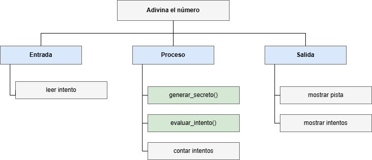

# Adivina el número — ejercicio guiado de funciones

Este ejercicio de repaso integra los temas de la clase 10: **funciones**, **especificación** (Supone / Garantiza), **pruebas con `assert`**, **diseño top-down con stubs**, el uso de una **librería** (`random`) y la organización del programa en **módulos propios**. Se desarrolla siguiendo el procedimiento habitual del curso: **entender → diseñar → especificar → implementar → probar → verificar**, y termina dividiendo el programa en varios archivos.

## Contenido de esta carpeta

| Archivo | Descripción |
|---|---|
| [`adivina_numero_actividad.py`](adivina_numero_actividad.py) | **Punto de partida.** Programa completo, salvo dos funciones provisionales (*stubs*) que se deben implementar |
| [`adivina_numero.py`](adivina_numero.py) | Solución de referencia. Se recomienda consultarla **solo después** de intentar el ejercicio |
| [`arbol_adivina_numero.png`](arbol_adivina_numero.png) | Diagrama top-down del problema |
| [`modulos_actividad/`](modulos_actividad/) | Archivos con pistas para la sección 7: el mismo programa dividido en módulos. [`opcion1_guarda/`](modulos_actividad/opcion1_guarda/) tiene `juego.py` y `main.py`; [`opcion2_archivo_pruebas/`](modulos_actividad/opcion2_archivo_pruebas/) agrega `test_juego.py` |

---

## 0. Objetivos

Al terminar este ejercicio, el estudiante estará en capacidad de:

- Descomponer un problema en funciones mediante diseño **top-down**.
- Leer la **especificación** de una función y escribir el código que la cumple.
- Utilizar el módulo **`random`** para generar números al azar.
- **Probar** con `assert` un programa que utiliza números aleatorios, mediante `random.seed()`.
- Dividir el programa en **módulos propios**, protegiendo las pruebas y el programa principal con `if __name__ == "__main__":`.

**Requisitos:** clases 7 (ciclo `while`, contador), 9 (funciones, `assert`) y 10 (especificación, top-down, librerías, módulos propios).

---

## 1. Entender el problema

### Enunciado

El programa elige un número entero al azar entre 1 y 100. El usuario intenta adivinarlo: después de cada intento, el programa indica si el número secreto es **mayor** o **menor** que el intento. Cuando el usuario acierta, el programa muestra cuántos intentos fueron necesarios.

### Entradas, proceso y salidas

| | Descripción |
|---|---|
| **Entradas** | Los intentos del usuario (números enteros), uno a la vez |
| **Proceso** | Generar el número secreto; comparar cada intento con el secreto; contar los intentos |
| **Salidas** | Una pista después de cada intento (`MAYOR` o `MENOR`) y, al final, el número de intentos |

### Ejemplo de una partida

Suponga que el número secreto es **74**:

```
Adivine el numero entre 1 y 100
Su intento: 50
El numero secreto es MAYOR
Su intento: 80
El numero secreto es MENOR
Su intento: 74
¡Correcto! Lo adivino en 3 intentos
```

---

## 2. Diseñar

### Diagrama top-down

> [!NOTE]
> **Antes de ver el diagrama**, dibuje en papel su propio árbol: empiece por el primer nivel (entrada, proceso y salida) y decida qué subproblemas merecen ser una **función**, con qué parámetros y qué retorna cada una. Después compárelo con el diagrama de abajo: ¿qué coincide y qué dividió de otra forma?



Las cajas en verde se implementan como **funciones**. El resto se resuelve con una o pocas líneas en el programa principal.

El árbol organiza las tareas por **tipo** (entrada, proceso o salida), no por **orden** de ejecución. En el programa, leer el intento, evaluarlo, contarlo y mostrar la pista se repiten **dentro del ciclo**, una vez por intento. El orden en que ocurren lo muestran el pseudocódigo y el diagrama de flujo de más abajo.

| Subproblema | Implementación |
|---|---|
| Generar el número secreto | Función `generar_secreto(minimo, maximo)` |
| Comparar un intento con el secreto | Función `evaluar_intento(intento, secreto)` |
| Leer el intento | `int(input(...))` en el programa principal |
| Contar los intentos | Contador en el programa principal |
| Mostrar la pista y el resultado | `print(...)` en el programa principal |

> [!TIP]
> `evaluar_intento` **no lee ni imprime nada**: recibe dos números y retorna un texto. Separar la lógica de la entrada/salida es lo que permite probarla con `assert`.

### Variables del programa principal

| Variable | Descripción | Tipo | Rol |
|---|---|---|---|
| `MINIMO`, `MAXIMO` | Límites del rango del juego (1 y 100) | Constante (entera) | — |
| `secreto` | Número que se debe adivinar | Entera | Se genera una sola vez, antes del ciclo |
| `intento` | Número ingresado por el usuario en cada vuelta | Entera | Entrada |
| `intentos` | Cantidad de intentos realizados | Entera | **Contador** (inicializar en 0) |
| `resultado` | Respuesta de `evaluar_intento`: `"mayor"`, `"menor"` o `"correcto"` | Texto | **Variable de control** del ciclo (inicializar en `""`) |

### Pseudocódigo del programa principal

```
Inicio
  MINIMO = 1
  MAXIMO = 100
  secreto = generar_secreto(MINIMO, MAXIMO)
  Escribir("Adivine el numero entre", MINIMO, "y", MAXIMO)

  intentos = 0
  resultado = ""
  Mientras (resultado != "correcto") Haga
    Leer(intento)
    intentos = intentos + 1
    resultado = evaluar_intento(intento, secreto)
    Si (resultado == "mayor") Entonces
      Escribir("El numero secreto es MAYOR")
    Sino
      Si (resultado == "menor") Entonces
        Escribir("El numero secreto es MENOR")
      Fin_Si
    Fin_Si
  Fin_Mientras

  Escribir("¡Correcto! Lo adivino en", intentos, "intentos")
Fin
```

### Diagrama de flujo del programa principal


---

## 3. Especificar

Antes de escribir el código, se define **qué** debe hacer cada función. Estas especificaciones ya están en el archivo de la actividad:

```python
def generar_secreto(minimo, maximo):
    """
    Genera el numero secreto del juego.

    Supone:
        minimo y maximo son enteros, con minimo <= maximo.
    Garantiza:
        Retorna un entero al azar entre minimo y maximo (ambos incluidos).
    """


def evaluar_intento(intento, secreto):
    """
    Compara el intento del usuario con el numero secreto.

    Supone:
        intento y secreto son enteros.
    Garantiza:
        Retorna "mayor" si el secreto es mayor que el intento,
        "menor" si el secreto es menor, y "correcto" si son iguales.
    """
```

> [!IMPORTANT]
> En `evaluar_intento`, `"mayor"` significa que **el secreto** es mayor que el intento, es decir, que el usuario debe probar un número **más grande**. Lea la especificación con cuidado: confundir este sentido es el error más frecuente del ejercicio.

---

## 4. Implementar con stubs (top-down)

El archivo [`adivina_numero_actividad.py`](adivina_numero_actividad.py) ya tiene el programa principal completo y las pruebas escritas. Solo las dos funciones son provisionales:

```python
def generar_secreto(minimo, maximo):
    ...
    return 0  # PENDIENTE: implementar con random.randint


def evaluar_intento(intento, secreto):
    ...
    return ""  # PENDIENTE: implementar
```

**Pasos:**

1. **Ejecute el archivo tal como está.** Las pruebas fallan:
   ```
       assert evaluar_intento(50, 74) == "mayor"
              ^^^^^^^^^^^^^^^^^^^^^^^^^^^^^^^^^^
   AssertionError
   ```
   Esto es lo esperado: **las pruebas indican qué falta por hacer**.
2. **Implemente `evaluar_intento`** de acuerdo con su especificación. Ejecute de nuevo: las tres primeras pruebas deben pasar.
3. **Implemente `generar_secreto`** usando `random.randint`. Ejecute de nuevo: todas las pruebas deben pasar y el juego debe comenzar.

<details>
<summary>Pista para <code>evaluar_intento</code></summary>

Se trata de una **alternativa múltiple** con tres casos: el secreto es mayor que el intento, es menor, o son iguales. Recuerde que la función debe **retornar** el texto, no imprimirlo.

</details>

<details>
<summary>Pista para <code>generar_secreto</code></summary>

Consulte la tabla del módulo `random` de la clase 10, o ejecute `help(random.randint)` en la consola. Tenga en cuenta si el límite superior queda incluido o no.

</details>

---

## 5. Probar

### Casos de prueba de `evaluar_intento`

| Caso | `intento` | `secreto` | Resultado esperado | Tipo |
|---|---|---|---|---|
| 1 | 50 | 74 | `"mayor"` | Típico |
| 2 | 80 | 74 | `"menor"` | Típico |
| 3 | 74 | 74 | `"correcto"` | Límite (frontera entre `"mayor"` y `"menor"`) |

### ¿Cómo se prueba una función que usa azar?

El resultado de `generar_secreto` cambia en cada ejecución, así que en general no se puede comparar con un valor fijo. Se prueban, en cambio, tres propiedades:

```python
assert generar_secreto(7, 7) == 7      # un rango de un solo numero
random.seed(10)
primero = generar_secreto(MINIMO, MAXIMO)
random.seed(10)
segundo = generar_secreto(MINIMO, MAXIMO)
assert primero == segundo              # con la misma semilla, el mismo numero
assert MINIMO <= primero <= MAXIMO     # el numero esta dentro del rango
```

La primera prueba es un **caso límite**: si `minimo` y `maximo` son iguales, el único resultado posible es ese número, sin importar el azar. Además, verifica que el límite superior quede **incluido**: una función que lo excluya, por ejemplo con `random.randrange(minimo, maximo)`, se detiene en esa línea con `ValueError: empty range for randrange()`.

Después de las pruebas, el programa principal llama a `random.seed()` **sin argumento**, para que el número secreto de cada partida sea impredecible.

---

## 6. Verificar

### Prueba de escritorio de una partida (secreto = 74)

| Vuelta | Condición (`resultado != "correcto"`) | `intento` | `intentos` | `resultado` | Salida |
|---|---|---|---|---|---|
| — | — | — | 0 | `""` | — |
| 1 | `"" != "correcto"` → Verdadera | 50 | 1 | `"mayor"` | `El numero secreto es MAYOR` |
| 2 | `"mayor" != "correcto"` → Verdadera | 80 | 2 | `"menor"` | `El numero secreto es MENOR` |
| 3 | `"menor" != "correcto"` → Verdadera | 74 | 3 | `"correcto"` | — |
| — | `"correcto" != "correcto"` → **Falsa** | — | 3 | `"correcto"` | `¡Correcto! Lo adivino en 3 intentos` |

> [!TIP]
> Para repetir esta partida exacta, cambie temporalmente `random.seed()` por `random.seed(10)` en el programa principal: con esa semilla el número secreto es **74**. Recuerde restaurarlo al terminar.

---

## 7. Organizar el programa en varios archivos

Hasta ahora todo el juego está en un solo archivo: funciones, pruebas y programa principal. En esta sección se divide en **módulos**, como en el ejemplo de conversión de temperaturas de la clase 10 (carpeta [`temperaturas_modulos/`](../temperaturas_modulos/)):

| Archivo | Contenido |
|---|---|
| `juego.py` | Las funciones `generar_secreto` y `evaluar_intento` (y, en la opción 1, sus pruebas) |
| `main.py` | Las constantes `MINIMO` y `MAXIMO` y el programa principal: el ciclo del juego |
| `test_juego.py` | Solo en la opción 2: las pruebas del módulo `juego` |

> [!WARNING]
> Termine primero las secciones 4 a 6: en esta sección se reutilizan las funciones ya implementadas. Recuerde que **ningún archivo puede llamarse `random.py`**, y que todos los archivos de una misma opción deben estar **en la misma carpeta**.

### 7.1 Punto de partida

Los archivos de [`modulos_actividad/`](modulos_actividad/) ya tienen el encabezado y comentarios `# PISTA` que indican qué va en cada lugar. Se completan en este orden:

| Paso | Carpeta | Archivos | Tema de la clase 10 |
|---|---|---|---|
| A | `opcion1_guarda/` | `juego.py`, `main.py` | Dividir un programa en varios archivos; ¿qué ocurre al importar un módulo? |
| B | `opcion1_guarda/` | `juego.py` | Opción 1: proteger las pruebas con la guarda |
| C | `opcion1_guarda/` | `main.py` | `def main()` y la guarda en el programa principal |
| D | `opcion2_archivo_pruebas/` | `juego.py`, `test_juego.py`, `main.py` | Opción 2: un archivo de pruebas aparte |

### 7.2 Paso A: separar funciones y programa principal

1. En `opcion1_guarda/juego.py`, escriba `import random` y copie las dos funciones con su especificación. Debajo, copie las pruebas **sin guarda** y agregue al final `print("Pruebas de juego: todas pasaron")`. Como `MINIMO` y `MAXIMO` ya no están en este archivo, las pruebas usan directamente los valores `1` y `100`.
2. En `opcion1_guarda/main.py`, escriba `import juego`, defina `MINIMO` y `MAXIMO`, y copie el programa principal **sin la línea `random.seed()`**. Cada llamada a una función del módulo lleva el prefijo `juego.`:

   ```python
   secreto = juego.generar_secreto(MINIMO, MAXIMO)
   ...
   resultado = juego.evaluar_intento(intento, secreto)
   ```

> [!IMPORTANT]
> **Prediga antes de ejecutar.** `import juego` ejecuta todo `juego.py` de arriba hacia abajo, incluidas las pruebas. Las pruebas llaman a `random.seed(10)`. ¿Qué cree que pasará con el número secreto?

Ejecute `main.py` dos o tres veces y pruebe siempre con el intento `5`. La salida tentativa es:

```
Pruebas de juego: todas pasaron
Adivine el numero entre 1 y 100
Su intento: 5
¡Correcto! Lo adivino en 1 intentos
```

<details>
<summary>¿Por qué el secreto siempre es 5?</summary>

Siga lo que hace Python, paso a paso, al ejecutar `python main.py`:

1. Llega a `import juego` y ejecuta **todo** `juego.py`, de arriba hacia abajo: define las funciones y corre las pruebas.
2. La última prueba de semilla hace `random.seed(10)` y luego `generar_secreto(1, 100)`, que produce **74**. El generador queda justo después de ese 74.
3. Vuelve a `main.py`. Como esta versión no tiene `random.seed()`, nadie cambia ese estado.
4. `juego.generar_secreto(MINIMO, MAXIMO)` pide el **siguiente** número de la secuencia de la semilla 10, que siempre es **5**.

Por eso el archivo de un solo programa llamaba a `random.seed()` después de las pruebas.

Las pruebas sin guarda no solo ensucian la salida (el usuario ve `Pruebas de juego: todas pasaron`): también **cambian el comportamiento** del programa. Y si una prueba fallara, el juego ni siquiera comenzaría.

</details>

### 7.3 Paso B: proteger las pruebas con la guarda (opción 1)

Coloque todas las pruebas de `juego.py` dentro de la guarda, con la indentación correspondiente:

```python
############ Pruebas ##############
if __name__ == "__main__":
    assert evaluar_intento(50, 74) == "mayor"
    ...
    print("Pruebas de juego: todas pasaron")
```

> [!TIP]
> No hace falta indentar línea por línea: seleccione todas las líneas de las pruebas y presione **Tab** (en Spyder y en VS Code). Con **Shift + Tab** se quita un nivel de indentación.

Ahora cada archivo se ejecuta para algo distinto:

| Comando | Valor de `__name__` en `juego.py` | Salida tentativa |
|---|---|---|
| `python juego.py` | `"__main__"` | `Pruebas de juego: todas pasaron` |
| `python main.py` | `"juego"` | El juego, **sin** el mensaje de las pruebas y con un secreto al azar en cada partida |

Salida tentativa de `python main.py` (el secreto cambia en cada ejecución, así que las pistas también):

```
Adivine el numero entre 1 y 100
Su intento: 50
El numero secreto es MAYOR
Su intento: 80
El numero secreto es MENOR
...
```

> [!NOTE]
> **Pregunta para pensar:** el Paso A eliminó `random.seed()` del programa principal. ¿Hace falta volver a ponerla? No: con la guarda, las pruebas ya no se ejecutan al importar `juego`, así que nadie fija la semilla y cada partida usa un número al azar.

### 7.4 Paso C: `def main()` y la guarda en el programa principal

Agrupe el programa principal de `main.py` en una función `main()` y llámela dentro de la guarda, con la misma estructura de `temperaturas_modulos/2_con_guarda/main.py`:

```
import juego                      ← imports
MINIMO = 1                        ← constantes
MAXIMO = 100

def main():                       ← programa principal agrupado en una función
    ...

if __name__ == "__main__":        ← guarda
    main()
```

La salida de `python main.py` no cambia respecto al Paso B. Lo que cambia es la organización: si otro archivo importara `main`, el juego no arrancaría solo.

### 7.5 Paso D: un archivo de pruebas aparte (opción 2)

1. `opcion2_archivo_pruebas/juego.py`: copie el `juego.py` del Paso B y **borre** toda la sección de pruebas, guarda incluida. Solo quedan el `import random` y las dos funciones.
2. `opcion2_archivo_pruebas/test_juego.py`: escriba `import juego` e `import random`, y copie las pruebas sin guarda. Cada llamada lleva el prefijo `juego.`:

   ```python
   assert juego.evaluar_intento(50, 74) == "mayor"
   ```

   Este archivo **no lleva guarda**: nadie lo importa, solo se ejecuta directamente con `python test_juego.py`, así que sus pruebas nunca corren por accidente.

3. `opcion2_archivo_pruebas/main.py`: copie el `main.py` del Paso C **sin cambios**.

| Comando | Salida tentativa |
|---|---|
| `python test_juego.py` | `Pruebas de juego: todas pasaron` |
| `python juego.py` | *(nada: el módulo solo define funciones)* |
| `python main.py` | El juego, igual que en el Paso C |

<details>
<summary>¿Por qué <code>main.py</code> no cambió entre la opción 1 y la opción 2?</summary>

`main.py` solo usa las **funciones** de `juego`, y esas funciones no cambiaron. Dónde están las pruebas es un asunto interno del módulo: para quien lo importa, las dos versiones de `juego.py` se comportan igual.

</details>

### 7.6 ¿Cuál opción usar?

La recomendación **para este curso** es la misma de la comparación de la clase 10: mientras haya pocas pruebas, se usa la **opción 1** (guarda en el módulo); cuando las pruebas crecen, se trasladan a `test_juego.py` (**opción 2**). En ambos casos, `main.py` nunca muestra las pruebas.

En la industria, las pruebas suelen escribirse dentro de funciones `def test_...():` y se ejecutan con herramientas como `pytest`, que reconoce los archivos llamados `test_<modulo>.py`. Ver [CS50P, Lecture 5 — *Unit Tests*](https://cs50.harvard.edu/python/notes/5/).

> [!NOTE]
> Al importar `juego` aparece una carpeta `__pycache__/` junto a los archivos. Python la crea automáticamente; puede ignorarse y **no se entrega**.

---

## 8. Errores frecuentes

| Síntoma | Causa | Solución |
|---|---|---|
| `AttributeError: module 'random' has no attribute 'randint'` | El archivo del estudiante se llama **`random.py`**, e `import random` carga ese archivo en lugar del módulo de Python | Renombrar el archivo y borrar la carpeta `__pycache__` si existe |
| `ValueError: empty range for randrange()` en la prueba `generar_secreto(7, 7)` | `generar_secreto` excluye el límite superior, por ejemplo con `random.randrange(minimo, maximo)` | Usar una función que incluya ambos límites (sección 4, pista de `generar_secreto`) |
| `ValueError: invalid literal for int() with base 10: 'abc'` | Se escribió texto en lugar de un número | Ingresar un número entero. (La validación de entradas no es parte de este ejercicio) |
| El programa nunca termina | `resultado` no se actualiza dentro del ciclo, así que la condición nunca cambia | Verificar que la línea `resultado = evaluar_intento(...)` esté **dentro** del ciclo |
| Las pistas están al revés | Se invirtió el sentido de `"mayor"` y `"menor"` | Releer la especificación (sección 3) |
| `intentos` muestra un número de más o de menos | El contador no se inicializa en 0, o se incrementa fuera del ciclo | Revisar la tabla de variables (sección 2) |
| `ModuleNotFoundError: No module named 'juego'` | `main.py` y `juego.py` están en carpetas distintas | Colocar todos los archivos de una opción en la misma carpeta (sección 7) |
| `ModuleNotFoundError: No module named 'juego.py'; 'juego' is not a package` | Se escribió `import juego.py` | Importar con el nombre del archivo **sin** la extensión: `import juego` |
| `NameError: name 'evaluar_intento' is not defined` | En `main.py` o `test_juego.py` se llamó a la función sin el prefijo del módulo | Escribir `juego.evaluar_intento(...)` |
| Al jugar aparece `Pruebas de juego: todas pasaron`, y el secreto siempre es 5 | Las pruebas de `juego.py` están sin guarda | Colocarlas dentro de `if __name__ == "__main__":` (sección 7.3) |

---

## 9. Para pensar y retos

1. **Estrategia óptima.** Si siempre se intenta el número del **medio** del rango que queda (50, luego 75 o 25, y así sucesivamente), ¿cuántos intentos se necesitan **como máximo** para adivinar un número entre 1 y 100?
   <details>
   <summary>Respuesta</summary>

   **7 intentos.** Cada intento descarta la mitad de los números posibles: 100 → 50 → 25 → 13 → 7 → 4 → 2 → 1. Esta estrategia se llama **búsqueda binaria** y se estudiará con más detalle en la unidad de arreglos.

   </details>
2. **Límite de intentos.** Modifique el programa para que el usuario tenga como máximo 7 intentos. Si no acierta, el programa debe revelar el número secreto. ¿Qué cambia en la condición del ciclo?
3. **Rango configurable.** Escriba una función `leer_rango()` que pida al usuario el mínimo y el máximo antes de comenzar. ¿Qué debe suponer `generar_secreto` sobre esos valores? ¿Quién debe validarlos: la función o el programa principal?
4. **Jugar de nuevo.** Al terminar la partida, pregunte al usuario si desea jugar otra vez. ¿Qué parte del programa debe ir dentro de un nuevo ciclo?

---

## Referencias

- Documentación oficial del módulo `random` (en español): https://docs.python.org/es/3/library/random.html
- CS50P, Lecture 4 — *Libraries* (incluye `def main()` con la guarda `if __name__ == "__main__":`): https://cs50.harvard.edu/python/notes/4/

> [!IMPORTANT]
> Se usó IA generativa para redactar y organizar este contenido a partir del material de la clase. El docente revisó y validó la versión final.
