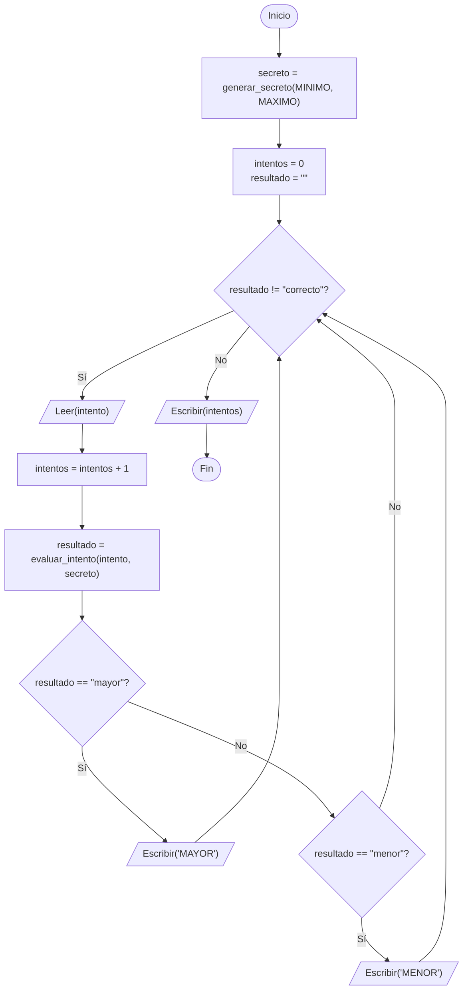

# Adivina el número — ejercicio guiado de funciones

Este ejercicio de repaso integra los temas de la clase 10: **funciones**, **especificación** (Supone / Garantiza), **pruebas con `assert`**, **diseño top-down con stubs** y el uso de una **librería** (`random`). Se desarrolla siguiendo el procedimiento habitual del curso: **entender → diseñar → especificar → implementar → probar → verificar**.

## Contenido de esta carpeta

| Archivo | Descripción |
|---|---|
| [`adivina_numero_actividad.py`](adivina_numero_actividad.py) | **Punto de partida.** Programa completo, salvo dos funciones provisionales (*stubs*) que se deben implementar |
| [`adivina_numero.py`](adivina_numero.py) | Solución de referencia. Se recomienda consultarla **solo después** de intentar el ejercicio |
| [`arbol_adivina_numero.png`](arbol_adivina_numero.png) | Diagrama top-down del problema |

---

## 0. Objetivos

Al terminar este ejercicio, el estudiante estará en capacidad de:

- Descomponer un problema en funciones mediante diseño **top-down**.
- Leer la **especificación** de una función y escribir el código que la cumple.
- Utilizar el módulo **`random`** para generar números al azar.
- **Probar** con `assert` un programa que utiliza números aleatorios, mediante `random.seed()`.

**Requisitos:** clases 7 (ciclo `while`, contador), 9 (funciones, `assert`) y 10 (especificación, top-down, librerías).

---

## 1. Entender el problema

### Enunciado

El programa elige un número entero al azar entre 1 y 100. El usuario intenta adivinarlo: después de cada intento, el programa indica si el número secreto es **mayor** o **menor** que el intento. Cuando el usuario acierta, el programa muestra cuántos intentos fueron necesarios.

### Entradas, proceso y salidas

| | Descripción |
|---|---|
| **Entradas** | Los intentos del usuario (números enteros), uno a la vez |
| **Proceso** | Generar el número secreto; comparar cada intento con el secreto; contar los intentos |
| **Salidas** | Una pista después de cada intento (`MAYOR` o `MENOR`) y, al final, el número de intentos |

### Ejemplo de una partida

Suponga que el número secreto es **74**:

```
Adivine el numero entre 1 y 100
Su intento: 50
El numero secreto es MAYOR
Su intento: 80
El numero secreto es MENOR
Su intento: 74
¡Correcto! Lo adivino en 3 intentos
```

---

## 2. Diseñar

### Diagrama top-down


Las cajas en verde se implementan como **funciones**. El resto se resuelve con una o pocas líneas en el programa principal.

| Subproblema | Implementación |
|---|---|
| Generar el número secreto | Función `generar_secreto(minimo, maximo)` |
| Comparar un intento con el secreto | Función `evaluar_intento(intento, secreto)` |
| Leer el intento | `int(input(...))` en el programa principal |
| Contar los intentos | Contador en el programa principal |
| Mostrar la pista y el resultado | `print(...)` en el programa principal |

> [!TIP]
> `evaluar_intento` **no lee ni imprime nada**: recibe dos números y retorna un texto. Separar la lógica de la entrada/salida es lo que permite probarla con `assert`.

### Variables del programa principal

| Variable | Descripción | Tipo | Rol |
|---|---|---|---|
| `MINIMO`, `MAXIMO` | Límites del rango del juego (1 y 100) | Constante (entera) | — |
| `secreto` | Número que se debe adivinar | Entera | Se genera una sola vez, antes del ciclo |
| `intento` | Número ingresado por el usuario en cada vuelta | Entera | Entrada |
| `intentos` | Cantidad de intentos realizados | Entera | **Contador** (inicializar en 0) |
| `resultado` | Respuesta de `evaluar_intento`: `"mayor"`, `"menor"` o `"correcto"` | Texto | **Variable de control** del ciclo (inicializar en `""`) |

### Pseudocódigo del programa principal

```
Inicio
  MINIMO = 1
  MAXIMO = 100
  secreto = generar_secreto(MINIMO, MAXIMO)
  Escribir("Adivine el numero entre", MINIMO, "y", MAXIMO)

  intentos = 0
  resultado = ""
  Mientras (resultado != "correcto") Haga
    Leer(intento)
    intentos = intentos + 1
    resultado = evaluar_intento(intento, secreto)
    Si (resultado == "mayor") Entonces
      Escribir("El numero secreto es MAYOR")
    Sino
      Si (resultado == "menor") Entonces
        Escribir("El numero secreto es MENOR")
      Fin_Si
    Fin_Si
  Fin_Mientras

  Escribir("¡Correcto! Lo adivino en", intentos, "intentos")
Fin
```

### Diagrama de flujo del programa principal



---

## 3. Especificar

Antes de escribir el código, se define **qué** debe hacer cada función. Estas especificaciones ya están en el archivo de la actividad:

```python
def generar_secreto(minimo, maximo):
    """
    Genera el numero secreto del juego.

    Supone:
        minimo y maximo son enteros, con minimo <= maximo.
    Garantiza:
        Retorna un entero al azar entre minimo y maximo (ambos incluidos).
    """


def evaluar_intento(intento, secreto):
    """
    Compara el intento del usuario con el numero secreto.

    Supone:
        intento y secreto son enteros.
    Garantiza:
        Retorna "mayor" si el secreto es mayor que el intento,
        "menor" si el secreto es menor, y "correcto" si son iguales.
    """
```

> [!IMPORTANT]
> En `evaluar_intento`, `"mayor"` significa que **el secreto** es mayor que el intento, es decir, que el usuario debe probar un número **más grande**. Lea la especificación con cuidado: confundir este sentido es el error más frecuente del ejercicio.

---

## 4. Implementar con stubs (top-down)

El archivo [`adivina_numero_actividad.py`](adivina_numero_actividad.py) ya tiene el programa principal completo y las pruebas escritas. Solo las dos funciones son provisionales:

```python
def generar_secreto(minimo, maximo):
    ...
    return 0  # PENDIENTE: implementar con random.randint


def evaluar_intento(intento, secreto):
    ...
    return ""  # PENDIENTE: implementar
```

**Pasos:**

1. **Ejecute el archivo tal como está.** Las pruebas fallan:
   ```
       assert evaluar_intento(50, 74) == "mayor"
              ^^^^^^^^^^^^^^^^^^^^^^^^^^^^^^^^^^
   AssertionError
   ```
   Esto es lo esperado: **las pruebas indican qué falta por hacer**.
2. **Implemente `evaluar_intento`** de acuerdo con su especificación. Ejecute de nuevo: las tres primeras pruebas deben pasar.
3. **Implemente `generar_secreto`** usando `random.randint`. Ejecute de nuevo: todas las pruebas deben pasar y el juego debe comenzar.

<details>
<summary>Pista para <code>evaluar_intento</code></summary>

Se trata de una **alternativa múltiple** con tres casos: el secreto es mayor que el intento, es menor, o son iguales. Recuerde que la función debe **retornar** el texto, no imprimirlo.

</details>

<details>
<summary>Pista para <code>generar_secreto</code></summary>

Consulte la tabla del módulo `random` de la clase 10, o ejecute `help(random.randint)` en la consola. Tenga en cuenta si el límite superior queda incluido o no.

</details>

---

## 5. Probar

### Casos de prueba de `evaluar_intento`

| Caso | `intento` | `secreto` | Resultado esperado | Tipo |
|---|---|---|---|---|
| 1 | 50 | 74 | `"mayor"` | Típico |
| 2 | 80 | 74 | `"menor"` | Típico |
| 3 | 74 | 74 | `"correcto"` | Límite (acierto) |

### ¿Cómo se prueba una función que usa azar?

El resultado de `generar_secreto` cambia en cada ejecución, así que no se puede comparar con un valor fijo. Se prueban, en cambio, dos propiedades:

```python
random.seed(10)
primero = generar_secreto(MINIMO, MAXIMO)
random.seed(10)
segundo = generar_secreto(MINIMO, MAXIMO)
assert primero == segundo              # con la misma semilla, el mismo numero
assert MINIMO <= primero <= MAXIMO     # el numero esta dentro del rango
```

Después de las pruebas, el programa principal llama a `random.seed()` **sin argumento**, para que cada partida tenga un número secreto distinto.

---

## 6. Verificar

### Prueba de escritorio de una partida (secreto = 74)

| Vuelta | Condición (`resultado != "correcto"`) | `intento` | `intentos` | `resultado` | Salida |
|---|---|---|---|---|---|
| — | — | — | 0 | `""` | — |
| 1 | `"" != "correcto"` → Verdadera | 50 | 1 | `"mayor"` | `El numero secreto es MAYOR` |
| 2 | `"mayor" != "correcto"` → Verdadera | 80 | 2 | `"menor"` | `El numero secreto es MENOR` |
| 3 | `"menor" != "correcto"` → Verdadera | 74 | 3 | `"correcto"` | — |
| — | `"correcto" != "correcto"` → **Falsa** | — | 3 | `"correcto"` | `¡Correcto! Lo adivino en 3 intentos` |

> [!TIP]
> Para repetir esta partida exacta, cambie temporalmente `random.seed()` por `random.seed(10)` en el programa principal: con esa semilla el número secreto es **74**. Recuerde restaurarlo al terminar.

---

## 7. Errores frecuentes

| Síntoma | Causa | Solución |
|---|---|---|
| `AttributeError: module 'random' has no attribute 'randint'` | El archivo del estudiante se llama **`random.py`**, e `import random` carga ese archivo en lugar del módulo de Python | Renombrar el archivo y borrar la carpeta `__pycache__` si existe |
| `ValueError: invalid literal for int() with base 10: 'abc'` | Se escribió texto en lugar de un número | Ingresar un número entero. (La validación de entradas no es parte de este ejercicio) |
| El programa nunca termina | `resultado` no se actualiza dentro del ciclo, así que la condición nunca cambia | Verificar que la línea `resultado = evaluar_intento(...)` esté **dentro** del ciclo |
| Las pistas están al revés | Se invirtió el sentido de `"mayor"` y `"menor"` | Releer la especificación (sección 3) |
| `intentos` muestra un número de más o de menos | El contador no se inicializa en 0, o se incrementa fuera del ciclo | Revisar la tabla de variables (sección 2) |

---

## 8. Para pensar y retos

1. **Estrategia óptima.** Si siempre se intenta el número del **medio** del rango que queda (50, luego 75 o 25, y así sucesivamente), ¿cuántos intentos se necesitan **como máximo** para adivinar un número entre 1 y 100?
   <details>
   <summary>Respuesta</summary>

   **7 intentos.** Cada intento descarta la mitad de los números posibles: 100 → 50 → 25 → 13 → 7 → 4 → 2 → 1. Esta estrategia se llama **búsqueda binaria** y se estudiará con más detalle en la unidad de arreglos.

   </details>
2. **Límite de intentos.** Modifique el programa para que el usuario tenga como máximo 7 intentos. Si no acierta, el programa debe revelar el número secreto. ¿Qué cambia en la condición del ciclo?
3. **Rango configurable.** Escriba una función `leer_rango()` que pida al usuario el mínimo y el máximo antes de comenzar. ¿Qué debe suponer `generar_secreto` sobre esos valores? ¿Quién debe validarlos: la función o el programa principal?
4. **Jugar de nuevo.** Al terminar la partida, pregunte al usuario si desea jugar otra vez. ¿Qué parte del programa debe ir dentro de un nuevo ciclo?

---

## Referencias

- Documentación oficial del módulo `random` (en español): https://docs.python.org/es/3/library/random.html
- CS50P, Lecture 4 — *Libraries*: https://cs50.harvard.edu/python/notes/4/

> [!IMPORTANT]
> Se usó IA generativa para redactar y organizar este contenido a partir del material de la clase. El docente revisó y validó la versión final.
