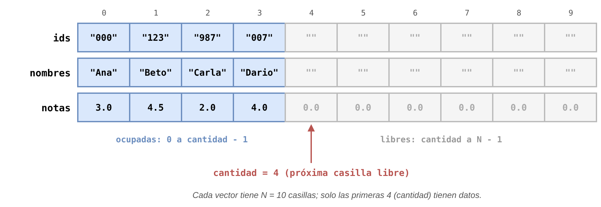
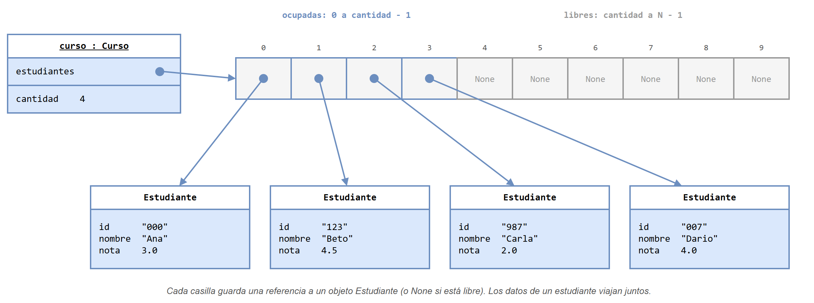
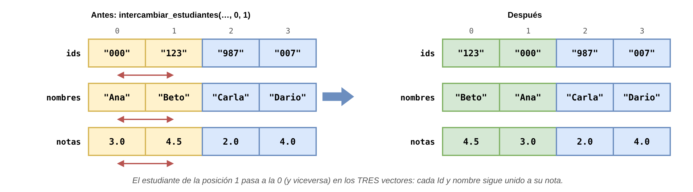
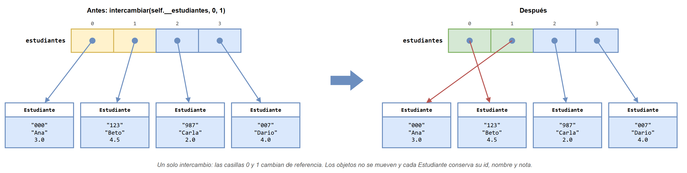
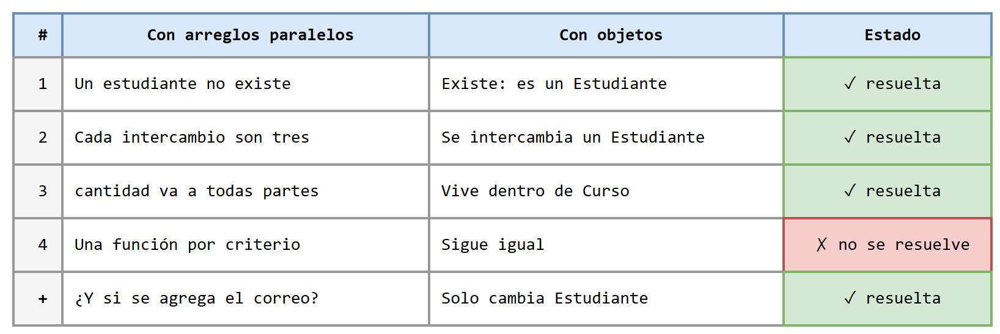

# Administración de un curso: de arreglos paralelos a objetos

Esta carpeta resuelve **un mismo problema dos veces**: un programa con menú para administrar las notas de un curso. La primera solución usa **programación estructurada** (funciones y arreglos paralelos); la segunda usa **programación orientada a objetos** (las clases `Estudiante` y `Curso`). Las dos tienen el mismo menú, los mismos estudiantes de ejemplo y la misma organización en archivos, de modo que se pueden comparar archivo por archivo.

La idea no es aprender un programa nuevo, sino ver **qué cambia y qué no** cuando los datos de un estudiante dejan de estar repartidos en tres arreglos y pasan a viajar juntos dentro de un objeto.

## Contenido de esta página

1. [El problema](#1-el-problema)
2. [Qué hay en la carpeta](#2-qué-hay-en-la-carpeta)
3. [Orden de estudio recomendado](#3-orden-de-estudio-recomendado)
4. [Comparación de las dos versiones](#4-comparación-de-las-dos-versiones)
5. [Lo que la POO no resuelve](#5-lo-que-la-poo-no-resuelve)

---

## 1. El problema

Se desea un programa para administrar las notas de un curso con cupo para `N = 10` estudiantes. De cada estudiante se conoce su **Id** (un texto, por ejemplo `"007"`), su **nombre** y su **nota** (entre 0.0 y 5.0). El programa empieza con cuatro estudiantes inscritos y muestra un menú:

```text
=== Administración del curso ===
1. Agregar estudiante
2. Eliminar estudiante
3. Actualizar nota
4. Buscar estudiante
5. Listar curso
6. Ordenar por nota
7. Ordenar por nombre
0. Salir
```

| Id | Nombre | Nota |
|---|---|---|
| `"000"` | Ana | 3.0 |
| `"123"` | Beto | 4.5 |
| `"987"` | Carla | 2.0 |
| `"007"` | Dario | 4.0 |

No se puede inscribir un Id repetido ni pasar del cupo. "Ordenar por nota" deja el curso de mayor a menor nota, y "Ordenar por nombre", en orden alfabético.

## 2. Qué hay en la carpeta

```text
📁 app_curso/
├── 📄 README.md — esta página: el problema y la comparación
├── 📁 version_estructurada/
│   ├── 📄 README.md — la solución con funciones y arreglos paralelos
│   └── 📁 codigo/ — curso.py, test_curso.py, main.py, ordenamientos.py
├── 📁 version_poo/
│   ├── 📄 README.md — la solución con las clases Estudiante y Curso
│   └── 📁 codigo/ — estudiante.py, curso.py, test_estudiante.py, test_curso.py, main.py, ordenamientos.py
├── 📁 diagramas/ — fuentes .drawio de todas las figuras
└── 📁 images/ — las figuras exportadas (.png)
```

## 3. Orden de estudio recomendado

1. Leer [la versión estructurada](version_estructurada/README.md) y ejecutarla. Es el mismo programa del integrador de ordenamiento: si ya se estudió, basta con repasar los diagramas.
2. Leer [la versión POO](version_poo/README.md) y ejecutarla con las mismas opciones del menú.
3. Volver a esta página y recorrer la comparación de la sección 4.

## 4. Comparación de las dos versiones

### 4.1 Cómo se guardan los datos

En la versión estructurada, un estudiante **no existe como tal**: su Id, su nombre y su nota están en la misma posición de tres arreglos distintos. Lo único que los une es el índice.



En la versión POO, el curso tiene **un solo arreglo**, y cada casilla guarda un objeto `Estudiante` con sus tres datos adentro. La `cantidad` también vive dentro del objeto `curso`.



### 4.2 Las mismas operaciones, escritas de dos formas

| Operación | Versión estructurada | Versión POO |
|---|---|---|
| Crear el curso | `ids = [""] * N`<br>`nombres = [""] * N`<br>`notas = [0.0] * N`<br>`cantidad = 0` | `curso = Curso(N)` |
| Agregar | `cantidad = agregar_estudiante(ids, nombres, notas, cantidad, "555", "Elena", 3.8)` | `curso.agregar_estudiante(Estudiante("555", "Elena", 3.8))` |
| Eliminar | `cantidad = eliminar_estudiante(ids, nombres, notas, cantidad, "123")` | `curso.eliminar_estudiante("123")` |
| Actualizar nota | `actualizar_nota(ids, notas, cantidad, "987", 3.5)` | `curso.actualizar_nota("987", 3.5)` |
| Buscar | `pos = buscar_id(ids, cantidad, "007")` | `pos = curso.buscar_id("007")` |
| Listar | `mostrar_listado(ids, nombres, notas, cantidad)` | `curso.mostrar_listado()` |
| Ordenar | `ordenar_por_nota(ids, nombres, notas, cantidad)` | `curso.ordenar_por_nota()` |

Dos diferencias saltan a la vista:

- **Los parámetros.** En la versión estructurada, cada función recibe los arreglos y `cantidad`, porque los datos viven afuera. En la versión POO, el método ya tiene acceso a los datos del curso (`self`) y solo recibe lo nuevo: un Id, una nota o un estudiante.
- **El `cantidad = ...`.** Cuando una función estructurada cambia `cantidad`, tiene que retornarla, y quien la llama no puede olvidar guardarla. Si se escribe `agregar_estudiante(ids, nombres, notas, cantidad, ...)` sin `cantidad =`, el estudiante queda guardado en el arreglo pero el programa no se entera. En la versión POO, el método actualiza `self.__cantidad` por dentro y retorna `True` o `False` para avisar si pudo hacerlo.

### 4.3 Intercambiar dos estudiantes al ordenar

En la versión estructurada, mover un estudiante de posición exige **tres intercambios**, uno por arreglo. Si se olvida uno, el nombre queda con la nota de otro estudiante y no aparece ningún error.



En la versión POO es **un solo intercambio**: las dos casillas cambian de referencia y cada estudiante sigue con sus datos. Es la misma función `intercambiar(lista, i, j)` de `ordenamientos.py`, sin ningún cambio: funciona igual con una lista de números que con una lista de objetos.



### 4.4 Validar la nota

Con la misma entrada, opción 3, Id `987` y nota `7.0`, las dos versiones responden distinto:

```text
Versión estructurada:  Nota actualizada.
Versión POO:           No se pudo actualizar: el Id no existe o la nota no está entre 0.0 y 5.0.
```

En la versión estructurada, la nota es un número en un arreglo y cualquier función puede escribir `notas[pos] = 7.0`. En la versión POO, la nota es un atributo privado de `Estudiante` y la única forma de cambiarla es `set_nota`, que valida el rango. La regla queda escrita **en un solo lugar**, y el `Curso` la aprovecha sin repetirla.

> [!NOTE]
> La versión estructurada también podría validar la nota dentro de `actualizar_nota`. La diferencia es que nada obliga a hacerlo: cualquier otra función que reciba `notas` podría escribir en él sin pasar por esa validación.

### 4.5 ¿Y si se agrega el correo?

Suponga que ahora también se debe guardar el correo de cada estudiante.

| | Versión estructurada | Versión POO |
|---|---|---|
| Datos | Un cuarto arreglo, `correos = [""] * N` | Un atributo más en `Estudiante`: `self.__correo` |
| Qué cambia | `main.py` y 6 de las 10 funciones de `curso.py`: `agregar_estudiante`, `eliminar_estudiante`, `mostrar_listado`, `intercambiar_estudiantes` y las dos de ordenar, porque todas reciben los arreglos | `Estudiante` (el constructor, un `get_correo` y `__str__`) y la opción 1 de `main.py`, que pide el correo |
| `Curso` | — | **No cambia**: guarda estudiantes, sin importar cuántos datos tenga cada uno |

### 4.6 El tablero de incomodidades

El tablero resume la comparación: tres incomodidades de la versión estructurada quedan resueltas con objetos, y también la del correo. La cuarta no se resuelve; la sección 5 explica por qué.



## 5. Lo que la POO no resuelve

Las dos versiones tienen **un método de ordenamiento por criterio**: `ordenar_por_nota` y `ordenar_por_nombre` son casi iguales; solo cambia la comparación (`get_nota()` con `>` en uno, `get_nombre()` con `<` en el otro). Si mañana se pide "ordenar por Id", habría que escribir un tercero. Los objetos no eliminan esa repetición. Para eso se necesitan herramientas que este curso no cubre, como pasar la función de comparación como parámetro. Por eso la fila 4 del tablero queda en rojo.

> [!TIP]
> Antes de leer las soluciones, intente responder: ¿qué funciones de la versión estructurada cambiarían si se agregara el correo? Luego compare su respuesta con la tabla de la sección 4.5.
