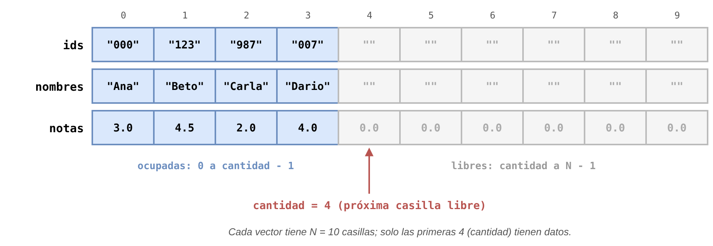
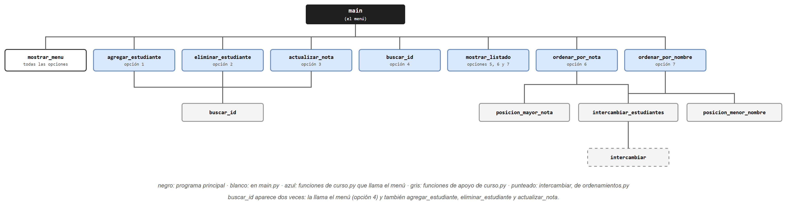
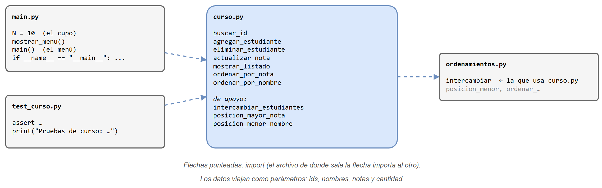

# Versión estructurada: funciones y arreglos paralelos

Esta es la solución del [problema del curso](../README.md#1-el-problema) con **programación estructurada**: los datos se guardan en tres arreglos paralelos y cada opción del menú es una función que recibe esos arreglos. Es el mismo programa del integrador de ordenamiento; aquí se presenta como punto de partida para compararlo con la [versión POO](../version_poo/README.md).

## Contenido de esta página

1. [Antes de empezar](#1-antes-de-empezar)
2. [Los datos: tres arreglos paralelos](#2-los-datos-tres-arreglos-paralelos)
3. [El diseño top-down](#3-el-diseño-top-down)
4. [Los archivos](#4-los-archivos)
5. [Cómo ejecutarlo paso a paso](#5-cómo-ejecutarlo-paso-a-paso)
6. [Resumen](#6-resumen)

---

## 1. Antes de empezar

Para seguir este código conviene tener claros estos conceptos:

| Concepto | Dónde se usa aquí |
|---|---|
| La lista usada como arreglo: `[0.0] * N`, índices `0..N-1` | Los tres arreglos `ids`, `nombres` y `notas` |
| Arreglos paralelos: la posición `i` de varios arreglos describe al mismo elemento | Un estudiante es `ids[i]`, `nombres[i]` y `notas[i]` |
| Arreglo parcialmente lleno: cupo `N` + `cantidad` | Solo las posiciones `0` a `cantidad - 1` tienen datos |
| Funciones que modifican la lista que reciben (caso 3) y especificación Supone/Garantiza | `agregar_estudiante`, `eliminar_estudiante`, `ordenar_por_nota`… |
| Búsqueda lineal y ordenamiento por selección | `buscar_id`, `ordenar_por_nota`, `ordenar_por_nombre` |
| Módulos, `import`, pruebas con `assert` y la guarda `if __name__ == "__main__":` | La organización en cuatro archivos |

## 2. Los datos: tres arreglos paralelos

El curso se guarda en tres arreglos del mismo tamaño, `N = 10` (el cupo), y en una variable `cantidad` que dice cuántos estudiantes hay inscritos. La posición `i` de los tres arreglos corresponde al mismo estudiante.



`cantidad` cumple dos papeles a la vez: cuenta los inscritos y señala la **próxima casilla libre**. Por eso agregar un estudiante es escribir en la posición `cantidad` de los tres arreglos y luego sumarle 1.

## 3. El diseño top-down

Cada opción del menú es una función de `curso.py`. Algunas de ellas, a su vez, se apoyan en funciones más pequeñas:



Para leer el árbol:

- **`buscar_id` aparece dos veces.** La llama el menú en la opción 4, y también la llaman `agregar_estudiante` (para no repetir un Id), `eliminar_estudiante` y `actualizar_nota` (para encontrar al estudiante). Escribirla una vez y reutilizarla es la razón de tenerla como función aparte.
- **Las dos funciones de ordenar comparten `intercambiar_estudiantes`.** Lo que cambia entre ellas es la búsqueda: `posicion_mayor_nota` en una, `posicion_menor_nombre` en la otra.
- **`intercambiar_estudiantes` llama tres veces a `intercambiar`**, una por arreglo. Es la incomodidad que se ve en la comparación con la versión POO.

## 4. Los archivos

El programa sigue la organización habitual: un módulo de funciones, su archivo de pruebas y un `main.py` con el menú.



| Archivo | Qué contiene |
|---|---|
| [`codigo/curso.py`](codigo/curso.py) | Las 10 funciones del curso, cada una con su Supone/Garantiza. No tiene `input` ni `print`, salvo `mostrar_listado`, cuyo trabajo es imprimir. |
| [`codigo/test_curso.py`](codigo/test_curso.py) | Pruebas con `assert` de las funciones de `curso.py`: casos típicos, límites (primero, último, cupo lleno) y especiales (curso vacío, notas repetidas). |
| [`codigo/main.py`](codigo/main.py) | El cupo `N`, `mostrar_menu()` y `main()`, que crea los arreglos, inscribe a los cuatro estudiantes de ejemplo y atiende el menú. |
| [`codigo/ordenamientos.py`](codigo/ordenamientos.py) | Los métodos de ordenamiento. `curso.py` solo usa `intercambiar`. |

Observe la firma de cualquier función de `curso.py`, por ejemplo:

```python
def agregar_estudiante(ids, nombres, notas, cantidad, id_nuevo, nombre, nota):
```

Los cuatro primeros parámetros son **el curso entero**, que tiene que viajar a cada función porque vive afuera de ellas. Y como `agregar_estudiante` cambia `cantidad`, la retorna, y quien la llama tiene que guardarla:

```python
cantidad = agregar_estudiante(ids, nombres, notas, cantidad, "555", "Elena", 3.8)
```

## 5. Cómo ejecutarlo paso a paso

1. Abra una terminal (o el Anaconda Prompt) y ubíquese en la carpeta del código:

   ```text
   cd clases/13/teoria/app_curso/version_estructurada/codigo
   ```

2. Ejecute las pruebas. Si todas pasan, se ve un solo mensaje:

   ```text
   python test_curso.py
   ```

   ```text
   Pruebas de curso: todas pasaron
   ```

   Si alguna falla, el programa se detiene con `AssertionError` e indica la línea de esa prueba.

3. Ejecute el programa:

   ```text
   python main.py
   ```

4. Pruebe el menú. Por ejemplo, con la opción `6` (ordenar por nota) se obtiene:

   ```text
   Opción: 6
   Id       Nombre          Nota
   123      Beto    4.5
   007      Dario   4.0
   000      Ana     3.0
   987      Carla   2.0
   ```

   Las columnas se separan con tabuladores, así que su alineación depende de la terminal.

5. Pruebe ahora la opción `3` con el Id `987` y la nota `7.0`. El programa responde `Nota actualizada.`: esta versión **no valida** el rango de la nota. Compare con lo que hace la versión POO.

6. Salga con la opción `0`.

> [!TIP]
> Los cuatro archivos tienen que estar en la misma carpeta, y los comandos se ejecutan desde ella. Si se ejecuta `python main.py` desde otra carpeta, aparece `ModuleNotFoundError: No module named 'curso'`.

## 6. Resumen

- Un estudiante no existe como tal: es una posición `i` compartida por tres arreglos.
- Cada función recibe el curso completo (`ids`, `nombres`, `notas`, `cantidad`) como parámetros.
- Las funciones que cambian `cantidad` la retornan, y el programa principal debe guardarla.
- Mover un estudiante al ordenar exige tres intercambios, uno por arreglo.

Estas cuatro observaciones son las que revisa la [comparación](../README.md#4-comparación-de-las-dos-versiones) con la versión POO.
