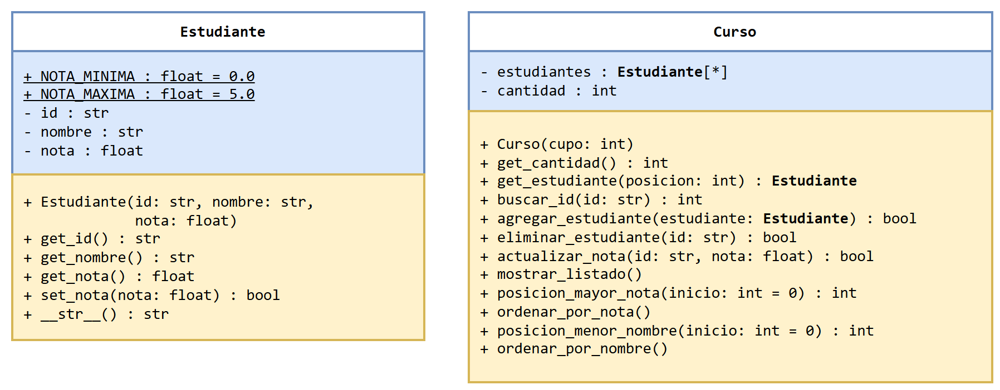
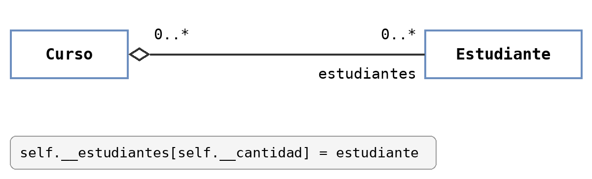
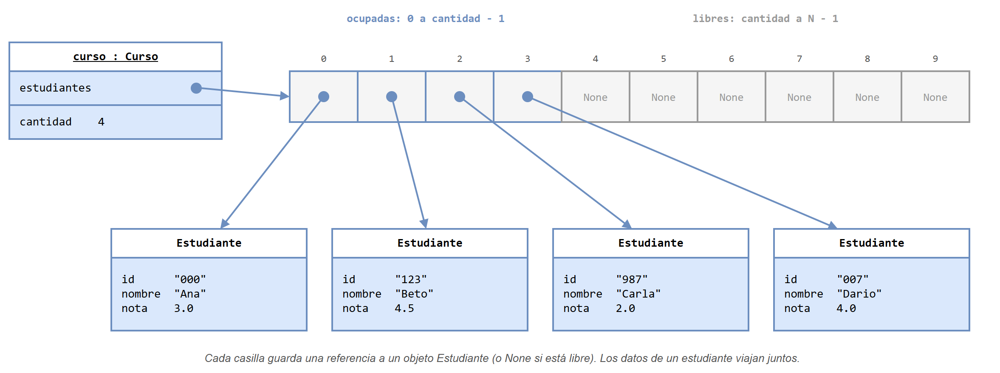
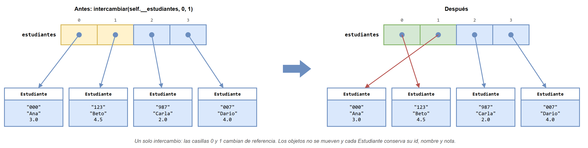
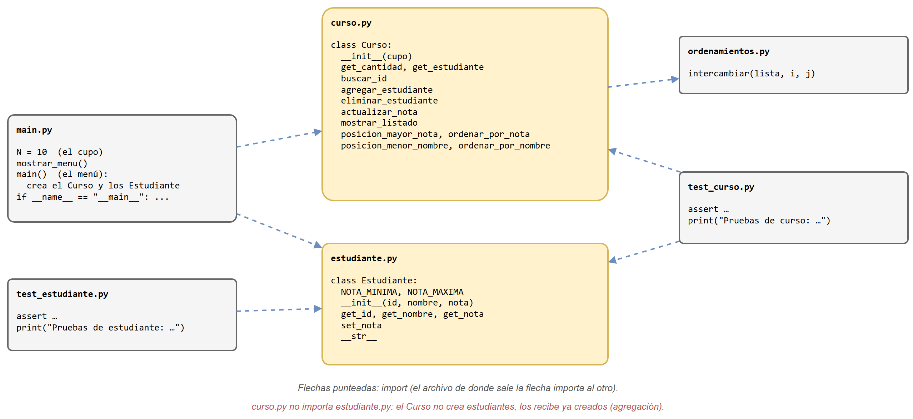
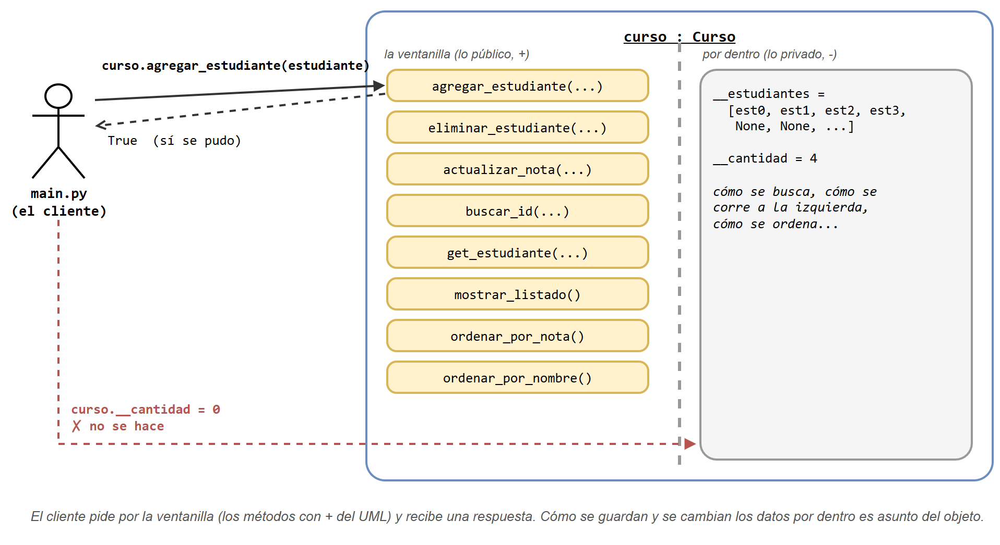
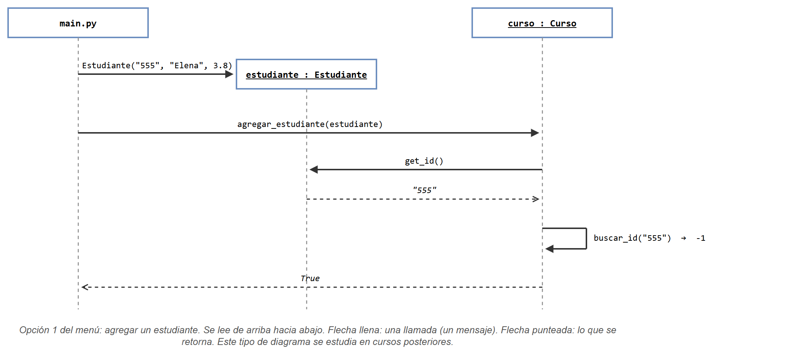

# Versión POO: las clases Estudiante y Curso

Esta es la solución del [problema del curso](../README.md#1-el-problema) con **programación orientada a objetos**. El menú, los estudiantes de ejemplo y la organización en archivos son los mismos de la [versión estructurada](../version_estructurada/README.md). Lo que cambia es dónde viven los datos: cada estudiante es un objeto `Estudiante`, y el curso es un objeto `Curso` que guarda a sus estudiantes y su `cantidad`.

## Contenido de esta página

1. [Antes de empezar](#1-antes-de-empezar)
2. [El diseño en UML](#2-el-diseño-en-uml)
3. [Los objetos en memoria](#3-los-objetos-en-memoria)
4. [Los archivos](#4-los-archivos)
5. [Usar las clases: el programa principal](#5-usar-las-clases-el-programa-principal)
6. [Cómo ejecutarlo paso a paso](#6-cómo-ejecutarlo-paso-a-paso)
7. [Resumen](#7-resumen)

---

## 1. Antes de empezar

Además de lo que pide la versión estructurada (arreglo parcialmente lleno, búsqueda lineal, selección, módulos y pruebas con `assert`), conviene tener claros estos conceptos:

| Concepto | Dónde se usa aquí |
|---|---|
| Clase y objeto; atributos ("sus características") y métodos ("lo que sabe hacer") | `Estudiante` y `Curso` |
| El constructor `__init__` y `self` | `Estudiante("000", "Ana", 3.0)`, `Curso(N)` |
| Atributos privados con `__` y métodos `get_`/`set_` | `self.__nota` solo se cambia con `set_nota` |
| Un `set_` que valida y retorna `bool` | `set_nota` rechaza notas fuera de 0.0 a 5.0 |
| `__str__` para imprimir un objeto | `print(estudiante)` muestra una línea del listado |
| Constantes de clase | `Estudiante.NOTA_MINIMA`, `Estudiante.NOTA_MAXIMA` |
| Un arreglo de objetos con `[None] * cupo` + `cantidad` | El atributo `estudiantes` de `Curso` |
| Agregación: el objeto se recibe ya creado | `curso.agregar_estudiante(Estudiante(...))` |

## 2. El diseño en UML



- **`Estudiante`** junta los tres datos que en la versión estructurada estaban repartidos en tres arreglos. La nota solo se cambia con `set_nota`, que valida el rango usando las constantes de clase `NOTA_MINIMA` y `NOTA_MAXIMA` (subrayadas en el UML porque pertenecen a la clase, no a cada objeto).
- **`Curso`** tiene un arreglo de estudiantes (`Estudiante[*]`) y su `cantidad`. Sus métodos son las opciones del menú, más tres de apoyo: `get_estudiante`, que entrega el estudiante de una posición (lo usan la opción 4 y las pruebas), y `posicion_mayor_nota`/`posicion_menor_nombre`, que buscan el siguiente estudiante al ordenar.
- Los métodos que no retornan nada, como `mostrar_listado()` u `ordenar_por_nota()`, se escriben sin tipo de retorno. En Python, esos métodos retornan `None`.

La relación entre las dos clases es una **agregación**:



Para decidir si es agregación o composición, la pregunta es **¿quién crea el objeto?** El `Curso` no crea estudiantes: los recibe ya creados en `agregar_estudiante` y solo guarda una referencia a ellos. Quien los crea es `main.py`. En el banco, en cambio, `abrir_cuenta` crea la cuenta adentro; eso es composición.

## 3. Los objetos en memoria

Después de inscribir a los cuatro estudiantes de ejemplo, la memoria queda así:



Hay **un solo arreglo**. Cada casilla ocupada guarda una referencia a un `Estudiante`, y las libres valen `None`. Por eso ordenar es intercambiar referencias: los objetos no se mueven, y cada estudiante sigue con su Id, su nombre y su nota.



El intercambio lo hace la misma función de siempre, `intercambiar(lista, i, j)` de `ordenamientos.py`:

```python
def ordenar_por_nota(self):
    for i in range(self.__cantidad - 1):
        pos_mayor = self.posicion_mayor_nota(i)
        intercambiar(self.__estudiantes, i, pos_mayor)
```

## 4. Los archivos

Como hay dos clases, hay dos módulos, cada uno con su archivo de pruebas:



| Archivo | Qué contiene |
|---|---|
| [`codigo/estudiante.py`](codigo/estudiante.py) | La clase `Estudiante`. |
| [`codigo/curso.py`](codigo/curso.py) | La clase `Curso`. Importa `intercambiar` de `ordenamientos.py`. |
| [`codigo/test_estudiante.py`](codigo/test_estudiante.py) | Pruebas de `Estudiante`: los `get_`, `set_nota` (típico, límites 0.0 y 5.0, fuera de rango) y `__str__`. |
| [`codigo/test_curso.py`](codigo/test_curso.py) | Las mismas pruebas de la versión estructurada, escritas con objetos, más una nueva: `actualizar_nota` con una nota inválida. |
| [`codigo/main.py`](codigo/main.py) | El cupo `N`, `mostrar_menu()` y `main()`, que crea el `Curso`, crea los cuatro `Estudiante` de ejemplo y atiende el menú. |
| [`codigo/ordenamientos.py`](codigo/ordenamientos.py) | El mismo archivo de la versión estructurada, sin cambios. |

Dos detalles del diagrama de módulos:

- **`curso.py` no importa `estudiante.py`.** El `Curso` nunca escribe `Estudiante(...)`: solo recibe estudiantes y les pide sus datos con `get_id()`, `get_nota()`, etc. Es la agregación vista en los archivos.
- **`test_curso.py` sí importa las dos clases**, porque para probar el curso tiene que crear estudiantes.

Compare ahora la misma operación en las dos versiones:

```python
# Versión estructurada
cantidad = agregar_estudiante(ids, nombres, notas, cantidad, "555", "Elena", 3.8)

# Versión POO
curso.agregar_estudiante(Estudiante("555", "Elena", 3.8))
```

El método no necesita recibir los arreglos ni `cantidad`, porque ya los tiene en `self`. Tampoco hay que guardar un valor de retorno para no perder la `cantidad`: el `True` o `False` que retorna solo avisa si se pudo agregar.

## 5. Usar las clases: el programa principal

Hasta aquí se vio cómo están **hechas** las clases. Pero una clase no hace nada sola: alguien tiene que crear objetos y pedirles cosas. En este programa, ese alguien es `main.py`.

Por eso, frente a una clase hay dos papeles: **quien la escribe** (el autor de `estudiante.py` y `curso.py`) y **quien la usa**, que se suele llamar el **cliente** de la clase. Son los mismos papeles de "autor del módulo" y "usuario del módulo" del laboratorio 4, ahora con objetos.

### 5.1 La idea: una ventanilla

Piense en un objeto como una oficina con ventanilla. El cliente se acerca, pide algo por la ventanilla y recibe una respuesta. No entra a la oficina ni sabe cómo están organizados los papeles por dentro.



- **La ventanilla son los métodos públicos**, los que tienen `+` en el UML. Para usar la clase basta con conocerlos: su nombre, qué reciben y qué retornan. No hace falta leer cómo están programados.
- **Lo de adentro son los atributos privados**, los que tienen `-`. Cómo se guarda el arreglo, cómo se busca o cómo se ordena es asunto del objeto. Si mañana se cambia la forma de guardar los estudiantes, el cliente no se entera, siempre que la ventanilla siga igual.

> [!NOTE]
> ¿Qué pasa si el cliente intenta entrar? Leer `curso.__cantidad` desde `main.py` produce `AttributeError: 'Curso' object has no attribute '__cantidad'`. Escribir `curso.__cantidad = 0` es peor: no da error, pero crea **otro** atributo con ese nombre y la cantidad verdadera no cambia (`curso.get_cantidad()` sigue dando lo mismo). Por eso el `__` se entiende como una señal de "no pasar": el cliente usa la ventanilla.

### 5.2 Lo que hace `main`, paso a paso

Todo lo que hace `main.py` con los objetos cabe en tres pasos:

```python
# 1. Crear los objetos
curso = Curso(N)
curso.agregar_estudiante(Estudiante("000", "Ana", 3.0))

# 2. Pedirles cosas (opción 1 del menú)
estudiante = Estudiante(id_nuevo, nombre, nota)
if curso.agregar_estudiante(estudiante):

    # 3. Mostrar el resultado según lo que respondieron
    print("Estudiante agregado.")
else:
    print("No se pudo agregar: el curso está lleno o el Id ya existe.")
```

| Paso | Qué hace el cliente | Qué **no** hace |
|---|---|---|
| 1. Crear | `Curso(N)`, `Estudiante(...)` | No crea arreglos ni lleva `cantidad` |
| 2. Pedir | `curso.agregar_estudiante(...)`, `curso.ordenar_por_nota()`… | No recorre el arreglo ni intercambia estudiantes |
| 3. Mostrar | Un mensaje según el `True`/`False` que recibe, o `print(curso.get_estudiante(pos))` | No arma la línea del estudiante: eso lo hace `__str__` |

Compare con la versión estructurada: allí `main` tenía en sus manos los tres arreglos y la `cantidad`, y los pasaba a cada función. Aquí `main` tiene **una sola variable**, `curso`, y le habla por la ventanilla.

### 5.3 Un adelanto: el diagrama de secuencia

El diagrama de clases (UML) muestra **qué hay**: las clases, sus atributos y sus métodos. Para mostrar **qué pasa** cuando el programa corre (quién le pide qué a quién, y en qué orden) existe otro diagrama UML, el **diagrama de secuencia**. Este es el de la opción 1 del menú:



Cómo leerlo:

- Cada columna es un participante: `main.py` y dos objetos. El nombre subrayado (`curso : Curso`) indica un objeto, no una clase. `estudiante` aparece más abajo porque se crea en ese momento.
- El tiempo corre **de arriba hacia abajo**. Cada flecha llena es una llamada; cada flecha punteada es lo que se retorna.
- La flecha que vuelve sobre `curso` es una llamada del objeto a sí mismo: dentro de `agregar_estudiante`, el curso usa su propio `buscar_id`, que retorna `-1` porque el Id `"555"` no está.

Cada flecha corresponde a una línea de código: `Estudiante(...)` y `curso.agregar_estudiante(estudiante)` en `main.py`; `estudiante.get_id()` y `self.buscar_id(...)` dentro de `Curso.agregar_estudiante`.

> [!IMPORTANT]
> Los diagramas de secuencia **hacen parte de otro curso**: se estudian más adelante en la carrera, en los cursos de análisis y diseño de software. Aquí solo se muestran para que los reconozca cuando los vea. No se pide dibujarlos.

## 6. Cómo ejecutarlo paso a paso

1. Abra una terminal (o el Anaconda Prompt) y ubíquese en la carpeta del código:

   ```text
   cd clases/13/teoria/app_curso/version_poo/codigo
   ```

2. Ejecute las pruebas de cada clase:

   ```text
   python test_estudiante.py
   python test_curso.py
   ```

   ```text
   Pruebas de estudiante: todas pasaron
   Pruebas de curso: todas pasaron
   ```

   Conviene probar primero `Estudiante`: si esa clase tiene un error, las pruebas de `Curso` también fallarían, y sería más difícil saber dónde está el problema.

3. Ejecute el programa:

   ```text
   python main.py
   ```

4. Pruebe la opción `6` (ordenar por nota). El resultado es el mismo de la versión estructurada:

   ```text
   Opción: 6
   Id       Nombre          Nota
   123      Beto    4.5
   007      Dario   4.0
   000      Ana     3.0
   987      Carla   2.0
   ```

5. Pruebe la opción `3` con el Id `987` y la nota `7.0`. Esta vez la nota se rechaza:

   ```text
   No se pudo actualizar: el Id no existe o la nota no está entre 0.0 y 5.0.
   ```

   `Curso.actualizar_nota` le pide el cambio a `set_nota`, y `set_nota` valida el rango.

6. Salga con la opción `0`.

> [!NOTE]
> La opción 4 (buscar) imprime al estudiante con `print(curso.get_estudiante(pos))`, que usa `__str__`. Por eso su línea sale separada con tabuladores, igual que el listado, mientras que en la versión estructurada sale separada con espacios.

## 7. Resumen

- Un estudiante **existe**: es un objeto `Estudiante` con sus tres datos adentro.
- `cantidad` **vive dentro del `Curso`**: ningún método la recibe ni la retorna.
- Ordenar mueve **un estudiante completo en un solo intercambio**.
- La regla "la nota está entre 0.0 y 5.0" queda escrita **en un solo lugar**, `set_nota`.
- El `Curso` **recibe** estudiantes ya creados: es una agregación, y por eso `curso.py` no importa `estudiante.py`.

Lo que no cambia, un método de ordenamiento por cada criterio, se discute en la [comparación](../README.md#5-lo-que-la-poo-no-resuelve).
