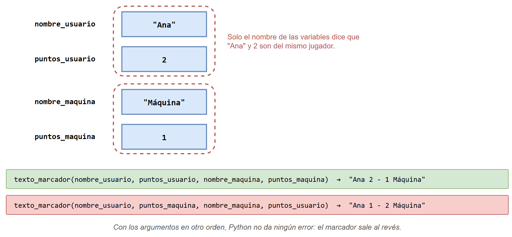
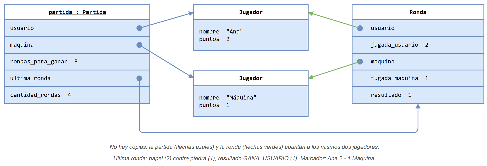
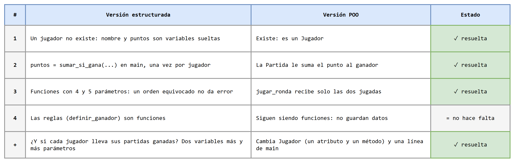

# Piedra, papel o tijera: de funciones a objetos

Esta carpeta resuelve **un mismo juego dos veces**: una partida de piedra, papel o tijera contra la máquina. La primera solución usa **programación estructurada** (funciones y variables sueltas); la segunda usa **programación orientada a objetos** (las clases `Jugador`, `Ronda` y `Partida`). Las dos juegan exactamente igual (con la misma entrada y la misma semilla de azar producen la misma salida), así que se pueden comparar archivo por archivo.

El juego parte del que se empezó a construir con funciones en la [sesión 27](../../../10/sesion_magistral-27/README.md) (clase 10), con algunas mejoras para evitar ambigüedades (sección 2).

## Contenido de esta página

1. [El problema](#1-el-problema)
2. [Qué cambió frente al juego de la clase de funciones](#2-qué-cambió-frente-al-juego-de-la-clase-de-funciones)
3. [Qué hay en la carpeta](#3-qué-hay-en-la-carpeta)
4. [Orden de estudio recomendado](#4-orden-de-estudio-recomendado)
5. [Comparación de las dos versiones](#5-comparación-de-las-dos-versiones)
6. [Lo que no cambia, y está bien](#6-lo-que-no-cambia-y-está-bien)
7. [Para practicar: el diseño puede seguir creciendo](#7-para-practicar-el-diseño-puede-seguir-creciendo)

---

## 1. El problema

Se desea un programa para jugar una **partida** de piedra, papel o tijera entre el usuario y la máquina:

- Al empezar, el programa pide el nombre del usuario.
- En cada **ronda**, el usuario elige su jugada (1 piedra, 2 papel, 3 tijera; si escribe otro número, se le vuelve a pedir) y la máquina elige la suya al azar.
- Piedra le gana a tijera, tijera le gana a papel y papel le gana a piedra. Si las dos jugadas son iguales, es empate.
- Quien gana la ronda suma un punto; en un empate, nadie suma.
- Después de cada ronda se muestran las jugadas, quién ganó y el marcador.
- **Gana la partida quien primero gane 3 rondas.**

Una partida de ejemplo (lo que escribe el usuario aparece después de `Su nombre:` y `Su jugada:`):

```text
=== Piedra, papel o tijera ===
Gana la partida quien gane primero 3 rondas.
Su nombre: Ana

1 Piedra
2 Papel
3 Tijera
Su jugada: 1
Ana: piedra | Máquina: papel | gana Máquina
Marcador: Ana 0 - 1 Máquina
...
Su jugada: 5
Jugada no válida.
Su jugada: 3
Ana: tijera | Máquina: piedra | gana Máquina
Marcador: Ana 1 - 2 Máquina
...
Su jugada: 2
Ana: papel | Máquina: papel | empate
Marcador: Ana 1 - 2 Máquina
...
Su jugada: 3
Ana: tijera | Máquina: papel | gana Ana
Marcador: Ana 3 - 2 Máquina

Ganador de la partida: Ana
```

## 2. Qué cambió frente al juego de la clase de funciones

| En la sesión 27 | Problema | Aquí |
|---|---|---|
| `definir_ganador` retornaba `0`, `1` o `2` | Números sin nombre: había que recordar que `0` era "gana el usuario" | Constantes `EMPATE`, `GANA_USUARIO`, `GANA_MAQUINA` |
| `obtener_nombre_jugada(4)` retornaba `"Incorrecto"` | Mezclaba el nombre de una jugada con un mensaje de error | `nombre_jugada` supone una jugada válida; la validación se hace antes, con `es_jugada_valida` |
| `int(input(...))` sin validar | Se podía jugar un 7 | `leer_jugada` vuelve a pedir la jugada mientras no esté entre 1 y 3 |
| `lanzar_dado()` en el módulo del juego | No tenía que ver con el juego (estaba para mostrar otra función que usa `random`) | Se quitó |
| Una sola ronda | No había nada que guardar entre rondas | Una partida a 3 rondas ganadas, con marcador |
| `definir_ganador` era un stub (actividad) | — | Está resuelta, con sus 9 casos de prueba |

Además, la máquina juega al azar en `main.py` y no dentro de la lógica: las funciones y los métodos reciben las dos jugadas como parámetros. Así se pueden probar con `assert` sin depender del azar.

## 3. Qué hay en la carpeta

```text
📁 app_piedra-papel-tijera/
├── 📄 README.md — esta página: el problema y la comparación
├── 📁 version_estructurada/
│   ├── 📄 README.md — la solución con funciones y variables sueltas
│   └── 📁 codigo/ — reglas.py, juego.py, main.py, test_reglas.py, test_juego.py
├── 📁 version_poo/
│   ├── 📄 README.md — la solución con las clases Jugador, Ronda y Partida
│   └── 📁 codigo/ — reglas.py, jugador.py, ronda.py, partida.py, main.py y sus test_*.py
├── 📁 notebooks/ — los dos notebooks que construyen el juego paso a paso
├── 📁 diagramas/ — fuentes .drawio de todas las figuras
└── 📁 images/ — las figuras exportadas (.png)
```

`reglas.py` (y su `test_reglas.py`) es **el mismo archivo** en las dos versiones.

## 4. Orden de estudio recomendado

1. Leer [la versión estructurada](version_estructurada/README.md) y jugar una partida.
2. Leer [la versión POO](version_poo/README.md) y jugar otra.
3. Volver a esta página y recorrer la comparación.

### Los notebooks: el juego construido paso a paso

Las páginas anteriores muestran el programa **terminado**. Los dos notebooks lo **construyen**: parten del enunciado, llegan al diseño y escriben una pieza a la vez, cada una con sus pruebas, hasta integrarlas. Todo el código se puede ejecutar, y casi todas las celdas tienen un enlace a Python Tutor.

| Notebook | Qué construye | Abrir en Colab |
|---|---|---|
| [Piedra, papel o tijera con funciones](notebooks/juego_estructurado.ipynb) | Las reglas, las funciones de la partida y el programa principal. Termina con lo que resulta incómodo de las variables sueltas | [](https://colab.research.google.com/github/algoritmos-UdeA/logica1-20262/blob/main/clases/13/teoria/app_piedra-papel-tijera/notebooks/juego_estructurado.ipynb) |
| [Piedra, papel o tijera con objetos](notebooks/juego_poo.ipynb) | Del enunciado a las clases `Jugador`, `Ronda` y `Partida` y sus relaciones, una clase a la vez, y la comparación con la versión anterior | [](https://colab.research.google.com/github/algoritmos-UdeA/logica1-20262/blob/main/clases/13/teoria/app_piedra-papel-tijera/notebooks/juego_poo.ipynb) |

Conviene estudiarlos en ese orden. Los dos usan la misma partida de ejemplo, calculada primero a mano, y dan la misma salida.

## 5. Comparación de las dos versiones

### 5.1 Un jugador: variables sueltas o un objeto

En la versión estructurada, el jugador **no existe como tal**: su nombre y sus puntos son dos variables de `main` que solo se relacionan por cómo se llaman. Si se pasan en otro orden a una función, Python no da ningún error:



En la versión POO, cada jugador es un objeto `Jugador` con su nombre y sus puntos adentro. La partida y la ronda guardan **referencias** a esos mismos dos objetos; no hay copias:



### 5.2 La misma ronda, escrita de dos formas

```python
# Versión estructurada (main.py)
resultado = definir_ganador(jugada_usuario, jugada_maquina)
puntos_usuario = sumar_si_gana(puntos_usuario, resultado, GANA_USUARIO)
puntos_maquina = sumar_si_gana(puntos_maquina, resultado, GANA_MAQUINA)
print(texto_ronda(nombre_usuario, jugada_usuario,
                  nombre_maquina, jugada_maquina, resultado))
print("Marcador:", texto_marcador(nombre_usuario, puntos_usuario,
                                  nombre_maquina, puntos_maquina))

# Versión POO (main.py)
partida.jugar_ronda(jugada_usuario, jugar_maquina())
print(partida.get_ultima_ronda())
print("Marcador:", partida)
```

| | Versión estructurada | Versión POO |
|---|---|---|
| ¿Quién suma el punto? | `main`, con `puntos = sumar_si_gana(...)` una vez por jugador. Si se olvida el `puntos =`, el punto se pierde sin error | `Partida.jugar_ronda`, que llama a `sumar_punto()` del jugador que ganó |
| ¿Cuántos datos recibe cada operación? | `texto_ronda` recibe 5, `texto_marcador` y `nombre_ganador` reciben 4 | `jugar_ronda` recibe 2: las jugadas. El resto ya lo tiene la partida en `self` |
| ¿Cómo se imprime? | Funciones que arman el texto (`texto_ronda`, `texto_marcador`) | `print(ronda)` y `print(partida)`, gracias a `__str__` |
| ¿Quién decide si terminó? | `partida_terminada(puntos_usuario, puntos_maquina, RONDAS_PARA_GANAR)` | `partida.terminada()` |

### 5.3 ¿Y si cada jugador lleva sus partidas ganadas?

Suponga que ahora se juegan varias partidas seguidas y cada jugador debe llevar cuántas ha ganado.

| | Versión estructurada | Versión POO |
|---|---|---|
| Datos | Dos variables más en `main`: `partidas_usuario` y `partidas_maquina` | Un atributo más en `Jugador`: `self.__partidas_ganadas` |
| Qué cambia | `main` (las variables y su actualización) y toda función que deba mostrarlas, que recibe dos parámetros más | `Jugador` (el atributo, un método `sumar_partida()` y quizá `__str__`) y una línea de `main`: `partida.get_ganador().sumar_partida()` |
| `Ronda` y `Partida` | — | **No cambian** |

### 5.4 El tablero



## 6. Lo que no cambia, y está bien

`reglas.py` es idéntico en las dos versiones: `definir_ganador`, `nombre_jugada`, `es_jugada_valida` y `jugar_maquina` siguen siendo **funciones**. No guardan datos entre una llamada y otra: reciben jugadas y retornan resultados. Convertirlas en métodos de una clase no ganaría nada.

> [!NOTE]
> La POO no reemplaza a las funciones. Un objeto tiene sentido cuando hay **datos que viajan juntos y operaciones sobre ellos** (un jugador con su nombre y sus puntos, una partida con su marcador). Una regla que solo transforma unos valores en otros se escribe bien como función.

## 7. Para practicar: el diseño puede seguir creciendo

Estos ejercicios se hacen sobre la versión POO. Antes de escribir código, decida qué clase cambia y dibuje el UML nuevo.

1. **Partidas ganadas.** Agregue a `Jugador` el atributo `partidas_ganadas` y el método `sumar_partida()`. Modifique `main.py` para jugar varias partidas seguidas (pregunte al final "¿Otra partida? (s/n)") y mostrar cuántas lleva cada jugador.
   > **Pregunta para pensar:** al empezar la segunda partida, los jugadores todavía tienen los puntos de la primera. ¿Dónde deberían vivir los puntos de una partida: en el `Jugador` o en la `Partida`? ¿Qué cambiaría en el UML con cada opción?
2. **Dos personas.** Cambie `main.py` para que juegue una segunda persona en lugar de la máquina. ¿Cambia alguna clase?
3. **El historial (a futuro).** Hoy la `Partida` solo recuerda la última ronda (`ultima_ronda : Ronda`). Para guardar todas, el atributo pasaría a ser un arreglo de rondas, `rondas : Ronda[*]`, con un cupo y una `cantidad`, como el curso de [`app_curso`](../app_curso/README.md). Al final de la partida se mostraría el historial completo. Dibuje primero el UML con ese cambio.
