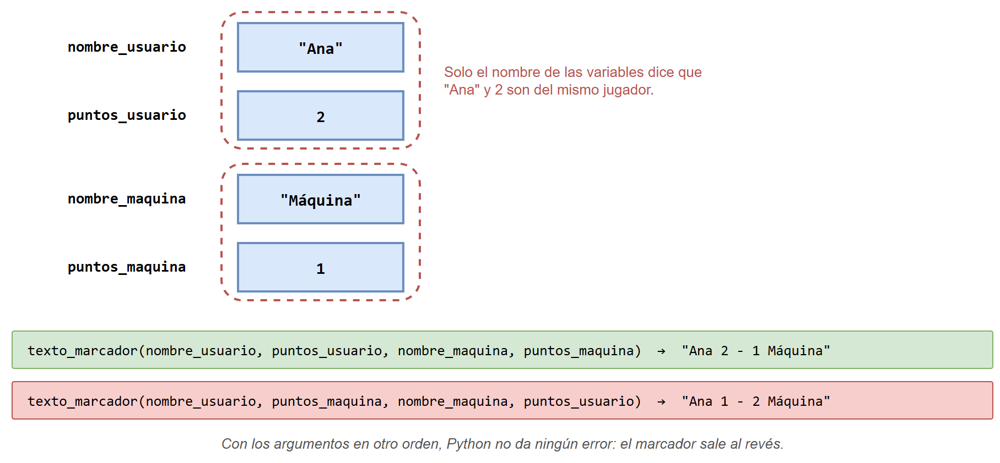
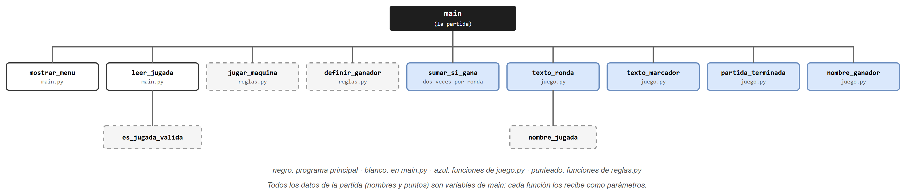
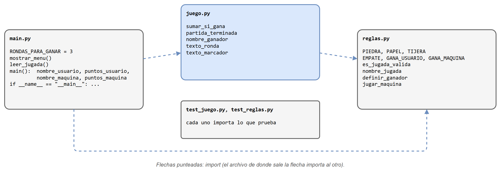

# Versión estructurada: funciones y variables sueltas

Esta es la solución del [juego de piedra, papel o tijera](../README.md#1-el-problema) con **programación estructurada**: los datos de la partida son variables de `main` y cada tarea es una función que recibe los datos que necesita. Se presenta como punto de partida para compararla con la [versión POO](../version_poo/README.md).

## Contenido de esta página

1. [Antes de empezar](#1-antes-de-empezar)
2. [Los datos: variables sueltas](#2-los-datos-variables-sueltas)
3. [El diseño top-down](#3-el-diseño-top-down)
4. [Los archivos](#4-los-archivos)
5. [Cómo ejecutarlo paso a paso](#5-cómo-ejecutarlo-paso-a-paso)
6. [Resumen](#6-resumen)

---

## 1. Antes de empezar

| Concepto | Dónde se usa aquí |
|---|---|
| Condicionales con `and`/`or` | `definir_ganador` |
| Ciclo `while` con condición de parada | La partida sigue mientras nadie llegue a 3; `leer_jugada` repite mientras la jugada no sea válida |
| Funciones con parámetros y `return`; especificación Supone/Garantiza | Todas las funciones de `reglas.py` y `juego.py` |
| Constantes en MAYÚSCULAS | `PIEDRA`, `GANA_USUARIO`, `RONDAS_PARA_GANAR` |
| El módulo `random` | `jugar_maquina` usa `random.randint` |
| Módulos, `import`, pruebas con `assert` y la guarda `if __name__ == "__main__":` | La organización en archivos |

## 2. Los datos: variables sueltas

Toda la información de la partida son cuatro variables de `main`:

```python
nombre_usuario = input("Su nombre: ")
nombre_maquina = "Máquina"
puntos_usuario = 0
puntos_maquina = 0
```

Nada en el programa dice que `nombre_usuario` y `puntos_usuario` describen al mismo jugador; solo lo sugieren sus nombres. Por eso cada función que necesita a un jugador recibe **sus dos datos por separado**, y el orden de los argumentos es responsabilidad de quien la llama:



Otra consecuencia: una función no puede cambiar `puntos_usuario`, porque es una variable de `main`. Lo que hace `sumar_si_gana` es **calcular el nuevo valor y retornarlo**, y `main` tiene que guardarlo:

```python
puntos_usuario = sumar_si_gana(puntos_usuario, resultado, GANA_USUARIO)
puntos_maquina = sumar_si_gana(puntos_maquina, resultado, GANA_MAQUINA)
```

Si se escribe `sumar_si_gana(puntos_usuario, resultado, GANA_USUARIO)` sin `puntos_usuario =`, el punto se calcula y se pierde, y Python no da ningún error.

## 3. El diseño top-down



- **`main` hace casi todo el trabajo de la partida**: lee las jugadas, pide el resultado, actualiza los puntos y muestra los textos. Las funciones de `juego.py` le ayudan, pero el estado (nombres y puntos) lo lleva `main`.
- **Las funciones punteadas son de `reglas.py`**: las reglas del juego, que no dependen de quién juega ni del marcador.
- **`sumar_si_gana` se llama dos veces por ronda**, una por jugador.

## 4. Los archivos



| Archivo | Qué contiene |
|---|---|
| [`codigo/reglas.py`](codigo/reglas.py) | Las constantes de las jugadas y de los resultados, y las reglas: `es_jugada_valida`, `nombre_jugada`, `definir_ganador`, `jugar_maquina`. |
| [`codigo/juego.py`](codigo/juego.py) | Las funciones de la partida: `sumar_si_gana`, `partida_terminada`, `nombre_ganador`, `texto_ronda`, `texto_marcador`. No tiene `input` ni `print`: las dos de texto **retornan** el texto, y por eso se pueden probar con `assert`. |
| [`codigo/test_reglas.py`](codigo/test_reglas.py) | Pruebas de las reglas, incluidos los 9 casos posibles de `definir_ganador`. |
| [`codigo/test_juego.py`](codigo/test_juego.py) | Pruebas de las funciones de la partida. |
| [`codigo/main.py`](codigo/main.py) | `RONDAS_PARA_GANAR`, `mostrar_menu()`, `leer_jugada()` y `main()`, con las cuatro variables de la partida y el ciclo de rondas. |

## 5. Cómo ejecutarlo paso a paso

1. Abra una terminal (o el Anaconda Prompt) y ubíquese en la carpeta del código:

   ```text
   cd clases/13/teoria/app_piedra-papel-tijera/version_estructurada/codigo
   ```

2. Ejecute las pruebas:

   ```text
   python test_reglas.py
   python test_juego.py
   ```

   ```text
   Pruebas de reglas: todas pasaron
   Pruebas de juego: todas pasaron
   ```

3. Juegue una partida:

   ```text
   python main.py
   ```

   La salida tiene la forma de la [partida de ejemplo](../README.md#1-el-problema); las jugadas de la máquina cambian en cada ejecución porque son al azar.

4. Durante la partida, escriba un número que no sea 1, 2 ni 3: el programa responde `Jugada no válida.` y vuelve a pedirlo.

> [!TIP]
> Para ver el error del orden de los argumentos sin jugar, ejecute en la misma carpeta:
>
> ```text
> python -c "from juego import texto_marcador; print(texto_marcador('Ana', 1, 'Máquina', 2))"
> ```
>
> Imprime `Ana 1 - 2 Máquina`, aunque la intención fuera que Ana tuviera 2.

## 6. Resumen

- Un jugador no existe como tal: es un nombre y unos puntos en variables separadas.
- `main` lleva todo el estado de la partida y lo pasa a cada función.
- Las funciones no pueden cambiar los puntos: retornan el nuevo valor y `main` debe guardarlo.
- Varias funciones reciben 4 o 5 parámetros, y un orden equivocado no produce error.

Estas cuatro observaciones son las que revisa la [comparación](../README.md#5-comparación-de-las-dos-versiones) con la versión POO.
