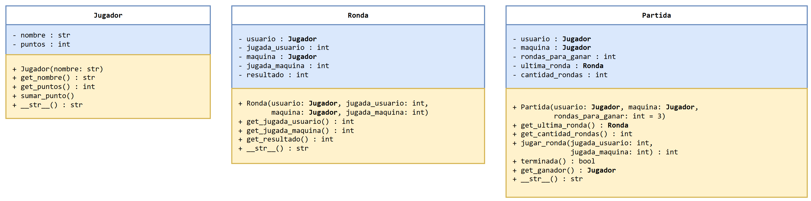
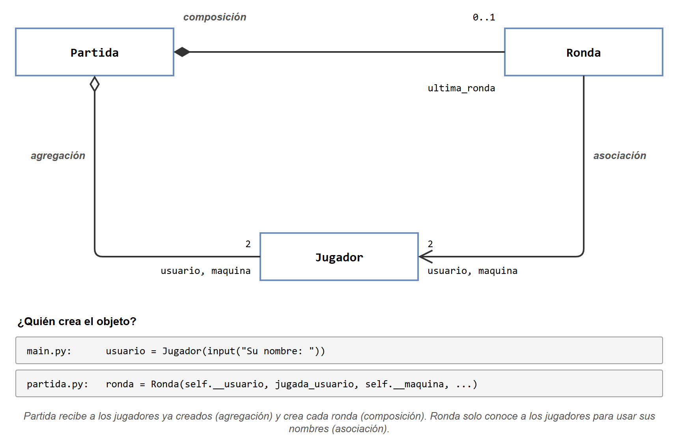
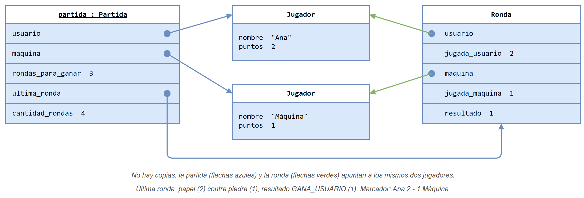
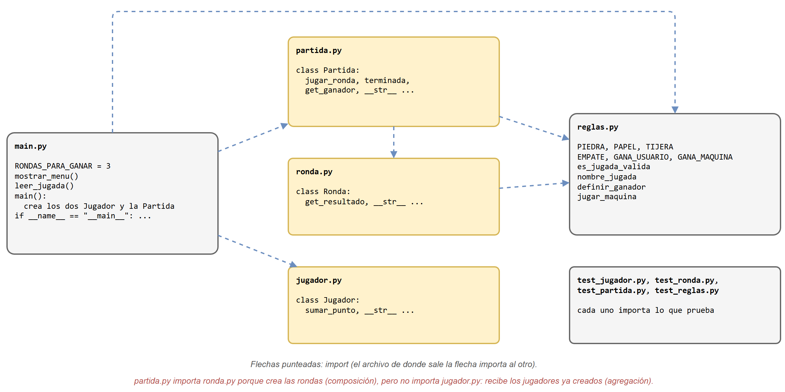
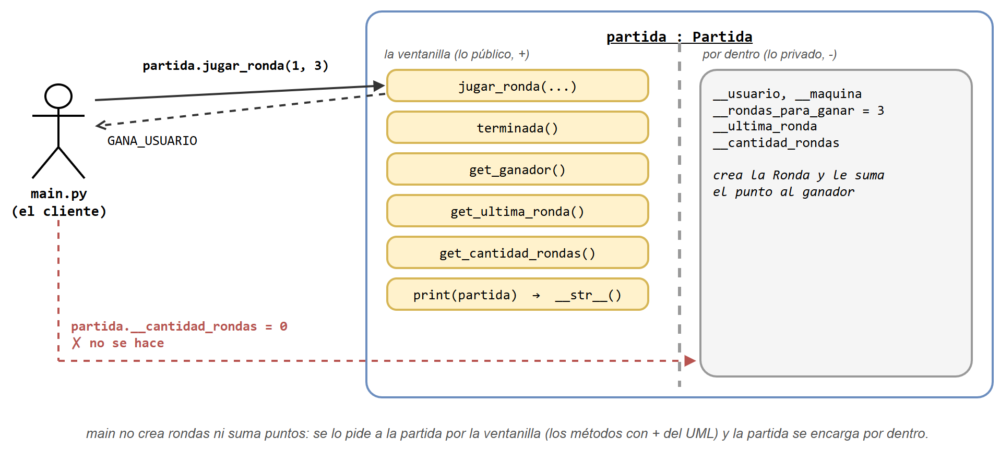
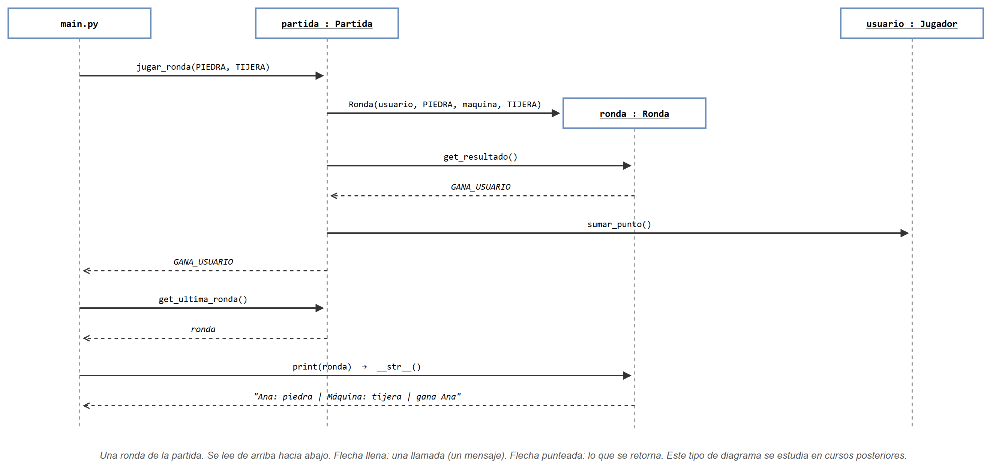

# Versión POO: las clases Jugador, Ronda y Partida

Esta es la solución del [juego de piedra, papel o tijera](../README.md#1-el-problema) con **programación orientada a objetos**. Juega exactamente igual que la [versión estructurada](../version_estructurada/README.md) y usa el mismo `reglas.py`. Lo que cambia es dónde viven los datos: cada jugador es un objeto `Jugador`, cada ronda es un objeto `Ronda`, y la partida es un objeto `Partida` que se encarga de jugar las rondas y llevar el marcador.

## Contenido de esta página

1. [Antes de empezar](#1-antes-de-empezar)
2. [El diseño crece en tres pasos](#2-el-diseño-crece-en-tres-pasos)
3. [Las relaciones entre las clases](#3-las-relaciones-entre-las-clases)
4. [Los objetos en memoria](#4-los-objetos-en-memoria)
5. [Los archivos](#5-los-archivos)
6. [Usar las clases: el programa principal](#6-usar-las-clases-el-programa-principal)
7. [Cómo ejecutarlo paso a paso](#7-cómo-ejecutarlo-paso-a-paso)
8. [Resumen](#8-resumen)

---

## 1. Antes de empezar

Además de lo que pide la versión estructurada, conviene tener claros estos conceptos:

| Concepto | Dónde se usa aquí |
|---|---|
| Clase y objeto; atributos ("sus características") y métodos ("lo que sabe hacer") | Las tres clases |
| El constructor `__init__` y `self` | `Jugador("Ana")`, `Partida(usuario, maquina, 3)` |
| Atributos privados con `__` y métodos `get_` | Los puntos de un `Jugador` solo cambian con `sumar_punto()` |
| `__str__` para imprimir un objeto | `print(ronda)`, `print(partida)` |
| Un atributo que guarda otro objeto | La `Ronda` y la `Partida` guardan objetos `Jugador` |
| Asociación, agregación y composición; el criterio "¿quién crea el objeto?" | Sección 3 |

## 2. El diseño crece en tres pasos



Las tres clases no aparecieron al mismo tiempo: cada una se apoya en la anterior. Es útil leerlas (y probarlas) en ese orden.

**Paso 1: `Jugador`.** Junta el nombre y los puntos que en la versión estructurada eran variables sueltas. Los puntos empiezan en 0 y solo pueden aumentar con `sumar_punto()`: desde afuera nadie puede restarlos ni ponerlos en un valor cualquiera.

**Paso 2: `Ronda`.** Guarda quién jugó, qué jugó cada uno y el resultado, que calcula en el constructor con `definir_ganador`. Conoce a los dos jugadores para poder describirse con sus nombres:

```python
>>> print(Ronda(ana, PIEDRA, maquina, TIJERA))
Ana: piedra | Máquina: tijera | gana Ana
```

Una ronda **no** suma puntos: solo dice qué pasó.

**Paso 3: `Partida`.** Une todo. Recibe a los dos jugadores, y cada vez que se juega una ronda la crea, mira el resultado y le suma el punto a quien ganó:

```python
def jugar_ronda(self, jugada_usuario, jugada_maquina):
    ronda = Ronda(self.__usuario, jugada_usuario,
                  self.__maquina, jugada_maquina)
    resultado = ronda.get_resultado()
    if resultado == GANA_USUARIO:
        self.__usuario.sumar_punto()
    elif resultado == GANA_MAQUINA:
        self.__maquina.sumar_punto()
    self.__ultima_ronda = ronda
    self.__cantidad_rondas = self.__cantidad_rondas + 1
    return resultado
```

Compare con la versión estructurada: allí, las cuatro primeras líneas de este método estaban repartidas en `main`, y los puntos se actualizaban con `puntos = sumar_si_gana(...)`. Aquí, `main` solo escribe `partida.jugar_ronda(jugada_usuario, jugar_maquina())`.

> [!NOTE]
> Los atributos de tipo `Jugador` y `Ronda` aparecen en negrilla en el UML para recordar que son objetos de otras clases, no números ni textos. Los métodos que no retornan nada, como `sumar_punto()`, se escriben sin tipo de retorno; en Python, esos métodos retornan `None`.

## 3. Las relaciones entre las clases

Este diseño tiene los tres tipos de relación vistos en clase:



| Relación | Entre | Por qué |
|---|---|---|
| **Agregación** ◇ | `Partida` y `Jugador` | La partida **recibe** a los jugadores ya creados (los crea `main.py`). Los jugadores existen antes de la partida y podrían seguir existiendo después, por ejemplo para jugar otra. |
| **Composición** ◆ | `Partida` y `Ronda` | La partida **crea** cada ronda dentro de `jugar_ronda`. Fuera de una partida, una ronda no tiene sentido. |
| **Asociación** → | `Ronda` y `Jugador` | La ronda conoce a los jugadores solo para usar sus nombres al describirse. No los crea ni los cambia. |

La pregunta que decide entre agregación y composición es la misma de siempre: **¿quién crea el objeto?**

## 4. Los objetos en memoria

Así queda la memoria después de cuatro rondas, cuando la última fue papel contra piedra:



Hay **solo dos objetos `Jugador`**. La partida y la ronda guardan referencias a ellos, no copias. Por eso, cuando la partida hace `self.__usuario.sumar_punto()`, el cambio lo ve cualquiera que tenga una referencia a Ana, incluida la variable `usuario` de `main`. Las pruebas lo verifican con `is`:

```python
assert partida.get_ganador() is ana          # el mismo objeto, no una copia
```

## 5. Los archivos

Cada clase va en su propio módulo, con su archivo de pruebas:



| Archivo | Qué contiene |
|---|---|
| [`codigo/reglas.py`](codigo/reglas.py) | El mismo archivo de la versión estructurada, sin cambios. |
| [`codigo/jugador.py`](codigo/jugador.py) | La clase `Jugador`. No importa nada. |
| [`codigo/ronda.py`](codigo/ronda.py) | La clase `Ronda`. Importa de `reglas.py`. |
| [`codigo/partida.py`](codigo/partida.py) | La clase `Partida`. Importa `Ronda`, porque la crea, y las constantes de `reglas.py`. |
| [`codigo/test_reglas.py`](codigo/test_reglas.py) | El mismo de la versión estructurada. |
| [`codigo/test_jugador.py`](codigo/test_jugador.py) | Pruebas de `Jugador`, incluida una que muestra que sumarle a un jugador no cambia a otro. |
| [`codigo/test_ronda.py`](codigo/test_ronda.py) | Pruebas de `Ronda`: un caso por resultado, su `__str__`, y que crear una ronda no suma puntos. |
| [`codigo/test_partida.py`](codigo/test_partida.py) | Una partida completa jugada con jugadas fijas, ronda por ronda, y una partida corta (a 1 ronda) que gana la máquina. |
| [`codigo/main.py`](codigo/main.py) | `RONDAS_PARA_GANAR`, `mostrar_menu()`, `leer_jugada()` y `main()`, que crea los dos `Jugador` y la `Partida` y juega las rondas. |

Observe en el diagrama de módulos que **`partida.py` importa `ronda.py` pero no `jugador.py`**: la partida escribe `Ronda(...)` porque crea las rondas (composición), pero nunca escribe `Jugador(...)`, porque recibe a los jugadores ya creados (agregación). Las relaciones del UML se ven también en los `import`.

## 6. Usar las clases: el programa principal

Hasta aquí se vio cómo están **hechas** las tres clases. Pero una clase no hace nada sola: alguien tiene que crear objetos y pedirles cosas. En este programa, ese alguien es `main.py`.

Frente a una clase hay dos papeles: **quien la escribe** (el autor de `jugador.py`, `ronda.py` y `partida.py`) y **quien la usa**, que se suele llamar el **cliente** de la clase. Son los mismos papeles de "autor del módulo" y "usuario del módulo" del laboratorio 4, ahora con objetos.

### 6.1 La idea: una ventanilla

Piense en un objeto como una oficina con ventanilla. El cliente se acerca, pide algo por la ventanilla y recibe una respuesta. No entra a la oficina ni sabe cómo se hace el trabajo por dentro.



- **La ventanilla son los métodos públicos**, los que tienen `+` en el UML. Para usar la clase basta con conocerlos: su nombre, qué reciben y qué retornan.
- **Lo de adentro son los atributos privados** (`-`) y todo el trabajo que hacen los métodos. Cuando `main` pide `jugar_ronda`, la partida crea la `Ronda`, mira el resultado y le suma el punto al ganador; `main` no ve nada de eso, solo recibe el resultado.

> [!NOTE]
> ¿Qué pasa si el cliente intenta entrar? Leer `partida.__cantidad_rondas` desde `main.py` produce `AttributeError`. Escribir `partida.__cantidad_rondas = 0` es peor: no da error, pero crea **otro** atributo con ese nombre y el verdadero no cambia. Por eso el `__` se entiende como una señal de "no pasar": el cliente usa la ventanilla.

### 6.2 Lo que hace `main`, paso a paso

Todo lo que hace `main.py` con los objetos cabe en tres pasos:

```python
# 1. Crear los objetos
usuario = Jugador(input("Su nombre: "))
maquina = Jugador("Máquina")
partida = Partida(usuario, maquina, RONDAS_PARA_GANAR)

while not partida.terminada():
    # 2. Pedirles cosas
    jugada_usuario = leer_jugada()
    partida.jugar_ronda(jugada_usuario, jugar_maquina())

    # 3. Mostrar lo que responden
    print(partida.get_ultima_ronda())
    print("Marcador:", partida)

print("Ganador de la partida:", partida.get_ganador().get_nombre())
```

| Paso | Qué hace el cliente | Qué **no** hace |
|---|---|---|
| 1. Crear | Los dos `Jugador` y la `Partida` | No crea las rondas: eso lo hace la partida |
| 2. Pedir | `partida.jugar_ronda(...)`, `partida.terminada()` | No decide quién ganó ni suma puntos |
| 3. Mostrar | `print(ronda)`, `print(partida)`, el nombre del ganador | No arma los textos: eso lo hacen los `__str__` |

Compare con la versión estructurada: allí `main` llevaba cuatro variables (dos nombres y dos puntos), llamaba a `definir_ganador` y actualizaba los puntos con `sumar_si_gana`. Aquí `main` lee jugadas, le habla a la partida por la ventanilla y muestra lo que ella responde.

### 6.3 Un adelanto: el diagrama de secuencia

El diagrama de clases (UML) muestra **qué hay**: las clases, sus atributos y sus métodos. Para mostrar **qué pasa** cuando el programa corre (quién le pide qué a quién, y en qué orden) existe otro diagrama UML, el **diagrama de secuencia**. Este es el de una ronda:



Cómo leerlo:

- Cada columna es un participante: `main.py` y tres objetos. El nombre subrayado (`partida : Partida`) indica un objeto, no una clase. `ronda` aparece más abajo porque la partida la crea en ese momento.
- El tiempo corre **de arriba hacia abajo**. Cada flecha llena es una llamada; cada flecha punteada es lo que se retorna.
- Las flechas que hay entre la llamada `jugar_ronda(PIEDRA, TIJERA)` y su respuesta `GANA_USUARIO` ocurren **dentro** de ese método: es el `jugar_ronda` de la sección 2, dibujado. `main` solo ve la llamada y la respuesta.
- `sumar_punto()` no tiene flecha de retorno porque no retorna nada.

> [!IMPORTANT]
> Los diagramas de secuencia **hacen parte de otro curso**: se estudian más adelante en la carrera, en los cursos de análisis y diseño de software. Aquí solo se muestran para que los reconozca cuando los vea. No se pide dibujarlos.

## 7. Cómo ejecutarlo paso a paso

1. Abra una terminal (o el Anaconda Prompt) y ubíquese en la carpeta del código:

   ```text
   cd clases/13/teoria/app_piedra-papel-tijera/version_poo/codigo
   ```

2. Ejecute las pruebas **en el orden en que crece el diseño**:

   ```text
   python test_reglas.py
   python test_jugador.py
   python test_ronda.py
   python test_partida.py
   ```

   ```text
   Pruebas de reglas: todas pasaron
   Pruebas de jugador: todas pasaron
   Pruebas de ronda: todas pasaron
   Pruebas de partida: todas pasaron
   ```

   Ese orden ayuda a encontrar errores: si `Jugador` tuviera uno, también fallarían las pruebas de `Ronda` y `Partida`, y sería más difícil saber dónde está el problema.

3. Juegue una partida:

   ```text
   python main.py
   ```

   La salida es igual a la de la versión estructurada: tiene la forma de la [partida de ejemplo](../README.md#1-el-problema).

## 8. Resumen

- Un jugador **existe**: es un objeto `Jugador` con su nombre y sus puntos.
- La `Partida` lleva el estado del juego y suma los puntos; `main` solo lee jugadas y muestra resultados.
- `jugar_ronda` recibe solo lo nuevo, las dos jugadas, porque lo demás ya está en `self`.
- El diseño muestra las tres relaciones: agregación (`Partida` ◇ `Jugador`), composición (`Partida` ◆ `Ronda`) y asociación (`Ronda` → `Jugador`).
- Las reglas siguen siendo funciones en `reglas.py`: no todo tiene que ser un objeto.

Los ejercicios de la [sección 7 de la comparación](../README.md#7-para-practicar-el-diseño-puede-seguir-creciendo) muestran cómo podría seguir creciendo este diseño.
