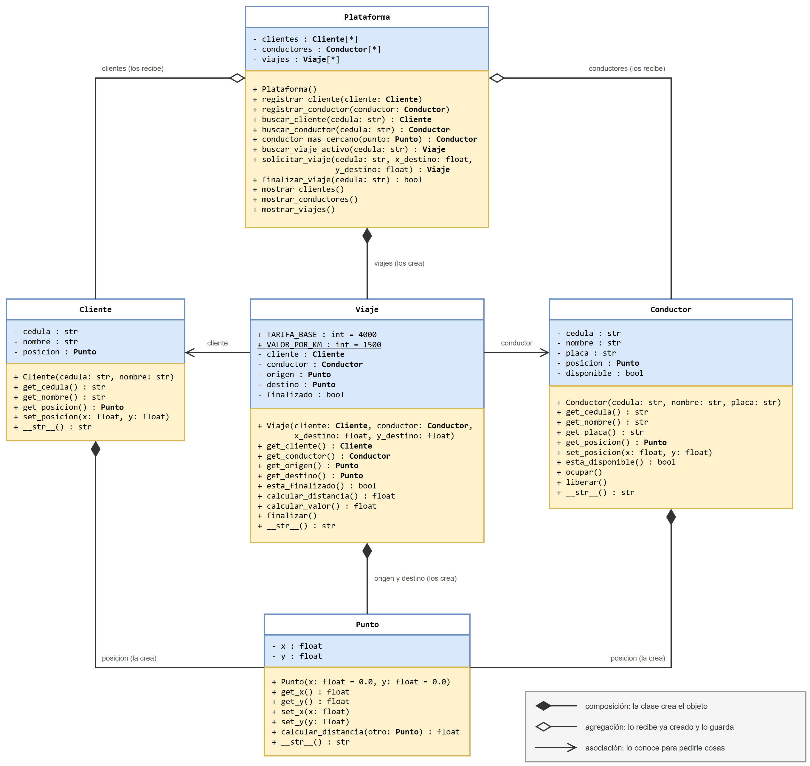
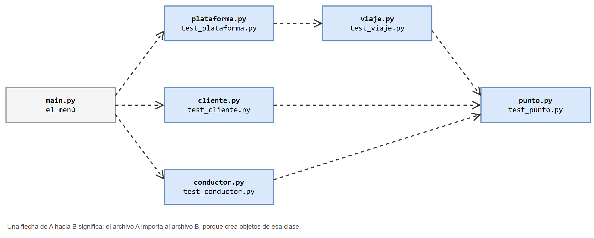

# Aplicación de transporte — manual de usuario

Una aplicación completa con **cinco clases que trabajan juntas**: una plataforma de transporte que registra clientes y conductores, y le asigna a cada cliente el conductor disponible más cercano.

Es la misma aplicación que se construye paso a paso en el notebook [De una clase a varias: una aplicación de transporte](../../sesion_magistral-32/notebooks/aplicacion_transporte.ipynb). Allá se explica **por qué** el diseño es así; aquí está el programa separado en archivos, con un menú, y las instrucciones para ejecutarlo.

## Contenido de esta página

1. [Qué hace el programa](#1-qué-hace-el-programa)
2. [Qué se necesita](#2-qué-se-necesita)
3. [Los archivos](#3-los-archivos)
4. [Cómo ejecutarlo](#4-cómo-ejecutarlo)
5. [Los datos con los que arranca](#5-los-datos-con-los-que-arranca)
6. [Las opciones del menú](#6-las-opciones-del-menú)
7. [Una sesión de ejemplo](#7-una-sesión-de-ejemplo)
8. [Cómo ejecutar las pruebas](#8-cómo-ejecutar-las-pruebas)
9. [Lo que el programa no revisa](#9-lo-que-el-programa-no-revisa)
10. [Si algo falla](#10-si-algo-falla)

## 1. Qué hace el programa

> Una empresa de transporte quiere un programa para administrar sus viajes dentro de una ciudad, que se representa como un plano: cada lugar es un **punto** con coordenadas `x` y `y`, medidas en kilómetros.
>
> La **plataforma** registra **clientes** y **conductores**. De cada cliente se conoce la cédula, el nombre y la posición donde se encuentra. De cada conductor se conoce la cédula, el nombre, la placa de su vehículo, la posición donde se encuentra y si está disponible. Todos empiezan en el punto (0, 0) y pueden cambiar de posición; un conductor recién registrado está disponible.
>
> Un cliente puede **solicitar un viaje** hacia un destino. La plataforma le asigna el conductor disponible **más cercano** al cliente; si no hay ninguno disponible, no hay viaje. De cada **viaje** se conoce el cliente, el conductor, el origen (la posición del cliente al solicitarlo) y el destino. La distancia del viaje es la que hay en línea recta entre el origen y el destino, y su valor es una tarifa base de \$4000 más \$1500 por cada kilómetro. Mientras dura el viaje, el conductor no está disponible.
>
> Al **finalizar el viaje**, el cliente y el conductor quedan en el destino y el conductor vuelve a estar disponible. Un cliente con un viaje sin finalizar no puede solicitar otro.
>
> La plataforma debe permitir consultar los clientes, los conductores y los viajes.
>
> **Se supone** que los datos que recibe el programa son correctos (cédulas que no se repiten, números donde se piden números). Las clases no lo verifican: es responsabilidad de quien las usa.

Las cinco clases y sus relaciones:



## 2. Qué se necesita

* Python 3 instalado (el curso usa el que viene con Anaconda).
* Los archivos de la carpeta [`codigo/`](codigo/), **todos en la misma carpeta**. No hay que instalar nada más: el programa solo usa el módulo `math`, que viene con Python.

## 3. Los archivos

```
📁 app_transporte/
   📄 README.md — este manual
   📁 codigo/
      📄 punto.py — la clase Punto
      📄 cliente.py — la clase Cliente
      📄 conductor.py — la clase Conductor
      📄 viaje.py — la clase Viaje
      📄 plataforma.py — la clase Plataforma
      📄 main.py — el programa principal, con el menú
      📄 test_punto.py — pruebas de Punto
      📄 test_cliente.py — pruebas de Cliente
      📄 test_conductor.py — pruebas de Conductor
      📄 test_viaje.py — pruebas de Viaje
      📄 test_plataforma.py — pruebas de Plataforma
   📁 diagramas/ — los diagramas, en formato de draw.io
   📁 images/ — los mismos diagramas, como imagen
```

Cada clase está en su propio archivo, y cada archivo tiene su archivo de pruebas. Un archivo importa a otro **solo si crea objetos de esa clase**:



| Archivo | Importa | Porque |
|---|---|---|
| [`punto.py`](codigo/punto.py) | `math` | Usa la raíz cuadrada. No conoce a ninguna otra clase |
| [`cliente.py`](codigo/cliente.py) | `punto.py` | Cada cliente crea su `Punto` |
| [`conductor.py`](codigo/conductor.py) | `punto.py` | Cada conductor crea su `Punto` |
| [`viaje.py`](codigo/viaje.py) | `punto.py` | Crea su origen y su destino. Al cliente y al conductor los recibe ya creados: no importa sus archivos |
| [`plataforma.py`](codigo/plataforma.py) | `viaje.py` | Crea los viajes. A los clientes y conductores los recibe ya creados |
| [`main.py`](codigo/main.py) | `cliente.py`, `conductor.py`, `plataforma.py` | Crea la plataforma, los clientes y los conductores |

## 4. Cómo ejecutarlo

**Desde la terminal** (Anaconda Prompt en Windows):

1. Entrar a la carpeta `codigo`. Por ejemplo, si el repositorio está en `D:\logica1-20262`:

   ```
   cd /d D:\logica1-20262\clases\13\teoria\app_transporte\codigo
   ```

2. Ejecutar el programa principal:

   ```
   python main.py
   ```

**Desde Spyder o VS Code:** abrir `main.py` y ejecutarlo. Los demás archivos deben estar en la misma carpeta que `main.py`.

El programa muestra el menú y espera una opción. Se escribe el número y se oprime **Enter**. Para terminar se escoge la opción `0`.

> [!NOTE]
> Los datos viven solo mientras el programa está abierto. Al salir se pierden, y la próxima vez el programa arranca otra vez con los datos iniciales.

## 5. Los datos con los que arranca

Para no empezar con la plataforma vacía, `main.py` registra cuatro clientes y cuatro conductores.

| Cédula | Cliente | Posición (km) |
|---|---|---|
| `1001` | Lucia | (0, 0) |
| `1002` | Michael | (2, 3) |
| `1003` | Kendl | (10, 10) |
| `1004` | Trevor | (-4, -3) |

| Cédula | Conductor | Placa | Posición (km) |
|---|---|---|---|
| `2001` | Tommy | `VCT986` | (3, 4) |
| `2002` | CJ | `GRV992` | (1, 1) |
| `2003` | Catalina | `LBC008` | (9, 12) |
| `2004` | Franklin | `LSA013` | (-6, -8) |

Los nombres son de personajes de videojuegos y solo sirven de ejemplo.

## 6. Las opciones del menú

```
===== Plataforma de transporte =====
1. Registrar cliente
2. Registrar conductor
3. Ubicar cliente
4. Ubicar conductor
5. Solicitar viaje
6. Finalizar viaje
7. Ver clientes
8. Ver conductores
9. Ver viajes
0. Salir
```

| Opción | Qué pide | Qué hace |
|---|---|---|
| 1. Registrar cliente | Cédula y nombre | Crea el cliente en (0, 0) y lo registra |
| 2. Registrar conductor | Cédula, nombre y placa | Crea el conductor en (0, 0), disponible, y lo registra |
| 3. Ubicar cliente | Cédula y coordenadas `x`, `y` | Deja al cliente en esa posición. Si la cédula no está registrada, avisa |
| 4. Ubicar conductor | Cédula y coordenadas `x`, `y` | Deja al conductor en esa posición. Si la cédula no está registrada, avisa |
| 5. Solicitar viaje | Cédula del cliente y coordenadas del destino | Asigna el conductor disponible más cercano y muestra el viaje con su distancia y su valor. Si no se puede, avisa |
| 6. Finalizar viaje | Cédula del cliente | Finaliza el viaje en curso de ese cliente: los dos quedan en el destino y el conductor queda disponible |
| 7. Ver clientes | Nada | Muestra los clientes y dónde están |
| 8. Ver conductores | Nada | Muestra los conductores, dónde están y si están disponibles u ocupados |
| 9. Ver viajes | Nada | Muestra todos los viajes, en curso y finalizados |
| 0. Salir | Nada | Termina el programa |

Un viaje **no se puede crear** en tres casos: la cédula no es de un cliente registrado, el cliente ya tiene un viaje en curso, o no hay conductores disponibles.

Las coordenadas se escriben como números, con punto para los decimales: `6`, `2.5`, `-4`.

## 7. Una sesión de ejemplo

Esta es la salida real del programa. Lo que escribe el usuario aparece después de los dos puntos. Para no repetir, el menú se muestra solo la primera vez; en el programa aparece antes de cada `Opción:`.

**Ver los conductores (opción 8)**

```
===== Plataforma de transporte =====
1. Registrar cliente
2. Registrar conductor
3. Ubicar cliente
4. Ubicar conductor
5. Solicitar viaje
6. Finalizar viaje
7. Ver clientes
8. Ver conductores
9. Ver viajes
0. Salir
Opción: 8
2001 Tommy (VCT986) en (3.0, 4.0) disponible
2002 CJ (GRV992) en (1.0, 1.0) disponible
2003 Catalina (LBC008) en (9.0, 12.0) disponible
2004 Franklin (LSA013) en (-6.0, -8.0) disponible
```

**Lucia pide un viaje a (6, 8) (opción 5)**

```
Opción: 5
Cédula del cliente: 1001
Coordenada x del destino (km): 6
Coordenada y del destino (km): 8
Viaje creado: Lucia con CJ: (0.0, 0.0) -> (6.0, 8.0) | 10.00 km | $19000 | en curso
Conductor asignado: 2002 CJ (GRV992) en (1.0, 1.0) ocupado
```

Lucia está en (0, 0). El conductor más cercano es CJ, a 1.41 km; Tommy está a 5 km. El viaje mide 10 km y vale 4000 + 1500 × 10 = \$19 000.

**Lucia pide otro viaje sin haber finalizado el primero (opción 5)**

```
Opción: 5
Cédula del cliente: 1001
Coordenada x del destino (km): 1
Coordenada y del destino (km): 1
No se pudo crear el viaje: el cliente no está registrado,
ya tiene un viaje en curso o no hay conductores disponibles.
```

**Kendl pide un viaje a (13, 14) (opción 5)**

```
Opción: 5
Cédula del cliente: 1003
Coordenada x del destino (km): 13
Coordenada y del destino (km): 14
Viaje creado: Kendl con Catalina: (10.0, 10.0) -> (13.0, 14.0) | 5.00 km | $11500 | en curso
Conductor asignado: 2003 Catalina (LBC008) en (9.0, 12.0) ocupado
```

**Ver los viajes (opción 9)**

```
Opción: 9
Lucia con CJ: (0.0, 0.0) -> (6.0, 8.0) | 10.00 km | $19000 | en curso
Kendl con Catalina: (10.0, 10.0) -> (13.0, 14.0) | 5.00 km | $11500 | en curso
```

**Finalizar el viaje de Lucia (opción 6) y ver cómo quedaron todos (opciones 8 y 7)**

```
Opción: 6
Cédula del cliente: 1001
Viaje finalizado.

Opción: 8
2001 Tommy (VCT986) en (3.0, 4.0) disponible
2002 CJ (GRV992) en (6.0, 8.0) disponible
2003 Catalina (LBC008) en (9.0, 12.0) ocupado
2004 Franklin (LSA013) en (-6.0, -8.0) disponible

Opción: 7
1001 Lucia en (6.0, 8.0)
1002 Michael en (2.0, 3.0)
1003 Kendl en (10.0, 10.0)
1004 Trevor en (-4.0, -3.0)
```

CJ y Lucia quedaron en (6, 8), y CJ volvió a estar disponible. Catalina sigue ocupada porque el viaje de Kendl no ha finalizado.

**Una cédula que no existe (opción 3), registrar una clienta (opción 1) y salir (opción 0)**

```
Opción: 3
Cédula del cliente: 9999
No hay un cliente con esa cédula.

Opción: 1
Cédula del cliente: 1005
Nombre: Amanda
Cliente registrado: 1005 Amanda en (0.0, 0.0)

Opción: 0
Hasta luego.
```

## 8. Cómo ejecutar las pruebas

Cada archivo de pruebas se ejecuta por separado, desde la carpeta `codigo`. Si todas las pruebas pasan, imprime un mensaje; si alguna falla, el programa se detiene con un `AssertionError` que dice en qué línea.

Las pruebas se ejecutan **en este orden**, que es el orden en que se construyeron las clases: primero la que no depende de ninguna.

| Orden | Comando | Salida esperada | Qué clases ejercita |
|---|---|---|---|
| 1 | `python test_punto.py` | `Pruebas de punto: todas pasaron` | `Punto` |
| 2 | `python test_cliente.py` | `Pruebas de cliente: todas pasaron` | `Cliente` y `Punto` |
| 3 | `python test_conductor.py` | `Pruebas de conductor: todas pasaron` | `Conductor` y `Punto` |
| 4 | `python test_viaje.py` | `Pruebas de viaje: todas pasaron` | `Viaje`, `Cliente`, `Conductor` y `Punto` |
| 5 | `python test_plataforma.py` | `Pruebas de plataforma: todas pasaron` | Las cinco |

El orden importa cuando algo falla. Si `test_cliente.py` falla pero `test_punto.py` pasó, el error está en `Cliente` y no en `Punto`.

## 9. Lo que el programa no revisa

El enunciado dice que las clases suponen datos correctos. Conviene saber qué pasa cuando no lo son:

| Si el usuario… | Pasa esto |
|---|---|
| Escribe letras donde se pide una coordenada | El programa se detiene con un `ValueError` |
| Registra dos clientes con la misma cédula | Los dos quedan registrados, pero las búsquedas siempre encuentran al primero |
| Escribe una opción que no está en el menú | El programa responde `Opción no válida.` y vuelve a mostrar el menú |

Los dos primeros casos son buenos ejercicios: ¿en qué archivo habría que hacer el cambio para evitarlos?

## 10. Si algo falla

| Mensaje | Causa probable | Qué hacer |
|---|---|---|
| `ModuleNotFoundError: No module named 'plataforma'` | El programa se ejecutó desde otra carpeta, o falta un archivo | Entrar a la carpeta `codigo` antes de ejecutar y revisar que estén todos los archivos |
| `python: can't open file 'main.py'` | La terminal no está en la carpeta `codigo` | Usar `cd` para entrar a ella (paso 1 de [Cómo ejecutarlo](#4-cómo-ejecutarlo)) |
| `ValueError: could not convert string to float` | Se escribió texto donde iba un número | Volver a ejecutar y escribir la coordenada como número |
| Aparece una carpeta `__pycache__` | No es un error: Python la crea al importar archivos | Se puede dejar o borrar |

## Para seguir

* El notebook [De una clase a varias: una aplicación de transporte](../../sesion_magistral-32/notebooks/aplicacion_transporte.ipynb) explica el diseño paso a paso y trae ejercicios para agregarle métodos a estas clases.
* Otras dos aplicaciones completas de la clase 13, cada una resuelta sin objetos y con objetos: [`app_curso`](../app_curso/README.md) y [`app_piedra-papel-tijera`](../app_piedra-papel-tijera/README.md).
