# Laboratorio 5 — Programación orientada a objetos: un parqueadero

## Antes de empezar

Antes de la sesión de laboratorio, repase el siguiente material:

* **[Clase 13](../../clases/13/README.md)** — clase y objeto, atributos y métodos, constructor, encapsulamiento, `__str__`, constantes de clase, diagramas UML y relaciones entre clases.
* **Notebook [De una clase a varias: una aplicación de transporte](../../clases/13/sesion_magistral-32/notebooks/aplicacion_transporte.ipynb)** — muestra, paso a paso, el mismo camino de este laboratorio: del enunciado al diagrama UML, y de ahí a las clases, una a la vez y cada una con sus pruebas.
* **Aplicaciones [`app_curso`](../../clases/13/teoria/app_curso/README.md) y [`app_piedra-papel-tijera`](../../clases/13/teoria/app_piedra-papel-tijera/README.md)** — dos programas completos con varias clases, cada uno con un notebook que lo construye.
* **Matrices** — crear una matriz, entrar a una casilla con dos índices y recorrerla con dos ciclos. La [sección sobre la matriz de puestos](#la-matriz-de-puestos) de esta guía trae un repaso con lo que se necesita.

## Objetivos

Al finalizar este laboratorio, el estudiante estará en capacidad de:

* Explicar cómo se llega de un **enunciado** a un **diagrama UML**: qué se vuelve clase, qué se vuelve atributo y qué se vuelve método.
* Leer un diagrama UML y la **documentación** de un método (*Supone / Garantiza*) e implementar el método a partir de ellos.
* Implementar clases con **atributos privados**, constructor, métodos de consulta, `__str__` y **constantes de clase**.
* Implementar **relaciones entre clases**: un objeto que recibe a otro ya creado (asociación) y un objeto que crea a otros (composición).
* Guardar objetos en una **matriz** y recorrerla para contar y para buscar.
* Usar `None` para representar que no hay objeto, y revisar ese caso antes de usar lo que retorna un método.
* Usar **pruebas ya escritas** como puntos de chequeo: leer un fallo, ubicar el método responsable y corregirlo.
* Construir un programa de varias clases **de forma incremental**: una clase a la vez, empezando por la que no depende de ninguna otra.

## Herramientas necesarias

* **Anaconda**: distribución de Python que incluye el intérprete, Spyder y Jupyter.
* **Visual Studio Code** (opcional): editor de código con las extensiones de Python y de Jupyter.
* **Una cuenta de YouTube** (de cualquiera de los integrantes), para publicar el video de la entrega.

## Descripción general

En este laboratorio se construye un programa para administrar un **parqueadero de varios pisos**. El programa completo tiene cuatro clases, un archivo que dibuja el parqueadero en pantalla y un programa principal con menú.

No se parte de cero. Se entrega una carpeta con el programa **a medio hacer**:

| Parte del programa | Estado | Qué hay que hacer |
|---|---|---|
| Las cuatro clases: `Vehiculo`, `Puesto`, `Recibo` y `Parqueadero` | **Incompletas**: está la estructura y la documentación de cada método, pero no el código | Completar cada método para que cumpla su documentación |
| Las pruebas de cada clase | Completas | Ejecutarlas: cada una es un **punto de chequeo** |
| `pantalla.py`, que dibuja el parqueadero | Completo | Nada: funciona cuando las clases estén listas |
| `main.py`, el programa con menú | Completo | Nada: funciona cuando las clases estén listas |

El trabajo se hace en **seis niveles**. Cada nivel termina cuando su prueba pasa:

| Nivel | Qué se completa | Punto de chequeo |
|---|---|---|
| **1** | La clase `Vehiculo` | `python test_vehiculo.py` |
| **2** | La clase `Puesto` | `python test_puesto.py` |
| **3** | La clase `Recibo` | `python test_recibo.py` |
| **4** | La clase `Parqueadero`: la matriz y las consultas | `python test_parqueadero_matriz.py` y `python test_pantalla.py` |
| **5** | La clase `Parqueadero`: buscar, ingresar y retirar | `python test_parqueadero_operaciones.py` |
| **6** | Nada: se usa el programa y se graba el video | `python main.py` |

---

# El problema y su diseño

Esta parte no pide escribir código. Explica **de dónde sale** el diagrama UML que se entrega, para que al completar las clases se entienda por qué son esas y no otras.

## El enunciado

> Se desea un programa para administrar un **parqueadero** de varios **pisos**. Todos los pisos tienen la misma cantidad de **puestos**. Al parqueadero entran **carros** y **motos**; de cada **vehículo** se conoce su **placa** y su **tipo**.
>
> Cuando un vehículo **ingresa**, se le asigna el **primer puesto libre**: se busca por el piso 1, puesto por puesto, y solo después se pasa al piso 2, y así sucesivamente. Si no hay puestos libres, el vehículo no puede ingresar. Tampoco pueden estar dentro, al mismo tiempo, dos vehículos con la misma placa.
>
> Cuando un vehículo **se retira**, se indica cuántos **minutos** estuvo. El parqueadero libera el puesto y entrega un **recibo** con el vehículo, los minutos, las horas que se cobran y el valor a pagar. Se cobra **por hora o fracción**, y como mínimo una hora. La hora de carro vale \$3000 y la de moto vale \$1000.
>
> El parqueadero lleva la cuenta del **dinero recaudado**. Además debe permitir **buscar** un vehículo por su placa, saber **cuántos puestos libres** hay y **ver** cómo está ocupado.
>
> **Se supone** que los datos que recibe el programa son correctos (los minutos son un entero que no es negativo; el tipo es carro o moto). Las clases no lo verifican: es responsabilidad de quien las usa.

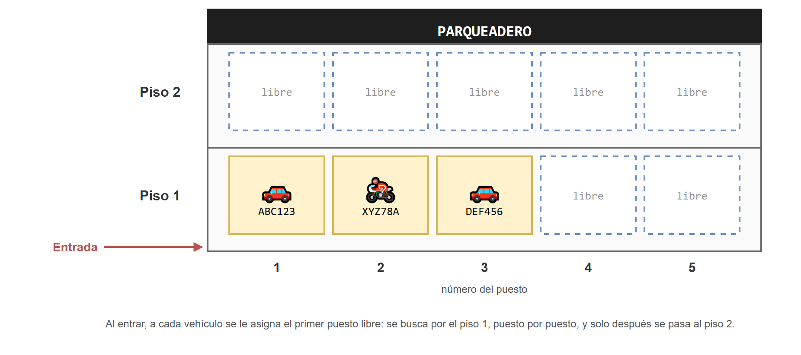

## Un caso para verificar a mano

Un buen enunciado permite calcular un ejemplo **antes** de programar. Este caso aparece después en las pruebas.

Un parqueadero de 2 pisos y 5 puestos por piso empieza vacío.

| # | Qué pasa | Resultado |
|---|---|---|
| 1 | Ingresa el carro `ABC123` | Queda en el piso 1, puesto 1 |
| 2 | Ingresa la moto `XYZ78A` | Queda en el piso 1, puesto 2 |
| 3 | Intenta ingresar otro vehículo con la placa `ABC123` | No puede: esa placa ya está adentro |
| 4 | Se retira `ABC123` después de 130 minutos | 130 minutos son 2 horas y 10 minutos: se cobran **3 horas**. Paga 3 × 3000 = **\$9000**. El puesto 1 del piso 1 queda libre |
| 5 | Se retira `XYZ78A` después de 45 minutos | Se cobra **1 hora**. Paga 1 × 1000 = **\$1000** |
| 6 | Se consulta el recaudo | 9000 + 1000 = **\$10 000** |

Para las horas que se cobran, estos son los casos que más confunden:

| Minutos | Horas que se cobran | Por qué |
|---|---|---|
| 0 | 1 | Como mínimo se cobra una hora |
| 59 | 1 | Una fracción de hora se cobra completa |
| 60 | 1 | Una hora exacta |
| 61 | 2 | Una hora y una fracción |
| 120 | 2 | Dos horas exactas |
| 130 | 3 | Dos horas y una fracción |

## Del enunciado al diagrama UML

El enunciado no dice qué clases escribir. Para descubrirlas se **subrayan los sustantivos y los verbos**:

* Los **sustantivos** (cosas) son candidatos a **clases** o a **atributos**.
* Los **verbos** (acciones) son candidatos a **métodos**.

### 1. Decidir qué es cada sustantivo

Para cada sustantivo se hacen tres preguntas, en orden:

1. **¿Tiene varios datos propios y algo que sabe hacer?** Entonces es una **clase**.
2. **¿Es un dato sencillo que describe a otra cosa?** Entonces es un **atributo** de esa cosa.
3. **¿Se puede calcular a partir de otros datos?** Entonces no se guarda: es un **método**.

| Sustantivo | Decisión | Por qué |
|---|---|---|
| **vehículo** | **Clase `Vehiculo`** | Tiene dos datos (placa y tipo) y sabe describirse |
| carro, moto | Dos **valores** del atributo `tipo`, guardados como constantes de `Vehiculo` | No hace falta una clase por cada uno: un carro y una moto tienen los mismos datos y solo cambia el tipo |
| placa, tipo | Atributos de `Vehiculo` (`str`) | Datos sencillos que describen al vehículo |
| **puesto** | **Clase `Puesto`** | Tiene tres datos (piso, número y el vehículo que lo ocupa) y sabe ocuparse y liberarse |
| piso (de un puesto), número | Atributos de `Puesto` (`int`) | Datos sencillos que dicen dónde está el puesto |
| el vehículo que ocupa un puesto | Atributo de `Puesto`, **de tipo `Vehiculo`** | Describe al puesto, pero no es un dato sencillo: es un objeto |
| **recibo** | **Clase `Recibo`** | Tiene dos datos (vehículo y minutos) y sabe calcular las horas y el valor |
| minutos | Atributo de `Recibo` (`int`) | Un dato sencillo |
| horas que se cobran, valor a pagar | **Métodos** de `Recibo` | No se guardan: se calculan con los minutos y el tipo de vehículo |
| valor de la hora de carro y de moto | Constantes de la clase `Recibo` | Son iguales para todos los recibos |
| **parqueadero** | **Clase `Parqueadero`** | Tiene los puestos y el recaudo, y sabe ingresar, retirar, buscar y contar |
| pisos, puestos por piso | Atributos de `Parqueadero` (`int`) | Datos sencillos: el tamaño del parqueadero |
| puestos (el grupo) | Atributo de `Parqueadero`: **una matriz de objetos `Puesto`** | Hay pisos y, en cada piso, puestos: dos dimensiones |
| dinero recaudado | Atributo `recaudo` de `Parqueadero` (`int`) | Un dato sencillo que se va acumulando |
| cuántos puestos libres hay | **Método** de `Parqueadero` | No se guarda: se cuenta recorriendo los puestos |
| programa | Se descarta | Es el programa mismo |

Quedan **cuatro clases**: `Vehiculo`, `Puesto`, `Recibo` y `Parqueadero`.

La pista de que hay una **relación entre clases** está en los atributos cuyo tipo es otra clase: el *vehículo* de un puesto es un `Vehiculo`; los *puestos* de un parqueadero son objetos `Puesto`.

### 2. Decidir de quién es cada verbo

Un método va en **la clase que tiene los datos necesarios para hacerlo**.

| Verbo del enunciado | Método | ¿En cuál clase? | Por qué ahí |
|---|---|---|---|
| ocupar un puesto, liberarlo | `ocupar(vehiculo)`, `liberar()` | `Puesto` | El puesto guarda al vehículo que lo ocupa |
| saber si un puesto está libre | `esta_libre()` | `Puesto` | El puesto sabe si tiene vehículo |
| calcular las horas que se cobran | `calcular_horas()` | `Recibo` | El recibo tiene los minutos |
| calcular el valor a pagar | `calcular_valor()` | `Recibo` | El recibo tiene los minutos, el vehículo y las tarifas |
| asignar el primer puesto libre | `buscar_puesto_libre()` | `Parqueadero` | Solo él conoce **todos** los puestos |
| buscar un vehículo por su placa | `buscar_vehiculo(placa)` | `Parqueadero` | Hay que revisar todos los puestos |
| ingresar | `ingresar_vehiculo(vehiculo)` | `Parqueadero` | Hay que revisar las placas y escoger un puesto |
| retirar | `retirar_vehiculo(placa, minutos)` | `Parqueadero` | Hay que encontrar el puesto, liberarlo, crear el recibo y sumar al recaudo |
| contar los puestos libres | `contar_libres()` | `Parqueadero` | Él tiene todos los puestos |
| ver cómo está ocupado | Funciones de `pantalla.py` | Ninguna clase | Dibujar en pantalla es una tarea aparte; usa lo que las clases le responden |

> **¿Por qué "ingresar" no es un método del vehículo, si es el vehículo el que ingresa?** Porque para ingresar hay que saber qué puestos están libres y qué placas hay adentro, y un vehículo no sabe nada de eso. El parqueadero sí. En el diseño, un verbo no va en la clase de quien lo hace en la vida real, sino en la clase que tiene los datos.

### 3. Decidir las relaciones

Cada vez que una clase tiene un atributo cuyo tipo es otra clase, hay una relación. Para cada una se responden **tres preguntas**:

1. **¿Quién conoce a quién?** La clase que tiene el atributo conoce a la otra, y no al revés.
2. **¿Quién crea el objeto?** Esto decide el tipo de relación.
3. **¿Quién le pide qué a quién?** Los métodos que una clase usa de la otra.

| Relación | Símbolo | Cuándo |
|---|---|---|
| **Composición** | Rombo negro | La clase **crea** el objeto que guarda |
| **Asociación** | Flecha | La clase **recibe** el objeto ya creado y lo conoce para pedirle cosas |

El rombo se dibuja del lado de la clase que crea y guarda.

| Relación | ¿Quién conoce a quién? | ¿Quién crea el objeto? | Tipo | ¿Qué le pide? |
|---|---|---|---|---|
| `Puesto` — `Vehiculo` | El puesto conoce al vehículo que lo ocupa | Nadie dentro del puesto: lo recibe en `ocupar` | Asociación | Que se convierta en texto, para describirse |
| `Recibo` — `Vehiculo` | El recibo conoce a su vehículo | Nadie dentro del recibo: lo recibe en el constructor | Asociación | Su tipo, para saber qué tarifa cobrar |
| `Parqueadero` — `Puesto` | El parqueadero conoce todos sus puestos | El parqueadero, en su constructor | Composición | Si está libre, su vehículo, que se ocupe, que se libere |
| `Parqueadero` — `Recibo` | El parqueadero crea el recibo y lo entrega | El parqueadero, en `retirar_vehiculo` | Composición | Su valor, para sumarlo al recaudo |

Hay que fijarse en la dirección: el puesto conoce a su vehículo, pero **el vehículo no sabe en qué puesto está**. Por eso `Vehiculo` es la clase más independiente, y es la primera que se completa.

Los vehículos no los crea ninguna de las cuatro clases. Los crea el **programa principal**, y se los entrega al parqueadero.

### 4. El diagrama UML

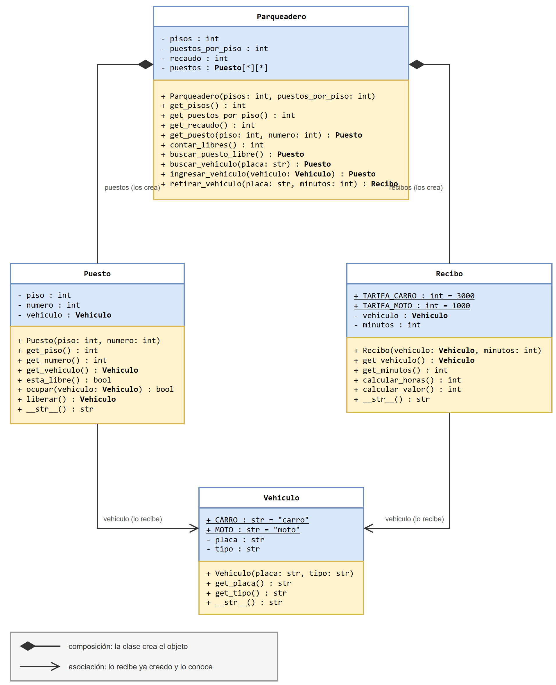

El diagrama se lee así:

* Arriba, el **nombre** de la clase; en el medio (azul), los **atributos**; abajo (amarillo), los **métodos**.
* `-` significa **privado** (solo se usa dentro de la clase) y `+` significa **público** (se puede usar desde afuera).
* Un atributo se escribe `nombre : tipo`. Un método se escribe `nombre(parámetros) : tipo de lo que retorna`.
* El **constructor** lleva el nombre de la clase y no tiene tipo de retorno.
* Los tipos en **negrita** son clases del programa, y lo <u>subrayado</u> pertenece a la clase y no a cada objeto (las constantes).
* `Puesto[*][*]` es notación nueva: `[*]` significa "varios", así que `[*][*]` significa **una matriz** de objetos `Puesto`.

> [!NOTE]
> Subrayar sustantivos y verbos es un punto de partida, no una receta: hay que decidir, descartar y a veces devolverse. En un programa real, el diseño se ajusta mientras se programa. En este laboratorio el diseño ya está decidido, para concentrar el trabajo en implementarlo.

## La matriz de puestos

Un parqueadero tiene pisos y, en cada piso, puestos. Para encontrar un puesto hacen falta **dos números**: el piso y el número del puesto. La estructura que guarda datos con dos índices es la **matriz**.

### Repaso: una matriz en Python

Una matriz es **una lista de filas**, y cada fila es una lista. Se crea en dos pasos, como los arreglos, sin `append`:

```python
FILAS = 2
COLUMNAS = 3

matriz = [None] * FILAS                  # una lista con una casilla por fila
for i in range(FILAS):
    matriz[i] = [0] * COLUMNAS           # cada casilla pasa a ser una fila nueva

matriz[0][2] = 7                         # fila 0, columna 2
matriz[1][0] = 5                         # fila 1, columna 0
print(matriz)
```

```
[[0, 0, 7], [5, 0, 0]]
```

Para llegar a una casilla se escriben los dos índices: **primero la fila, después la columna**. Para recorrer toda la matriz se usan dos ciclos, uno dentro del otro:

```python
suma = 0
for i in range(FILAS):                   # por cada fila
    for j in range(COLUMNAS):            # por cada columna de esa fila
        suma = suma + matriz[i][j]
print(suma)
```

```
12
```

> [!WARNING]
> Las filas se crean **dentro del ciclo**, una por una. Si se escribe `matriz = [[0] * COLUMNAS] * FILAS`, todas las filas son **la misma lista**: al cambiar una casilla, cambia en todas las filas. Es el mismo efecto de `b = a` con las listas.

### La matriz del parqueadero

En el parqueadero, **cada fila es un piso** y **cada columna es un puesto**. Las casillas no guardan números: guardan objetos `Puesto`.

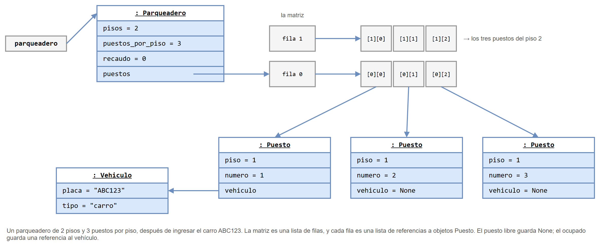

### Cuidado: dos formas de contar

> [!WARNING]
> **Para el usuario, los pisos y los puestos se cuentan desde 1. En la matriz, las filas y las columnas se cuentan desde 0.** El puesto 1 del piso 1 está en la fila 0, columna 0. Confundir las dos formas de contar es el error más frecuente de este laboratorio.

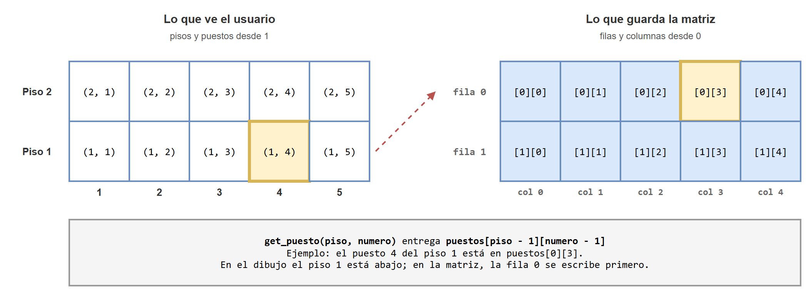

Para que esa conversión no quede regada por todo el programa, se hace en **un solo lugar**: el método `get_puesto(piso, numero)` recibe los números del usuario y entrega la casilla `[piso - 1][numero - 1]`. El resto del programa (las pruebas, `pantalla.py`, `main.py`) usa siempre los números del usuario.

Hay un segundo detalle en el dibujo: el parqueadero se muestra como un edificio, con el piso 1 **abajo**. En la matriz, la fila 0 (el piso 1) es la **primera**. Son dos formas de dibujar lo mismo.

Cada objeto `Puesto` también guarda su piso y su número, **contados desde 1**. El puesto que está en la fila `i`, columna `j`, es el puesto `j + 1` del piso `i + 1`.

---

# Cómo se trabaja

## Organización en archivos

La carpeta [`codigo/`](codigo/) tiene todo lo necesario. **Todos los archivos deben quedar en la misma carpeta.**

```
📁 codigo/
   📄 vehiculo.py — la clase Vehiculo · POR COMPLETAR
   📄 puesto.py — la clase Puesto · POR COMPLETAR
   📄 recibo.py — la clase Recibo · POR COMPLETAR
   📄 parqueadero.py — la clase Parqueadero · POR COMPLETAR
   📄 test_vehiculo.py — punto de chequeo 1 · ya viene hecho
   📄 test_puesto.py — punto de chequeo 2 · ya viene hecho
   📄 test_recibo.py — punto de chequeo 3 · ya viene hecho
   📄 test_parqueadero_matriz.py — punto de chequeo 4 · ya viene hecho
   📄 test_pantalla.py — punto de chequeo 4, segunda parte · ya viene hecho
   📄 test_parqueadero_operaciones.py — punto de chequeo 5 · ya viene hecho
   📄 pantalla.py — dibuja el parqueadero · ya viene hecho
   📄 main.py — el programa con menú · ya viene hecho
```

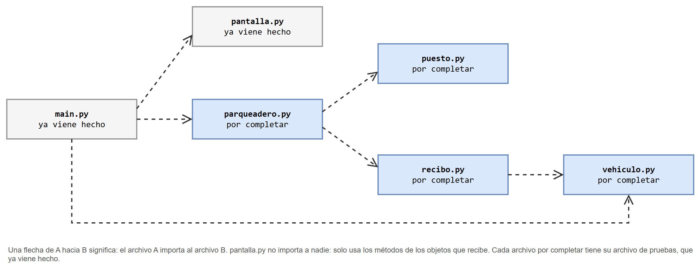

Un archivo importa a otro cuando necesita su clase: para **crear objetos** de ella o para usar sus **constantes**. `puesto.py` no importa `vehiculo.py`, aunque guarda un vehículo, porque nunca crea uno: lo recibe ya creado.

> [!IMPORTANT]
> Los archivos marcados "ya viene hecho" **no se modifican**. Si una prueba falla, el error está en una de las cuatro clases, no en la prueba. Tampoco se cambian los nombres de los métodos ni sus parámetros: las pruebas y el programa principal los usan tal como están.

## Cómo es un archivo por completar

Cada clase trae su estructura completa. Cada método tiene su **documentación** y, en lugar del código, la palabra `pass`:

```python
    def esta_libre(self):
        """Garantiza: retorna True si el puesto no tiene vehículo, y False si lo tiene."""
        # COMPLETE: reemplace el pass por el código de este método
        pass
```

`pass` es una instrucción que no hace nada. Está ahí porque Python no acepta un método vacío. El trabajo consiste en **reemplazar cada `pass`** por el código que cumple lo que dice la documentación:

* **Supone** dice qué datos espera recibir el método. No hay que verificarlos.
* **Garantiza** dice qué debe hacer el método y qué debe retornar. Es lo que revisan las pruebas.

La documentación no se borra: es parte del programa.

## El ciclo de trabajo

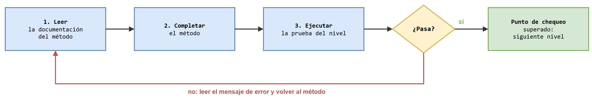

1. **Leer** la documentación del método y ubicarlo en el diagrama UML.
2. **Completar** el método.
3. **Ejecutar** la prueba del nivel.
4. Si la prueba falla, **leer el mensaje**, corregir y volver a ejecutar. Si pasa, se superó el punto de chequeo y se sigue con el siguiente nivel.

No hace falta completar todos los métodos de una clase antes de ejecutar la prueba. Conviene ejecutarla a menudo: la prueba se detiene en el primer `assert` que falla, y eso dice **cuál método revisar**.

## Cómo leer una prueba que falla

Mientras una clase no esté completa, su prueba falla. Es normal: el mensaje dice dónde seguir. Por ejemplo, con `vehiculo.py` recién descargado:

```
Traceback (most recent call last):
  File "test_vehiculo.py", line 15, in <module>
    assert carro.get_placa() == "ABC123"
AssertionError
```

Se lee de abajo hacia arriba: hubo un `AssertionError`, en la línea 15 de la prueba, al comparar `carro.get_placa()` con `"ABC123"`. Hay que revisar `get_placa` y, si ese método ya parece correcto, el constructor, que es quien guarda la placa.

| Mensaje | Qué significa | Qué revisar |
|---|---|---|
| `AssertionError` | El método retornó algo distinto de lo esperado. Un método que todavía tiene `pass` retorna `None` | El método que aparece en la línea del `assert` |
| `AttributeError: 'NoneType' object has no attribute ...` | Se le pidió un método a `None`. Un método anterior retornó `None` en vez de un objeto | El método que debía entregar el objeto (por ejemplo `get_vehiculo` o `get_puesto`) |
| `AttributeError: 'Puesto' object has no attribute '_Puesto__vehiculo'` | Un método usa un atributo que el constructor nunca creó | El constructor: ¿guarda todos los atributos? ¿Con el mismo nombre que usan los otros métodos? |
| `TypeError: __str__ returned non-string` | `__str__` no retornó un texto | El `return` de `__str__` |
| `TypeError: can only concatenate str (not "int") to str` | Se intentó unir un texto con un número usando `+` | Convertir el número con `str(...)` |
| `IndexError: list index out of range` | Se usó un índice que no existe en la matriz | La conversión entre los números del usuario (desde 1) y los índices (desde 0) |
| `NameError: name '...' is not defined` (dentro de un método) | Falta `self.` antes de un atributo o de un método | Escribir `self.__atributo` o `self.metodo()` |
| `ModuleNotFoundError: No module named '...'` | La prueba se ejecutó desde otra carpeta, o falta un archivo | Entrar a la carpeta `codigo` antes de ejecutar |

## El notebook de apoyo

El notebook [`parqueadero.ipynb`](parqueadero.ipynb) reúne, para cada nivel, todo lo necesario en un solo lugar: el enunciado de la clase, su diagrama UML, la plantilla de la clase y la celda con sus pruebas.

[](https://colab.research.google.com/github/algoritmos-UdeA/logica1-20262/blob/main/laboratorios/5/parqueadero.ipynb)

Sirve para trabajar más rápido: se completa la clase en una celda, se ejecuta la celda de pruebas debajo y se ve el resultado de inmediato.

> [!IMPORTANT]
> El notebook es una ayuda, **no es la entrega**. Cuando una clase pasa su punto de chequeo en el notebook, hay que **copiarla a su archivo** en `codigo/` y ejecutar la prueba desde la terminal. Lo que se entrega y se sustenta son los archivos `.py`.

El uso del notebook es opcional: el laboratorio se puede hacer completo trabajando directamente en los archivos.

## Trabajo en parejas

Este laboratorio se realiza **en parejas**. La pareja decide cómo se reparte el trabajo, y lo deja por escrito **antes de empezar** en una tabla como esta, que hace parte de la entrega:

| Tarea | Responsable principal | Quién revisa |
|---|---|---|
| Nivel 1: completar `Vehiculo` | | |
| Nivel 2: completar `Puesto` | | |
| Nivel 3: completar `Recibo` | | |
| Nivel 4: completar la matriz y las consultas de `Parqueadero` | | |
| Nivel 5: completar buscar, ingresar y retirar en `Parqueadero` | | |
| Ejecutar todas las pruebas y el programa completo | | |
| Preparar el guion del video | | |
| Grabar y publicar el video | | |

Tres condiciones para llenarla:

* **Cada integrante es responsable principal de al menos dos niveles.**
* **Quien revisa no es quien escribe.** Revisar es leer el método contra su documentación y contra el diagrama UML, y ejecutar la prueba.
* Si durante el trabajo cambian el reparto, actualizan la tabla. Se entrega lo que realmente pasó.

> [!IMPORTANT]
> La **sustentación es individual**. Cada integrante debe poder explicar cualquier método de cualquier clase, no solo los que escribió.

## Fechas importantes

* **Asignación:** *por definir*.
* **Entrega y sustentación:** *por definir*.

## Entregables

* **En Python:** la carpeta `codigo/` con las cuatro clases completas y los demás archivos sin modificar, **sin** la carpeta `__pycache__/`. Cada clase con sus autores y la fecha en el encabezado. Los seis archivos de pruebas deben pasar.
* **La tabla de responsabilidades**, con el reparto que realmente se hizo.
* **Un video en YouTube**, de **máximo 10 minutos**, donde la pareja muestra cómo resolvió el laboratorio. Se entrega el enlace. El video puede publicarse como *No listado*: así solo lo ve quien tenga el enlace.

El video debe mostrar, en este orden:

| Parte | Qué se muestra | Tiempo sugerido |
|---|---|---|
| 1. Presentación | Los nombres de los integrantes y la tabla de responsabilidades | 1 minuto |
| 2. Las pruebas | Los seis archivos de pruebas ejecutándose y pasando, en orden | 1 minuto |
| 3. El programa | Una sesión con `main.py`: ingresar, ver el mapa, buscar, retirar y ver el recaudo | 2 minutos |
| 4. El código | **Cada integrante** explica dos métodos que **no** escribió: qué dice su documentación y cómo la cumple. Al menos uno debe ser de `Parqueadero` | 4 minutos |
| 5. Lo aprendido | El error que más les costó encontrar y cómo lo encontraron | 2 minutos |

En el video debe verse la pantalla con el código y oírse la voz de los dos integrantes. No hace falta editarlo ni que aparezcan en cámara.

---

# Niveles

## Nivel 1 — La clase `Vehiculo`

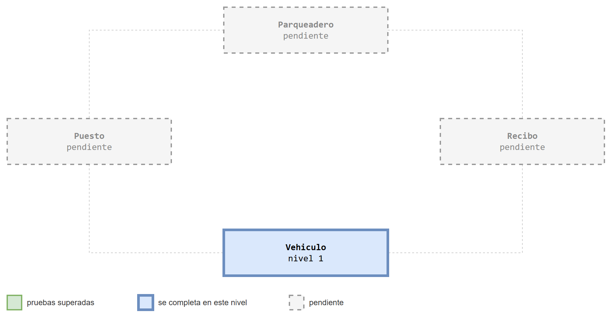

`Vehiculo` no conoce a ninguna otra clase. Por eso es la primera: se completa y se prueba sola.

### Enunciado

> Diseñe una clase llamada `Vehiculo`. La clase contiene:
>
> * Dos constantes, `CARRO` y `MOTO`, con los valores `"carro"` y `"moto"`.
> * Dos atributos privados: `placa` (`str`) y `tipo` (`str`).
> * Un constructor que recibe la placa y el tipo.
> * Métodos para consultar la placa y el tipo.
> * Un método que devuelve el vehículo en texto, por ejemplo `ABC123 (carro)`.

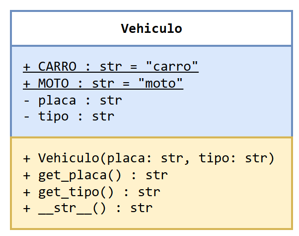

### Qué hay que hacer

Abrir [`codigo/vehiculo.py`](codigo/vehiculo.py) y completar los **4 métodos**. Las constantes ya están escritas.

> [!TIP]
> Un atributo privado se crea en el constructor con `self.` y dos guiones bajos: `self.__placa = placa`. Los demás métodos lo usan con el mismo nombre.

<details>
<summary>Pista adicional</summary>

`__str__` debe **retornar** un texto, no imprimirlo. El texto se arma uniendo partes con `+`: la placa, un espacio y un paréntesis, el tipo y el paréntesis que cierra.

</details>

### Punto de chequeo 1

```
python test_vehiculo.py
```

```
Punto de chequeo 1 superado: la clase Vehiculo pasa todas sus pruebas
```

> **Pregunta para pensar:** la clase no tiene `set_placa` ni `set_tipo`. ¿Qué se gana con que un vehículo no pueda cambiar de placa después de creado?

## Nivel 2 — La clase `Puesto`

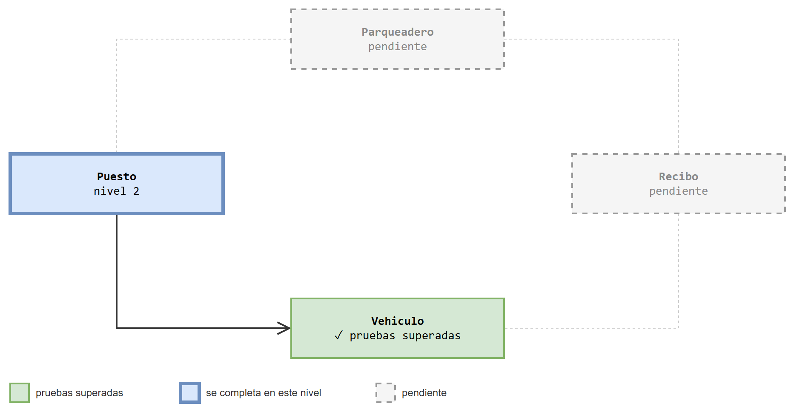

Aquí aparece la primera relación: un puesto **guarda una referencia** a un vehículo que ya existía.

### Enunciado

> Diseñe una clase llamada `Puesto`. La clase contiene:
>
> * Tres atributos privados: `piso` (`int`), `numero` (`int`) y `vehiculo`, que es el objeto `Vehiculo` que ocupa el puesto, o `None` si está libre.
> * Un constructor que recibe el piso y el número, y crea el puesto **libre**.
> * Métodos para consultar el piso, el número y el vehículo.
> * Un método `esta_libre`, que dice si el puesto no tiene vehículo.
> * Un método `ocupar`, que recibe un vehículo. Si el puesto está libre, lo guarda y retorna `True`; si ya está ocupado, no cambia nada y retorna `False`.
> * Un método `liberar`, que deja el puesto libre y retorna el vehículo que lo ocupaba, o `None` si ya estaba libre.
> * Un método que devuelve el puesto en texto, por ejemplo `Piso 1, puesto 3: ABC123 (carro)` o `Piso 1, puesto 3: libre`.

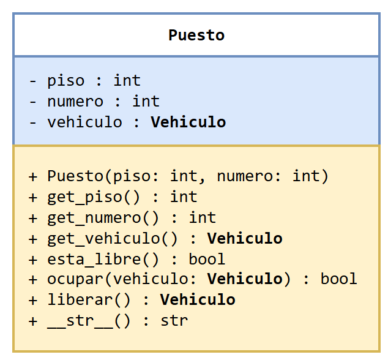

### Las tres preguntas

| Pregunta | Respuesta |
|---|---|
| ¿Quién conoce a quién? | El puesto conoce al vehículo que lo ocupa. El vehículo no sabe en qué puesto está |
| ¿Quién crea el objeto? | **Nadie dentro del puesto**: el vehículo llega ya creado a `ocupar`. Es **asociación** |
| ¿Quién le pide qué a quién? | El puesto le pide al vehículo su texto, para armar el suyo |

### Qué hay que hacer

Abrir [`codigo/puesto.py`](codigo/puesto.py) y completar los **8 métodos**.

> [!TIP]
> `None` es el valor de Python para decir "no hay objeto". Un puesto libre es un puesto cuyo vehículo es `None`. Se compara con `==` y `!=`.

<details>
<summary>Pista adicional para <code>liberar</code></summary>

El método tiene que hacer dos cosas: dejar el atributo en `None` y retornar el vehículo que había. Si primero se pone el atributo en `None`, el vehículo se pierde. Hace falta una variable que lo guarde un momento, como `temp` al intercambiar dos casillas.

</details>

<details>
<summary>Pista adicional para <code>__str__</code></summary>

El piso y el número son enteros: para unirlos a un texto con `+` hay que convertirlos con `str(...)`. Para la última parte, `str(vehiculo)` entrega el texto del vehículo, usando el `__str__` que se completó en el nivel 1.

</details>

### Punto de chequeo 2

```
python test_puesto.py
```

```
Punto de chequeo 2 superado: la clase Puesto pasa todas sus pruebas
```

> **Pregunta para pensar:** la prueba dice `assert puesto.get_vehiculo() is carro`. ¿Qué diferencia hay entre que el puesto guarde **el mismo** objeto y que guarde una copia? Si después de ocupar el puesto alguien cambiara un dato del vehículo, ¿lo vería el puesto?

## Nivel 3 — La clase `Recibo`

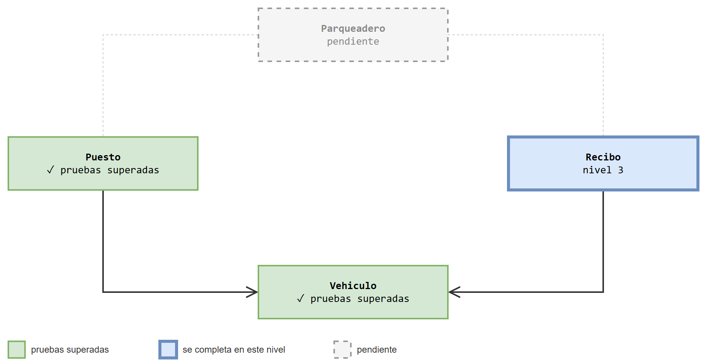

El recibo tiene pocos datos y un cálculo que exige cuidado: las horas que se cobran.

### Enunciado

> Diseñe una clase llamada `Recibo`. La clase contiene:
>
> * Dos constantes, `TARIFA_CARRO` y `TARIFA_MOTO`, con los valores 3000 y 1000: lo que vale una hora.
> * Dos atributos privados: `vehiculo` (un objeto `Vehiculo`) y `minutos` (`int`).
> * Un constructor que recibe el vehículo y los minutos.
> * Métodos para consultar el vehículo y los minutos.
> * Un método `calcular_horas`, que retorna cuántas horas se cobran: por hora o fracción, y como mínimo una.
> * Un método `calcular_valor`, que retorna las horas que se cobran multiplicadas por la tarifa del tipo de vehículo.
> * Un método que devuelve el recibo en texto, por ejemplo `ABC123 (carro) | 130 min | 3 h | $9000`.

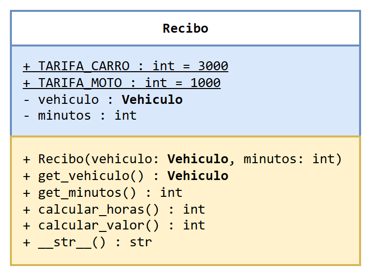

### Las tres preguntas

| Pregunta | Respuesta |
|---|---|
| ¿Quién conoce a quién? | El recibo conoce a su vehículo. El vehículo no sabe que tiene un recibo |
| ¿Quién crea el objeto? | **Nadie dentro del recibo**: el vehículo llega ya creado al constructor. Es **asociación** |
| ¿Quién le pide qué a quién? | El recibo le pide al vehículo su tipo, para saber qué tarifa cobrar, y su texto |

### Qué hay que hacer

Abrir [`codigo/recibo.py`](codigo/recibo.py) y completar los **6 métodos**. Las constantes y el `import` ya están escritos.

> [!TIP]
> Para `calcular_horas` sirven los dos operadores de la división entera: `minutos // 60` dice cuántas horas **completas** hay, y `minutos % 60` dice cuántos minutos **sobran**. Con 130 minutos: `130 // 60` es 2 y `130 % 60` es 10.

<details>
<summary>Pista adicional para <code>calcular_horas</code></summary>

Hay que resolver dos casos después de calcular las horas completas: si sobran minutos, se cobra una hora más; y si el resultado es 0, se cobra 1. Antes de programar, verifique a mano los seis casos de la tabla de [un caso para verificar a mano](#un-caso-para-verificar-a-mano).

</details>

<details>
<summary>Pista adicional para <code>calcular_valor</code></summary>

Las constantes se usan con el nombre de la clase: `Recibo.TARIFA_CARRO`. Para saber cuál tarifa usar, se compara el tipo del vehículo con `Vehiculo.CARRO`. Y para las horas, no se repite el cálculo: se le pide a `self.calcular_horas()`.

</details>

### Punto de chequeo 3

```
python test_recibo.py
```

```
Punto de chequeo 3 superado: la clase Recibo pasa todas sus pruebas
```

> **Pregunta para pensar:** las horas y el valor son métodos y no atributos. ¿Qué problema podría aparecer si el recibo guardara el valor en un atributo, además de los minutos?

## Nivel 4 — `Parqueadero`: la matriz y las consultas

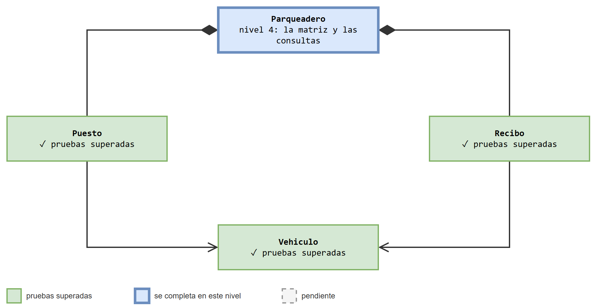

`Parqueadero` es la clase más grande, y se completa en dos niveles. En este se crea la **matriz de puestos** y se escriben los métodos que la consultan.

### Enunciado

> Diseñe una clase llamada `Parqueadero`. La clase contiene:
>
> * Cuatro atributos privados: `pisos` (`int`), `puestos_por_piso` (`int`), `recaudo` (`int`) y `puestos`, una matriz de objetos `Puesto` con una fila por piso y una columna por puesto.
> * Un constructor que recibe la cantidad de pisos y de puestos por piso, y crea el parqueadero con todos sus puestos libres y un recaudo de 0.
> * Métodos para consultar los pisos, los puestos por piso y el recaudo.
> * Un método `get_puesto`, que recibe un piso y un número **contados desde 1** y retorna el objeto `Puesto` que está ahí.
> * Un método `contar_libres`, que retorna cuántos puestos están libres.
>
> *(Los otros cuatro métodos se completan en el nivel 5.)*

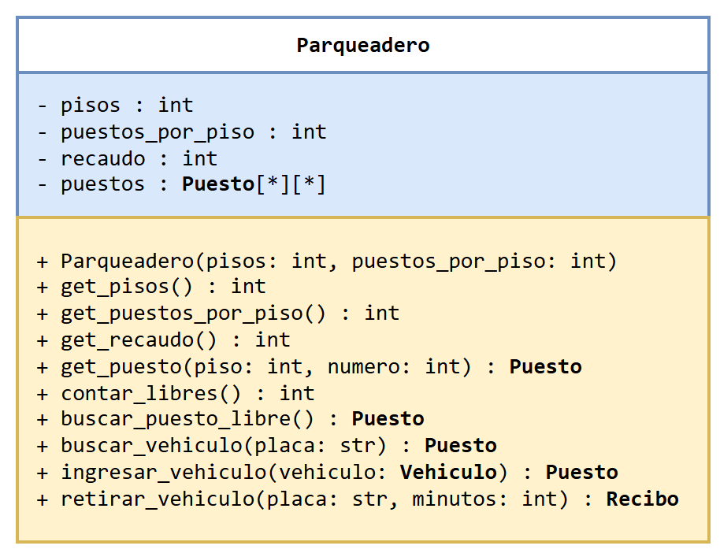

### Las tres preguntas

| Pregunta | Respuesta |
|---|---|
| ¿Quién conoce a quién? | El parqueadero conoce todos sus puestos. Un puesto no sabe a qué parqueadero pertenece |
| ¿Quién crea el objeto? | **El parqueadero**, en su constructor: crea un `Puesto` por cada casilla de la matriz. Es **composición** |
| ¿Quién le pide qué a quién? | En este nivel, el parqueadero le pregunta a cada puesto si está libre |

### Qué hay que hacer

Abrir [`codigo/parqueadero.py`](codigo/parqueadero.py) y completar **6 métodos**: `__init__`, `get_pisos`, `get_puestos_por_piso`, `get_recaudo`, `get_puesto` y `contar_libres`. Los otros cuatro se dejan con su `pass`.

> [!TIP]
> El constructor es el método más importante del laboratorio. Vuelva a leer el repaso de [la matriz de puestos](#la-matriz-de-puestos): la matriz se crea igual que en el ejemplo, pero en cada casilla, en lugar de un `0`, va un objeto `Puesto` nuevo.

> [!WARNING]
> En la fila `i`, columna `j`, va el puesto del piso `i + 1`, número `j + 1`. Y `get_puesto(piso, numero)` hace el camino contrario: entrega la casilla `[piso - 1][numero - 1]`.

<details>
<summary>Pista adicional para el constructor</summary>

Son dos ciclos, uno dentro del otro. El de afuera recorre los pisos y, en cada vuelta, crea la fila de ese piso. El de adentro recorre los puestos de esa fila y, en cada vuelta, guarda en la casilla un `Puesto(...)` con su piso y su número.

Cada vuelta del ciclo de adentro debe crear un `Puesto` **distinto**. Si se crea un solo puesto antes de los ciclos y se guarda en todas las casillas, todas señalan al mismo objeto: al ocupar uno, quedan ocupados todos.

</details>

<details>
<summary>Pista adicional para <code>contar_libres</code></summary>

Es un contador con dos ciclos, como la suma del repaso de matrices. En cada casilla hay un objeto `Puesto`: no se compara con nada, se le **pregunta** con su método `esta_libre()`.

</details>

### Punto de chequeo 4

Este punto de chequeo tiene dos pruebas. La primera revisa la matriz:

```
python test_parqueadero_matriz.py
```

```
Punto de chequeo 4 superado: la matriz y las consultas de Parqueadero pasan sus pruebas
Ahora ejecute: python test_pantalla.py
```

La segunda revisa que `pantalla.py`, que ya viene hecho, pueda dibujar el parqueadero con las clases que se llevan completas:

```
python test_pantalla.py
```

```
Punto de chequeo 4 superado: el parqueadero ya se puede ver en pantalla

         1     2     3     4     5
Piso 2 [   ] [ M ] [   ] [   ] [ C ]
Piso 1 [ C ] [   ] [   ] [ M ] [   ]

C: carro   M: moto   [   ]: libre
Libres: 6 de 10

ABC123  carro  piso 1, puesto 1
XYZ78A  moto  piso 1, puesto 4
QWE12B  moto  piso 2, puesto 2
GHI789  carro  piso 2, puesto 5

--- Recibo ---
Vehículo: ABC123 (carro)
Tiempo: 130 minutos
Horas cobradas: 3
Valor: $9000
```

Es la primera vez que las cuatro clases trabajan juntas. `pantalla.py` no conoce los atributos de ninguna: solo usa sus métodos públicos.

> **Pregunta para pensar:** `test_parqueadero_matriz.py` crea un parqueadero de 4 pisos y 2 puestos por piso, además del de 2 pisos y 5 puestos. ¿Qué error del constructor detecta ese caso, que el otro podría dejar pasar?

## Nivel 5 — `Parqueadero`: buscar, ingresar y retirar


Faltan los cuatro métodos que hacen el trabajo del parqueadero. Los dos primeros **buscan** en la matriz; los otros dos **usan** esas búsquedas.

### Enunciado

> Complete la clase `Parqueadero` con estos métodos:
>
> * `buscar_puesto_libre`, que retorna el **primer** puesto libre, buscando por el piso 1, puesto por puesto, y después por los pisos siguientes. Si el parqueadero está lleno, retorna `None`.
> * `buscar_vehiculo`, que recibe una placa y retorna el puesto ocupado por el vehículo con esa placa, o `None` si no hay ninguno.
> * `ingresar_vehiculo`, que recibe un vehículo ya creado. Si no hay otro con la misma placa y hay un puesto libre, el vehículo ocupa el primer puesto libre y se retorna ese puesto. Si no, retorna `None`.
> * `retirar_vehiculo`, que recibe una placa y los minutos. Si hay un vehículo con esa placa, libera su puesto, crea el recibo, suma su valor al recaudo y retorna el recibo. Si no, retorna `None`.

### Las tres preguntas

| Pregunta | Con `Puesto` | Con `Recibo` |
|---|---|---|
| ¿Quién conoce a quién? | El parqueadero conoce sus puestos | El parqueadero crea el recibo y lo entrega; no lo guarda |
| ¿Quién crea el objeto? | El parqueadero (nivel 4) | **El parqueadero**, dentro de `retirar_vehiculo`. Es **composición** |
| ¿Quién le pide qué a quién? | Si está libre, su vehículo, que se ocupe, que se libere | Su valor, para sumarlo al recaudo |

### Qué hay que hacer

Completar en [`codigo/parqueadero.py`](codigo/parqueadero.py) los **4 métodos** que quedaron con `pass`.

> [!TIP]
> `ingresar_vehiculo` y `retirar_vehiculo` **no recorren la matriz**. Ese trabajo ya lo hacen `buscar_vehiculo` y `buscar_puesto_libre`: basta pedírselo al mismo objeto con `self.`, por ejemplo `self.buscar_puesto_libre()`.

> [!WARNING]
> Los dos métodos de búsqueda pueden retornar `None`. Antes de pedirle algo a lo que retornan, hay que revisar que no sea `None`. Si no, aparece el error `'NoneType' object has no attribute ...`.

Esto es lo que pasa cuando el programa principal ingresa un vehículo:

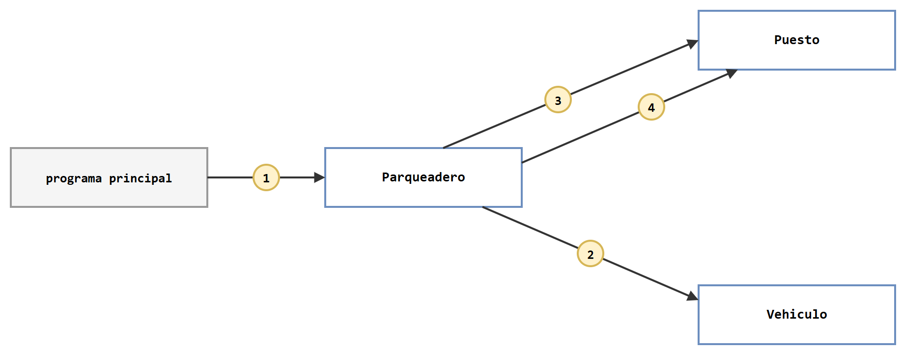

| # | Quién pide | A quién | Qué le pide | Para qué |
|---|---|---|---|---|
| 1 | Programa principal | `Parqueadero` | `ingresar_vehiculo(vehiculo)` | Es lo único que el programa sabe pedir |
| 2 | `Parqueadero` | `Vehiculo` | `get_placa()` | Saber qué placa buscar |
| 3 | `Parqueadero` | cada `Puesto` | `esta_libre()` y `get_vehiculo()` | Revisar que la placa no esté adentro, y hallar el primer puesto libre |
| 4 | `Parqueadero` | el `Puesto` escogido | `ocupar(vehiculo)` | Que el vehículo quede en ese puesto |

Y esto, cuando lo retira:

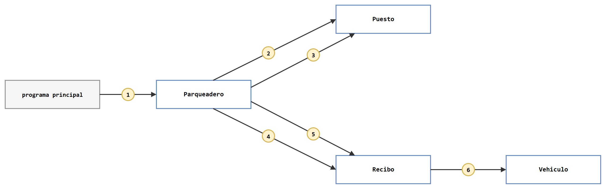

| # | Quién pide | A quién | Qué le pide | Para qué |
|---|---|---|---|---|
| 1 | Programa principal | `Parqueadero` | `retirar_vehiculo(placa, minutos)` | Es lo único que el programa sabe pedir |
| 2 | `Parqueadero` | cada `Puesto` | `esta_libre()` y `get_vehiculo()` | Hallar el puesto donde está esa placa |
| 3 | `Parqueadero` | ese `Puesto` | `liberar()` | Dejar el puesto libre y recibir el vehículo |
| 4 | `Parqueadero` | la clase `Recibo` | `Recibo(vehiculo, minutos)` | Crear el recibo |
| 5 | `Parqueadero` | ese `Recibo` | `calcular_valor()` | Sumar el valor al recaudo |
| 6 | `Recibo` | `Vehiculo` | `get_tipo()` | Saber qué tarifa cobrar |

Ninguna clase hace todo el trabajo. Cada una hace una parte pequeña y le pide el resto a quien sabe hacerlo.

<details>
<summary>Pista adicional para <code>buscar_puesto_libre</code></summary>

Se recorre la matriz con dos ciclos, en el orden que pide el enunciado: primero toda la fila 0, después toda la fila 1. Hace falta una variable que guarde el puesto encontrado y que empiece en `None`.

El cuidado está en quedarse con el **primero**: una vez encontrado un puesto libre, los que aparezcan después no deben reemplazarlo. Una forma es guardar el puesto solo si todavía no se ha encontrado ninguno.

</details>

<details>
<summary>Pista adicional para <code>buscar_vehiculo</code></summary>

En cada casilla hay que hacer dos preguntas, **en este orden**: ¿el puesto está ocupado?, y solo si lo está, ¿la placa de su vehículo es la que se busca? Si se pregunta por la placa de un puesto libre, su vehículo es `None` y aparece un error.

La placa se obtiene con una llamada encadenada: el puesto entrega su vehículo, y el vehículo entrega su placa.

</details>

<details>
<summary>Pista adicional para <code>retirar_vehiculo</code></summary>

El orden importa. Primero se busca el puesto. Si existe, se libera, y `liberar()` entrega el vehículo que estaba ahí: ese vehículo es el que necesita el recibo. Después se crea el recibo y se le pide su valor para sumarlo al recaudo.

</details>

### Punto de chequeo 5

```
python test_parqueadero_operaciones.py
```

```
Punto de chequeo 5 superado: la clase Parqueadero está completa
Ahora ejecute: python main.py
```

Antes de seguir, ejecute otra vez los cinco archivos de pruebas anteriores: completar una clase no debe dañar lo que ya funcionaba.

> **Pregunta para pensar:** después de retirar el vehículo del piso 1, puesto 1, el siguiente que ingresa queda en ese mismo puesto, aunque haya vehículos en los puestos 2 y 3. ¿Qué parte del enunciado obliga a que sea así? ¿Qué pasaría si `buscar_puesto_libre` retornara el **último** puesto libre que encuentra?

## Nivel 6 — El programa completo y el video

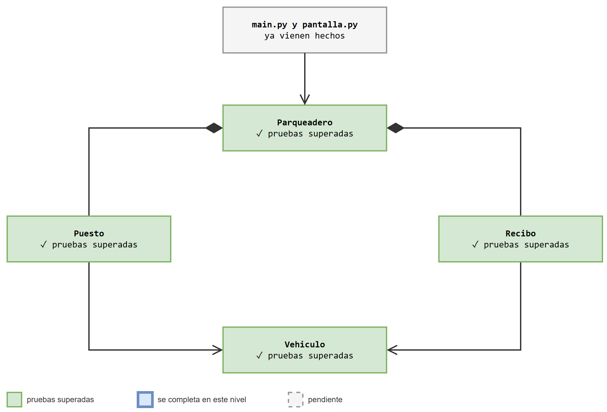

No hay nada que completar. Con las cuatro clases listas, el programa principal ya funciona:

```
python main.py
```

El programa arranca con tres vehículos adentro, para no empezar con el parqueadero vacío. Esta es una sesión real (el menú se muestra solo la primera vez; en el programa aparece antes de cada `Opción:`):

```
===== Parqueadero =====
1. Ingresar vehículo
2. Retirar vehículo
3. Buscar vehículo
4. Ver mapa
5. Ver vehículos
6. Ver recaudo
0. Salir
Opción: 4
         1     2     3     4     5
Piso 2 [   ] [   ] [   ] [   ] [   ]
Piso 1 [ C ] [ M ] [ C ] [   ] [   ]

C: carro   M: moto   [   ]: libre
Libres: 7 de 10

Opción: 1
Placa: JKL012
Tipo (1 carro, 2 moto): 2
Vehículo ingresado. Piso 1, puesto 4: JKL012 (moto)

Opción: 1
Placa: ABC123
Tipo (1 carro, 2 moto): 1
No se pudo ingresar: el parqueadero está lleno
o ya hay un vehículo con esa placa.

Opción: 2
Placa: ABC123
Minutos que estuvo: 130
--- Recibo ---
Vehículo: ABC123 (carro)
Tiempo: 130 minutos
Horas cobradas: 3
Valor: $9000

Opción: 4
         1     2     3     4     5
Piso 2 [   ] [   ] [   ] [   ] [   ]
Piso 1 [   ] [ M ] [ C ] [ M ] [   ]

C: carro   M: moto   [   ]: libre
Libres: 7 de 10

Opción: 5
XYZ78A  moto  piso 1, puesto 2
DEF456  carro  piso 1, puesto 3
JKL012  moto  piso 1, puesto 4

Opción: 6
Recaudo: $9000

Opción: 0
Hasta luego.
```

### Qué hay que hacer

1. Repetir esta sesión y comprobar que el programa responde igual.
2. Probar por cuenta propia: llenar el parqueadero hasta que no quepa nadie, retirar una placa que no existe, buscar un vehículo.
3. Abrir [`codigo/main.py`](codigo/main.py) y [`codigo/pantalla.py`](codigo/pantalla.py) y leerlos. No hay que modificarlos, pero sí entender cómo usan las clases: forman parte de lo que se sustenta.
4. Grabar y publicar el **video** (ver [Entregables](#entregables)).

> **Pregunta para pensar:** `main.py` nunca crea un `Puesto` ni un `Recibo`, y `pantalla.py` no importa ninguno de los otros archivos. ¿Por qué pueden funcionar así? ¿Qué tendría que cambiar en ellos si mañana la matriz de puestos se reemplazara por otra forma de guardarlos?

## Retos opcionales

1. **Recaudo por tipo.** Además del recaudo total, el parqueadero debe saber cuánto ha recaudado por carros y cuánto por motos. ¿Qué atributos y métodos se agregan, y en cuál clase? Agréguelos primero al diagrama UML.
2. **Puestos solo para motos.** El último puesto de cada piso se reserva para motos: un carro no puede ocuparlo. ¿El cambio va en `Puesto`, en `Parqueadero` o en los dos? Escriba primero la prueba.
3. **Ocupación por piso.** Agregue a `Parqueadero` un método `contar_libres_en_piso(piso)` y úselo para mostrar, junto al mapa, cuántos puestos libres tiene cada piso.

## Reflexión final

> ¿En qué nivel le resultó más útil tener las pruebas ya escritas? ¿Hubo algún error que la prueba detectó y que usted no habría notado ejecutando el programa?

> Un compañero propone quitar la clase `Puesto` y guardar los vehículos directamente en la matriz, con `None` en los puestos libres. ¿Qué se simplificaría y qué se perdería?

**Idea central del laboratorio:** un programa con varias clases se construye de a una, empezando por la que no depende de ninguna otra. Cada clase hace una parte pequeña del trabajo y le pide el resto a las demás a través de sus métodos. Las pruebas confirman, en cada paso, que lo construido cumple lo que su documentación promete.

## Recursos

* [Clase 13 — Programación orientada a objetos](../../clases/13/README.md).
* Notebook [De una clase a varias: una aplicación de transporte](../../clases/13/sesion_magistral-32/notebooks/aplicacion_transporte.ipynb): el mismo camino de este laboratorio, con otro problema.
* Notebooks [Administración de un curso con objetos](../../clases/13/teoria/app_curso/notebooks/curso_poo.ipynb) y [Piedra, papel o tijera con objetos](../../clases/13/teoria/app_piedra-papel-tijera/notebooks/juego_poo.ipynb).
* [Documentación oficial de Python en español: Clases](https://docs.python.org/es/3/tutorial/classes.html).
* [Python Tutor](https://pythontutor.com/): para ver los objetos y las referencias entre ellos. No sirve para ejecutar el programa completo, porque no puede importar archivos propios, pero sí para probar una clase sola.

> [!IMPORTANT]
> ### Nota de transparencia sobre uso de IA
>
> Se usó IA generativa para preparar este laboratorio (el enunciado, el código, las pruebas, los diagramas y esta guía) a partir de las indicaciones del docente. El docente revisa y valida la versión final antes de asignarlo.
