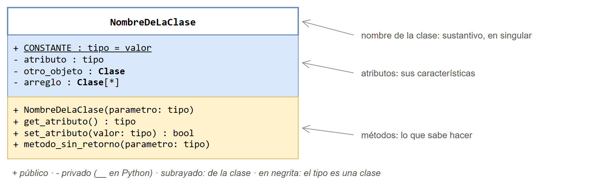
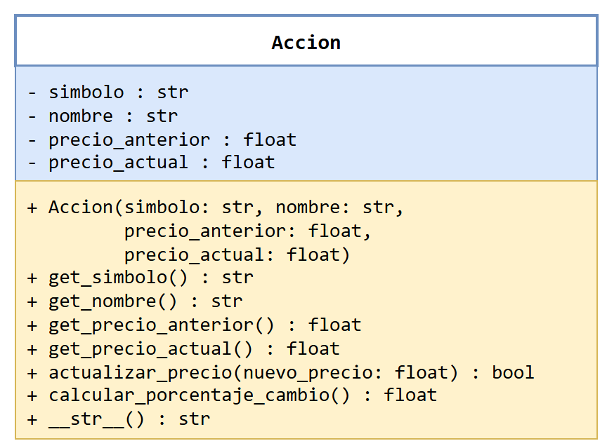
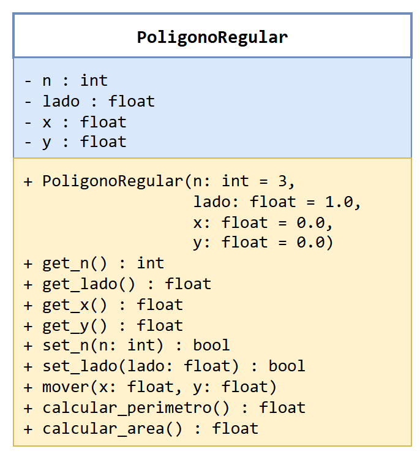
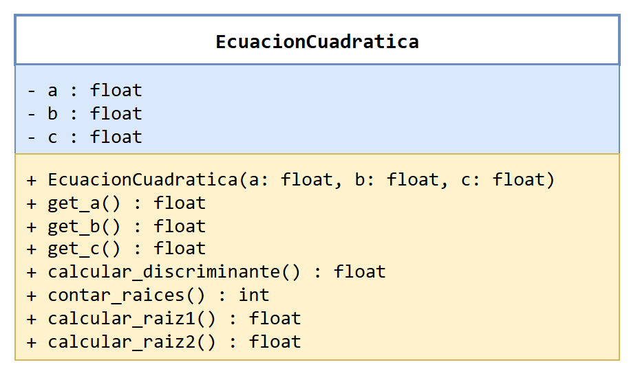
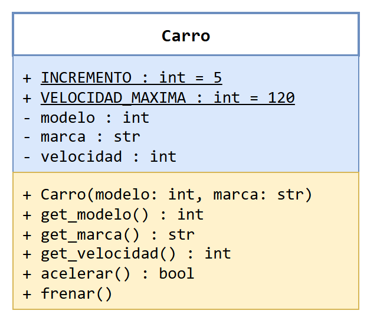
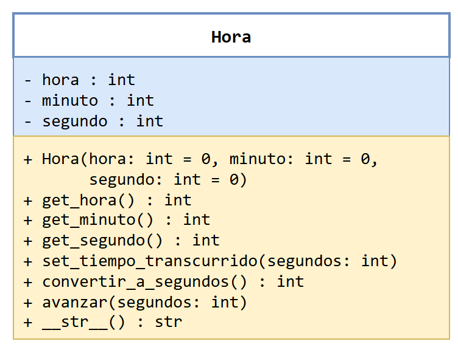
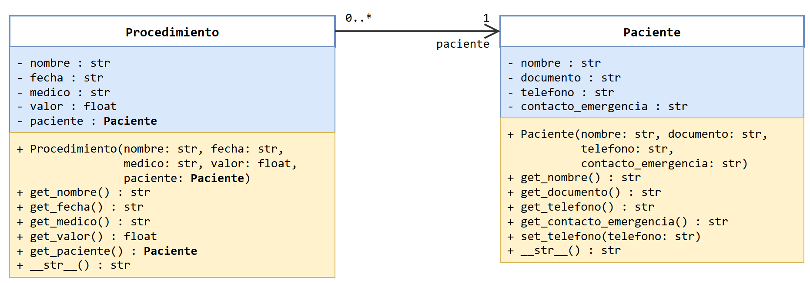
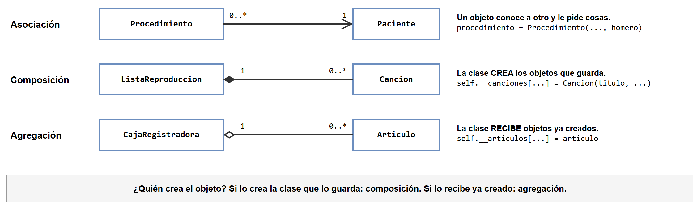

# Taller 5 — Programación orientada a objetos

Este taller sirve de repaso del tema de **programación orientada a objetos** de la [clase 13](../../clases/13/README.md). Cubre:

* Clase y objeto, y el paso del diagrama UML a Python.
* Encapsulamiento: atributos privados con `__`, *getters* y *setters* que validan.
* Constantes de clase, valores por defecto y `__str__`.
* Métodos que usan otros métodos.
* Alias entre objetos.
* Las relaciones entre clases (asociación, composición y agregación).
* Arreglos de objetos con cupo.

La herencia y el polimorfismo no hacen parte del curso.

> [!NOTE]
> **Autoría y fuentes:** varios ejercicios son adaptaciones de los capítulos de clases y objetos de dos libros de la bibliografía del curso:
>
> * **Y. Daniel Liang**, *Introduction to Programming Using Python* (Pearson, 2013), capítulo 7.
> * **Tony Gaddis**, *Starting Out with Python* (6a ed., Pearson, 2023), capítulo 10.
>
> Los enunciados pertenecen a sus autores. Aquí se tradujeron y se adaptaron a la notación UML y a las convenciones de Python vistas en clase: nombres en español, atributos privados, *setters* que validan y retornan `bool`, y arreglos con cupo en lugar de listas que crecen. También se agregaron casos de prueba y preguntas. Los demás ejercicios se escribieron para este taller. La tabla [Fuentes de los ejercicios](#fuentes-de-los-ejercicios) indica el origen de cada uno.

> [!NOTE]
> **Convenciones de la clase 13.**
>
> * **En UML:** `- atributo : tipo` y `+ metodo(parametro: tipo) : tipo_de_retorno`.
>   * El constructor lleva el nombre de la clase y no tiene tipo de retorno.
>   * Un método que no retorna nada **omite** el tipo (en Python retorna `None`).
>   * Las constantes de clase van subrayadas.
>   * Un tipo que es una clase va en negrita (**Paciente**).
>   * Un arreglo se escribe `Clase[*]`.
> * **En Python:**
>   * Los atributos privados empiezan con `__`.
>   * Los *setters* que validan retornan `True` o `False`.
>   * Los constructores no validan.
>   * `__str__` retorna el texto con el que se muestra el objeto.
>   * Un arreglo de objetos se crea con `[None] * cupo` y se recorre hasta `cantidad`, sin `append`.
>   * No se usan excepciones.

## Cómo trabajar cada problema

1. **Entender:** lea el enunciado y subraye los **sustantivos**, que son candidatos a clases o atributos, y los **verbos**, que son candidatos a métodos. Pregúntese qué características tiene cada objeto (**atributos**) y qué sabe hacer (**métodos**).
2. **Diseñar el UML:** dibuje cada clase con sus tres compartimentos. Si hay varias clases, responda las tres preguntas de la clase 13:
   * ¿Quién conoce a quién?
   * ¿Quién crea el objeto?
   * ¿Quién le pide qué a quién?

   Con las respuestas, decida el tipo de relación (ver el [anexo A.4](#a4-las-tres-relaciones)).
3. **Probar antes de integrar:** convierta la tabla de casos de prueba en instrucciones `assert`. Pruebe casos **típicos**, **límite** (el cupo justo, el valor mínimo) y **especiales** (un dato inválido, un objeto que no está).
4. **Implementar y verificar:** escriba la clase hasta que pasen todas las pruebas. Después escriba el programa principal, que crea los objetos y les pide cosas.

Si lo resuelve en el computador, organícelo en tres archivos, como en el [laboratorio 4](../../laboratorios/4/README.md) y en las [aplicaciones de la clase 13](../../clases/13/teoria/app_curso/README.md):

* un módulo con la clase o las clases;
* `test_<módulo>.py` con los `assert`;
* `main.py` con `def main()` y la guarda `if __name__ == "__main__":`.

Para dibujar a mano, use esta plantilla:



---

## 1. Preguntas de repaso

Responda con sus palabras y, cuando pueda, con un ejemplo de código.

**1.1** ¿Qué diferencia hay entre una **clase** y un **objeto**? ¿Cuántos objetos se pueden crear a partir de una clase?

**1.2** Todo objeto tiene **estado**, **comportamiento** e **identidad**. Explique cada término con un objeto de la clase `CuentaBancaria` de la clase 13.

**1.3** ¿Qué es `self`? ¿Por qué todos los métodos lo reciben como primer parámetro, si al invocarlos no se escribe?

**1.4** ¿Para qué sirve el método `__init__`? ¿Cuándo se ejecuta? ¿Qué pasa si una clase tiene dos métodos `__init__`?

**1.5** ¿Qué es el **encapsulamiento**? ¿Por qué los atributos se declaran privados y se ofrecen métodos para consultarlos y cambiarlos?

**1.6** En Python, ¿un atributo que empieza con `__` es imposible de cambiar desde fuera de la clase? Explique qué hace Python con ese nombre.

**1.7** El método `set_nota` de la clase `Estudiante` retorna `True` o `False`, pero `set_nombre` no retorna nada. ¿Por qué? ¿Cómo se escribe cada uno en UML?

**1.8** ¿Qué diferencia hay entre una **constante de clase** (como `Ventilador.RAPIDO`) y un atributo de cada objeto? ¿Cómo se distinguen en UML?

**1.9** ¿Para qué sirve el método `__str__`? ¿Qué muestra `print(objeto)` si la clase no lo tiene?

**1.10** Clasifique cada relación como **asociación**, **composición** o **agregación**, y diga **quién crea** el objeto:

* a. Un `Banco` abre una cuenta con `abrir_cuenta(titular, saldo)` y la guarda en su arreglo.
* b. Un `Curso` recibe un `Estudiante` ya creado con `agregar_estudiante(estudiante)`.
* c. Una `CuentaBancaria` guarda el `Titular` que recibe en su constructor.
* d. Una `Sala` de cine crea todas sus sillas en el constructor.
* e. Un `Parqueadero` crea un `Recibo` cada vez que sale un vehículo.

---

## 2. Prueba de escritorio y predicción de la salida

Prediga la salida de cada código **a mano, sin la ayuda del computador**. Cuando haya varios objetos, dibuje un **diagrama de memoria**:

* una caja por cada objeto, con sus atributos;
* una flecha desde cada variable hasta el objeto al que se refiere.

Dos variables que apuntan a la misma caja son **alias**. Al terminar, compruebe su respuesta ejecutando el código o simulándolo en [Python Tutor](https://pythontutor.com/), que dibuja esas mismas cajas y flechas.

**Código 2.1.** Dos objetos de la misma clase.

```python
class Contador:
    def __init__(self, inicio=0):
        self.__valor = inicio

    def incrementar(self):
        self.__valor = self.__valor + 1

    def get_valor(self):
        return self.__valor


a = Contador()
b = Contador(10)
a.incrementar()
a.incrementar()
b.incrementar()
print(a.get_valor(), b.get_valor())
```

**Código 2.2.** Alias y comparación.

```python
class Cuenta:
    def __init__(self, titular, saldo=0.0):
        self.__titular = titular
        self.__saldo = saldo

    def depositar(self, valor):
        self.__saldo = self.__saldo + valor

    def get_saldo(self):
        return self.__saldo


c1 = Cuenta("Lisa", 100.0)
c2 = c1
c3 = Cuenta("Lisa", 100.0)
c2.depositar(50.0)
print(c1.get_saldo(), c2.get_saldo(), c3.get_saldo())
print(c1 is c2, c1 is c3, c1 == c3)
```

> **Pregunta para pensar:** `c1` y `c3` tienen el mismo titular y el mismo saldo. ¿Por qué `c1 == c3` no da `True`?

**Código 2.3.** Un método que usa otro método.

```python
class Cuenta:
    def __init__(self, titular, saldo=0.0):
        self.__titular = titular
        self.__saldo = saldo

    def get_saldo(self):
        return self.__saldo

    def depositar(self, valor):
        self.__saldo = self.__saldo + valor

    def retirar(self, valor):
        retirado = False
        if valor <= self.__saldo:
            self.__saldo = self.__saldo - valor
            retirado = True
        return retirado

    def transferir(self, destino, valor):
        transferido = False
        if self.retirar(valor):
            destino.depositar(valor)
            transferido = True
        return transferido


homero = Cuenta("Homero", 300.0)
marge = Cuenta("Marge", 500.0)
print(homero.transferir(marge, 200.0))
print(homero.transferir(marge, 200.0))
print(marge.transferir(homero, 700.0))
print(homero.get_saldo(), marge.get_saldo())
```

**Código 2.4.** Constantes de clase, valores por defecto y un *setter* que valida.

```python
class Lampara:
    APAGADA = 0
    BAJA = 1
    ALTA = 2

    def __init__(self, color="blanca", nivel=0):
        self.__color = color
        self.__nivel = nivel

    def set_nivel(self, nivel):
        cambiado = False
        if nivel >= Lampara.APAGADA and nivel <= Lampara.ALTA:
            self.__nivel = nivel
            cambiado = True
        return cambiado

    def subir(self):
        self.set_nivel(self.__nivel + 1)

    def __str__(self):
        return "Lampara " + self.__color + ", nivel " + str(self.__nivel)


l1 = Lampara()
l2 = Lampara("roja", Lampara.ALTA)
print(l1.set_nivel(5))
l1.subir()
l1.subir()
l1.subir()
l2.subir()
print(l1)
print(l2)
print(l2.subir())
```

> **Pregunta para pensar:** ¿por qué la última línea muestra lo que muestra? Dibuje el UML de `Lampara`: ¿qué tipo de retorno lleva `subir`?

**Código 2.5.** Un objeto que se pasa a una función.

```python
class Punto:
    def __init__(self, x=0.0, y=0.0):
        self.__x = x
        self.__y = y

    def mover(self, dx, dy):
        self.__x = self.__x + dx
        self.__y = self.__y + dy

    def __str__(self):
        return "(" + str(self.__x) + ", " + str(self.__y) + ")"


def desplazar(punto):
    punto.mover(1.0, 1.0)


def reemplazar(punto):
    punto = Punto(9.0, 9.0)
    punto.mover(1.0, 1.0)


p = Punto(2.0, 3.0)
desplazar(p)
print(p)
reemplazar(p)
print(p)
```

> [!Tip]
> **Pista:** el parámetro `punto` es otra flecha hacia el mismo objeto que `p`. ¿Qué pasa cuando se usa esa flecha para pedirle algo al objeto? ¿Y qué pasa cuando se le asigna otro objeto a `punto`?

**Código 2.6.** Un arreglo de objetos con cupo.

```python
class Estudiante:
    def __init__(self, nombre, nota):
        self.__nombre = nombre
        self.__nota = nota

    def get_nombre(self):
        return self.__nombre

    def get_nota(self):
        return self.__nota


def intercambiar(lista, i, j):
    temp = lista[i]
    lista[i] = lista[j]
    lista[j] = temp


cupo = 5
grupo = [None] * cupo
grupo[0] = Estudiante("Ana", 3.0)
grupo[1] = Estudiante("Beto", 4.5)
grupo[2] = Estudiante("Carla", 2.0)
cantidad = 3

pos_mayor = 0
for i in range(1, cantidad):
    if grupo[i].get_nota() > grupo[pos_mayor].get_nota():
        pos_mayor = i
intercambiar(grupo, 0, pos_mayor)

for i in range(cantidad):
    print(i, grupo[i].get_nombre(), grupo[i].get_nota())
print(grupo[3])
```

> **Pregunta para pensar:** ¿cuántas veces se llama a `intercambiar` para mover al estudiante completo? Compárelo con los tres arreglos paralelos `ids`, `nombres` y `notas` de la clase 12.

**Código 2.7.** El mismo objeto en dos arreglos.

```python
class Jugador:
    def __init__(self, nombre):
        self.__nombre = nombre
        self.__puntos = 0

    def sumar_punto(self):
        self.__puntos = self.__puntos + 1

    def get_puntos(self):
        return self.__puntos

    def __str__(self):
        return self.__nombre + ": " + str(self.__puntos)


class Equipo:
    def __init__(self, nombre, cupo):
        self.__nombre = nombre
        self.__jugadores = [None] * cupo
        self.__cantidad = 0

    def agregar_jugador(self, jugador):
        agregado = False
        if self.__cantidad < len(self.__jugadores):
            self.__jugadores[self.__cantidad] = jugador
            self.__cantidad = self.__cantidad + 1
            agregado = True
        return agregado

    def calcular_puntos(self):
        total = 0
        for i in range(self.__cantidad):
            total = total + self.__jugadores[i].get_puntos()
        return total


bart = Jugador("Bart")
milhouse = Jugador("Milhouse")
rojo = Equipo("Rojo", 2)
azul = Equipo("Azul", 2)
print(rojo.agregar_jugador(bart))
print(rojo.agregar_jugador(milhouse))
print(rojo.agregar_jugador(Jugador("Nelson")))
print(azul.agregar_jugador(bart))
bart.sumar_punto()
bart.sumar_punto()
milhouse.sumar_punto()
print(rojo.calcular_puntos(), azul.calcular_puntos())
print(bart)
```

> **Pregunta para pensar:** ¿la relación entre `Equipo` y `Jugador` es de composición o de agregación? ¿Qué parte del código lo muestra? ¿Sería posible que `bart` quedara en dos equipos si fuera composición?

---

## 3. De UML a código

Cada problema trae el diagrama UML de una clase. Impleméntela **tal como está en el diagrama**: mismos nombres, misma visibilidad, mismos parámetros y mismos tipos de retorno. El diagrama no dice **qué hace** cada método. Eso lo dice el texto, y conviene escribirlo en el *docstring* de cada método, con *Supone* y *Garantiza* si hace falta.

En cada problema:

1. Escriba la clase.
2. Convierta la tabla de casos de prueba en `assert`.
3. Escriba el programa principal que se pide.

**3.1 Acciones de la bolsa.** La clase `Accion` representa la acción de una empresa en la bolsa de valores.



* `actualizar_precio(nuevo_precio)`: si el nuevo precio es mayor que cero, el precio actual pasa a ser el precio anterior, el nuevo precio queda como precio actual y retorna `True`. Si no, no cambia nada y retorna `False`.
* `calcular_porcentaje_cambio()` retorna cuánto cambió el precio, en porcentaje, desde el precio anterior hasta el actual:

$$
\text{cambio} = \frac{\text{actual} - \text{anterior}}{\text{anterior}} \times 100
$$

* `__str__()` retorna el símbolo, el nombre entre paréntesis y el precio actual, por ejemplo `"INTC (Intel Corporation): 21.0"`.

Escriba un programa principal que cree la acción con símbolo `INTC`, nombre `Intel Corporation`, precio anterior 20.5 y precio actual 20.35, y que muestre el porcentaje de cambio con dos decimales.

| Instrucciones | Resultado esperado |
|---|---|
| `a = Accion("INTC", "Intel Corporation", 20.5, 20.35)` y `round(a.calcular_porcentaje_cambio(), 2)` | `-0.73` |
| `a.actualizar_precio(21.0)` | `True`; el precio anterior queda en `20.35` y el actual en `21.0` |
| Después, `round(a.calcular_porcentaje_cambio(), 2)` | `3.19` |
| `a.actualizar_precio(-5.0)` | `False`; los precios no cambian |
| `a.actualizar_precio(0.0)` | `False` |
| `str(a)` | `"INTC (Intel Corporation): 21.0"` |
| Una acción con precio anterior y actual de 10.0 | El cambio es `0.0` |

> **Pregunta para pensar:** el constructor no valida los precios. ¿Qué pasa con `calcular_porcentaje_cambio()` si el precio anterior es `0.0`? ¿Qué debería decir el *Supone* de ese método?

**3.2 Polígono regular.** Un polígono regular tiene sus `n` lados de la misma longitud y todos sus ángulos iguales. La clase `PoligonoRegular` guarda el número de lados, la longitud del lado y las coordenadas `(x, y)` de su centro.



* `set_n(n)` solo acepta `n >= 3` y `set_lado(lado)` solo acepta `lado > 0`. Si el valor no es válido, no cambian nada y retornan `False`.
* `mover(x, y)` cambia el centro y no valida.
* `calcular_perimetro()` retorna $n \cdot s$, donde $s$ es la longitud del lado.
* `calcular_area()` retorna:

$$
\text{área} = \frac{n \cdot s^2}{4 \cdot \tan\left(\frac{\pi}{n}\right)}
$$

Escriba un programa principal que cree tres polígonos, `PoligonoRegular()`, `PoligonoRegular(6, 4.0)` y `PoligonoRegular(10, 4.0, 5.6, 7.8)`, y muestre el perímetro y el área de cada uno con dos decimales.

| Polígono | Perímetro | Área (2 decimales) |
|---|---|---|
| `PoligonoRegular()` | `3.0` | `0.43` |
| `PoligonoRegular(6, 4.0)` | `24.0` | `41.57` |
| `PoligonoRegular(10, 4.0, 5.6, 7.8)` | `40.0` | `123.11` |

| Instrucciones sobre `p = PoligonoRegular()` | Resultado esperado |
|---|---|
| `p.set_n(2)` | `False`; `p.get_n()` sigue en `3` |
| `p.set_lado(0)` | `False`; `p.get_lado()` sigue en `1.0` |
| `p.set_n(4)` y `p.set_lado(2.0)` | `True` y `True`; el área es `4.0` (un cuadrado de lado 2) |
| `p.mover(1.0, -2.0)` | `p.get_x()` es `1.0` y `p.get_y()` es `-2.0` |

> [!Tip]
> **Pista:** use `math.tan` y `math.pi`. La tangente de `math` recibe el ángulo en **radianes**, y $\frac{\pi}{n}$ ya está en radianes. Para comparar reales en las pruebas, redondee: `assert round(p.calcular_area(), 2) == 41.57`.

**3.3 Ecuación cuadrática.** La clase `EcuacionCuadratica` representa la ecuación $ax^2 + bx + c = 0$.



* `calcular_discriminante()` retorna $b^2 - 4ac$.
* `contar_raices()` retorna 2 si el discriminante es positivo, 1 si es cero y 0 si es negativo.
* `calcular_raiz1()` y `calcular_raiz2()` retornan las raíces:

$$
r_1 = \frac{-b + \sqrt{b^2 - 4ac}}{2a} \qquad r_2 = \frac{-b - \sqrt{b^2 - 4ac}}{2a}
$$

* Si el discriminante es negativo, las dos raíces retornan `0.0`.
* La clase **supone** que `a` no es cero.

Escriba un programa principal que lea `a`, `b` y `c`, y que según la cantidad de raíces muestre las dos raíces, la única raíz o el mensaje `La ecuación no tiene raíces reales`.

| `a`, `b`, `c` | Discriminante | `contar_raices()` | `calcular_raiz1()` | `calcular_raiz2()` |
|---|---|---|---|---|
| 1.0, -3.0, 2.0 | `1.0` | `2` | `2.0` | `1.0` |
| 2.0, 3.0, 1.0 | `1.0` | `2` | `-0.5` | `-1.0` |
| 1.0, 2.0, 1.0 | `0.0` | `1` | `-1.0` | `-1.0` |
| 1.0, 2.0, 3.0 | `-8.0` | `0` | `0.0` | `0.0` |

> [!Tip]
> **Pista:** `contar_raices`, `calcular_raiz1` y `calcular_raiz2` necesitan el discriminante. No repita la fórmula: llame a `self.calcular_discriminante()`.

> **Pregunta para pensar:** ¿qué pasa si se crea `EcuacionCuadratica(0.0, 2.0, 1.0)` y se pide la raíz? ¿Dónde se debe evitar ese caso: en la clase o en el programa principal?

**3.4 Carro.** La clase `Carro` guarda el modelo (año), la marca y la velocidad actual. Un carro nuevo empieza con velocidad 0.



* `acelerar()` suma `INCREMENTO` a la velocidad y retorna `True`. Si al sumar se pasara de `VELOCIDAD_MAXIMA`, no cambia nada y retorna `False`.
* `frenar()` resta `INCREMENTO` a la velocidad, pero la velocidad nunca queda negativa: si es menor que `INCREMENTO`, queda en 0.

Escriba un programa principal que cree un carro, lo acelere cinco veces mostrando la velocidad después de cada aceleración y luego lo frene cinco veces mostrando la velocidad después de cada frenada.

| Instrucciones | Resultado esperado |
|---|---|
| `Carro(2020, "Renault")` | Velocidad `0` |
| Acelerar cinco veces | Velocidades `5 10 15 20 25` |
| Después, frenar cinco veces | Velocidades `20 15 10 5 0` |
| Frenar otra vez | La velocidad sigue en `0` |
| Acelerar 24 veces desde 0 | Las 24 llamadas retornan `True`; la velocidad queda en `120` |
| Acelerar una vez más | `False`; la velocidad sigue en `120` |

> **Pregunta para pensar:** ¿por qué la condición usa `Carro.VELOCIDAD_MAXIMA` y no el número `120`? ¿Qué habría que cambiar si el máximo fuera 100?

**3.5 Hora del día.** La clase `Hora` representa una hora del día (de `00:00:00` a `23:59:59`).



* `set_tiempo_transcurrido(segundos)` recibe una cantidad de segundos contados desde la medianoche y calcula la hora, el minuto y el segundo correspondientes. Si pasan más de 24 horas, la hora vuelve a empezar desde 0. Por ejemplo, 555550 segundos son 6 días, 10 horas, 19 minutos y 10 segundos: la hora queda `10:19:10`.
* `convertir_a_segundos()` hace lo contrario: retorna cuántos segundos han pasado desde la medianoche.
* `avanzar(segundos)` suma segundos a la hora. Resuélvalo con los dos métodos anteriores.
* `__str__()` retorna la hora con dos dígitos en cada parte, por ejemplo `"07:05:09"`.

| Instrucciones | Resultado esperado |
|---|---|
| `str(Hora())` | `"00:00:00"` |
| `str(Hora(7, 5, 9))` | `"07:05:09"` |
| `h = Hora()` y `h.set_tiempo_transcurrido(3725)` | `str(h)` es `"01:02:05"` |
| `h.set_tiempo_transcurrido(555550)` | `str(h)` es `"10:19:10"` |
| `Hora(23, 59, 30).convertir_a_segundos()` | `86370` |
| `h = Hora(23, 59, 30)` y `h.avanzar(45)` | `str(h)` es `"00:00:15"` |
| `h = Hora(7, 5, 9)` y `h.avanzar(3600)` | `h.get_hora()` es `8` |

> [!Tip]
> **Pista:** use `//` para saber cuántos minutos u horas completos hay, y `%` para lo que sobra. Por ejemplo, `3725 % 60` es `5` segundos y `3725 // 60` es `62` minutos. Para mostrar un entero con dos dígitos, use `f"{numero:02d}"`: con `numero = 7` produce `"07"`.

**3.6 Procedimientos de un paciente.** Una clínica registra los procedimientos médicos que se le hacen a cada paciente. Cada procedimiento conoce al paciente al que se le hizo.



* `__str__()` de `Paciente` retorna el nombre y el documento entre paréntesis: `"Homero Simpson (1001)"`.
* `__str__()` de `Procedimiento` retorna la fecha, el nombre, el médico y el valor: `"27/11/2026 Examen físico - Dr. Hibbert: $250.0"`.

Escriba un programa principal que:

1. Cree un paciente: Homero Simpson, documento `"1001"`, teléfono `"555-7334"`, contacto de emergencia Marge Simpson.
2. Guarde en un arreglo de tamaño 3 los procedimientos de la tabla.
3. Muestre cada procedimiento y el valor total.

| Procedimiento | Fecha | Médico | Valor |
|---|---|---|---|
| Examen físico | 27/11/2026 | Dr. Hibbert | 250.0 |
| Rayos X | 27/11/2026 | Dra. Rivera | 500.0 |
| Examen de sangre | 27/11/2026 | Dr. Hibbert | 200.0 |

El total es `950.0`.

Responda:

* a. ¿Qué tipo de relación hay entre `Procedimiento` y `Paciente`? ¿Qué significan el `0..*` y el `1` del diagrama?
* b. Si después de crear los procedimientos se ejecuta `homero.set_telefono("555-0000")`, ¿qué retorna `procedimientos[2].get_paciente().get_telefono()`? ¿Por qué?
* c. ¿Cuántos objetos `Paciente` hay en memoria al final del programa?

---

## 4. De código a UML

Cada problema trae el código de una o dos clases que **funciona**. Dibuje a mano el diagrama UML de las clases, con la plantilla de la sección [Cómo trabajar cada problema](#cómo-trabajar-cada-problema). El diagrama debe tener:

* el nombre de la clase;
* los atributos con su visibilidad y su tipo, que se deduce de cómo se usan;
* las constantes de clase subrayadas;
* el constructor y los métodos con sus parámetros, sus tipos y su tipo de retorno (omitido si el método no retorna nada);
* si hay dos clases, la relación entre ellas, con su multiplicidad y el nombre del atributo que la implementa.

Después responda las preguntas.

**4.1 Mascota.**

```python
class Mascota:
    def __init__(self, nombre, tipo, edad=0):
        self.__nombre = nombre
        self.__tipo = tipo
        self.__edad = edad

    def get_nombre(self):
        return self.__nombre

    def get_tipo(self):
        return self.__tipo

    def get_edad(self):
        return self.__edad

    def set_nombre(self, nombre):
        self.__nombre = nombre

    def set_edad(self, edad):
        cambiada = False
        if edad >= 0:
            self.__edad = edad
            cambiada = True
        return cambiada

    def cumplir_anios(self):
        self.__edad = self.__edad + 1

    def es_cachorro(self):
        return self.__edad < 1

    def __str__(self):
        return self.__nombre + " (" + self.__tipo + ", " + str(self.__edad) + " años)"


ayudante = Mascota("Ayudante de Santa", "perro", 3)
bola = Mascota("Bola de Nieve", "gato")
```

* a. ¿Qué tipo retorna `es_cachorro`? ¿Y `cumplir_anios`?
* b. ¿Por qué `set_edad` retorna un valor y `set_nombre` no?
* c. ¿Cómo se representa en UML el valor por defecto de `edad`?
* d. Escriba tres `assert` que prueben `set_edad`: un valor válido, el límite `0` y un valor inválido.

**4.2 Caja registradora.**

```python
class Articulo:
    def __init__(self, descripcion, unidades, precio):
        self.__descripcion = descripcion
        self.__unidades = unidades
        self.__precio = precio

    def get_descripcion(self):
        return self.__descripcion

    def get_unidades(self):
        return self.__unidades

    def get_precio(self):
        return self.__precio

    def set_precio(self, precio):
        self.__precio = precio

    def vender_unidad(self):
        vendida = False
        if self.__unidades > 0:
            self.__unidades = self.__unidades - 1
            vendida = True
        return vendida


class CajaRegistradora:
    def __init__(self, cupo):
        self.__articulos = [None] * cupo
        self.__cantidad = 0

    def get_cantidad(self):
        return self.__cantidad

    def registrar(self, articulo):
        registrado = False
        if self.__cantidad < len(self.__articulos) and articulo.vender_unidad():
            self.__articulos[self.__cantidad] = articulo
            self.__cantidad = self.__cantidad + 1
            registrado = True
        return registrado

    def calcular_total(self):
        total = 0.0
        for i in range(self.__cantidad):
            total = total + self.__articulos[i].get_precio()
        return total

    def mostrar_articulos(self):
        for i in range(self.__cantidad):
            print(self.__articulos[i].get_descripcion(), self.__articulos[i].get_precio())

    def vaciar(self):
        self.__cantidad = 0


chaqueta = Articulo("Chaqueta", 12, 59.95)
jean = Articulo("Jean", 40, 34.95)
camisa = Articulo("Camisa", 20, 24.95)

caja = CajaRegistradora(10)
caja.registrar(chaqueta)
caja.registrar(jean)
caja.registrar(camisa)
caja.mostrar_articulos()
print(f"Total: {caja.calcular_total():.2f}")
print(chaqueta.get_unidades())
```

* a. ¿Qué tipo de relación hay entre `CajaRegistradora` y `Articulo`? ¿Qué línea del código lo muestra?
* b. Prediga la salida del programa.
* c. Si al final se agregan las líneas `camisa.set_precio(20.0)` y `print(f"Total: {caja.calcular_total():.2f}")`, ¿qué total se muestra? ¿Por qué cambia, si la caja no se volvió a tocar?
* d. `vaciar` no borra los artículos del arreglo, solo pone `cantidad` en 0. ¿Por qué es suficiente?
* e. ¿Qué pasa si se registra un artículo que tiene 0 unidades?

**4.3 Lista de reproducción.**

```python
class Cancion:
    def __init__(self, titulo, artista, duracion):
        self.__titulo = titulo
        self.__artista = artista
        self.__duracion = duracion

    def get_titulo(self):
        return self.__titulo

    def get_artista(self):
        return self.__artista

    def get_duracion(self):
        return self.__duracion

    def __str__(self):
        minutos = self.__duracion // 60
        segundos = self.__duracion % 60
        return f"{self.__titulo} - {self.__artista} ({minutos}:{segundos:02d})"


class ListaReproduccion:
    def __init__(self, nombre, cupo):
        self.__nombre = nombre
        self.__canciones = [None] * cupo
        self.__cantidad = 0

    def get_nombre(self):
        return self.__nombre

    def get_cantidad(self):
        return self.__cantidad

    def get_cancion(self, posicion):
        return self.__canciones[posicion]

    def agregar_cancion(self, titulo, artista, duracion):
        agregada = False
        if self.__cantidad < len(self.__canciones):
            self.__canciones[self.__cantidad] = Cancion(titulo, artista, duracion)
            self.__cantidad = self.__cantidad + 1
            agregada = True
        return agregada

    def buscar_titulo(self, titulo):
        encontrada = None
        for i in range(self.__cantidad):
            if self.__canciones[i].get_titulo() == titulo:
                encontrada = self.__canciones[i]
        return encontrada

    def calcular_duracion_total(self):
        total = 0
        for i in range(self.__cantidad):
            total = total + self.__canciones[i].get_duracion()
        return total


lista = ListaReproduccion("Para estudiar", 3)
lista.agregar_cancion("Cancion A", "Grupo 1", 185)
lista.agregar_cancion("Cancion B", "Grupo 2", 242)
lista.agregar_cancion("Cancion C", "Grupo 1", 200)
print(lista.agregar_cancion("Cancion D", "Grupo 3", 90))
for i in range(lista.get_cantidad()):
    print(lista.get_cancion(i))
print(lista.calcular_duracion_total())
print(lista.buscar_titulo("Cancion B"))
print(lista.buscar_titulo("Cancion Z"))
```

* a. ¿Qué tipo de relación hay entre `ListaReproduccion` y `Cancion`? Compárela con la del problema 4.2: ¿en qué se diferencian `agregar_cancion` y `registrar`?
* b. ¿Qué tipo retorna `buscar_titulo`? ¿Cómo se escribe en UML un método que puede retornar un objeto o `None`?
* c. Prediga la salida del programa.
* d. Si la lista tuviera dos canciones con el mismo título, ¿cuál retornaría `buscar_titulo`: la primera o la última? ¿Qué habría que cambiar para que retorne la primera, sin usar `break`?

---

## 5. Encontrar y corregir errores

Cada código tiene un error. Para cada uno:

* a. ¿El programa se detiene con un mensaje de error o corre sin avisar y da un resultado equivocado (error **silencioso**)?
* b. Si se detiene, ¿qué tipo de error muestra Python?
* c. ¿Por qué ocurre?
* d. ¿Cómo se corrige?

Los errores silenciosos son los más peligrosos: solo una prueba con `assert` los descubre.

**5.1**

```python
class Rectangulo:
    def __init__(self, base, altura):
        self.__base = base
        self.__altura = altura

    def calcular_area():
        return self.__base * self.__altura


r = Rectangulo(4.0, 3.0)
print(r.calcular_area())
```

**5.2**

```python
class Rectangulo:
    def __init__(self, base, altura):
        self.__base = base
        self.__altura = altura

    def calcular_perimetro(self):
        return 2 * (base + self.__altura)


r = Rectangulo(4.0, 3.0)
print(r.calcular_perimetro())
```

**5.3**

```python
class Termometro:
    def __init__(self, temperatura=20.0):
        self.__temperatura = temperatura

    def get_temperatura(self):
        return self.__temperatura

    def set_temperatura(self, temperatura):
        cambiada = False
        if temperatura >= -273.15:
            self.temperatura = temperatura
            cambiada = True
        return cambiada


t = Termometro()
print(t.set_temperatura(35.5))
print(t.get_temperatura())
```

> [!Tip]
> **Pista:** compare con cuidado el nombre del atributo en `__init__` y en `set_temperatura`. Asignar a un atributo que no existe no es un error en Python: lo crea.

**5.4**

```python
class Bombillo:
    def __init__(self, potencia):
        self.__potencia = potencia
        self.__encendido = False

    def encender(self):
        self.__encendido = True

    def __str__(self):
        if self.__encendido:
            return "Bombillo de " + str(self.__potencia) + " W, encendido"


b = Bombillo(60)
print(b)
```

**5.5** El programador quería poder crear un producto con precio o sin él (precio 0.0).

```python
class Producto:
    def __init__(self, nombre):
        self.__nombre = nombre
        self.__precio = 0.0

    def __init__(self, nombre, precio):
        self.__nombre = nombre
        self.__precio = precio

    def get_precio(self):
        return self.__precio


p1 = Producto("Lapiz", 1500.0)
p2 = Producto("Borrador")
print(p1.get_precio(), p2.get_precio())
```

> [!Tip]
> **Pista:** Python no tiene sobrecarga de métodos. Recuerde cómo resolvió esto el `Ventilador` de la clase 13.

**5.6** El programador quería comprobar que nadie puede cambiar el saldo desde fuera de la clase.

```python
class Cuenta:
    def __init__(self, titular, saldo=0.0):
        self.__titular = titular
        self.__saldo = saldo

    def get_saldo(self):
        return self.__saldo


c = Cuenta("Burns", 1000000.0)
c.__saldo = 0.0
print(c.get_saldo())
```

¿Qué muestra el programa? ¿Qué hizo realmente la línea `c.__saldo = 0.0`? ¿Se puede concluir que el saldo está protegido?

**5.7** Promedio de las notas de un grupo con cupo para 4 estudiantes, de los cuales hay 2 inscritos.

```python
class Estudiante:
    def __init__(self, nombre, nota):
        self.__nombre = nombre
        self.__nota = nota

    def get_nota(self):
        return self.__nota


grupo = [None] * 4
grupo[0] = Estudiante("Ana", 3.0)
grupo[1] = Estudiante("Beto", 4.5)
cantidad = 2

suma = 0.0
for i in range(len(grupo)):
    suma = suma + grupo[i].get_nota()
print(suma / cantidad)
```

**5.8** El programador esperaba que el programa mostrara `Son el mismo punto`.

```python
class Punto:
    def __init__(self, x, y):
        self.__x = x
        self.__y = y


p = Punto(1.0, 2.0)
q = Punto(1.0, 2.0)
if p == q:
    print("Son el mismo punto")
else:
    print("Son puntos diferentes")
```

> **Pregunta para pensar:** sin usar métodos que no se han visto en el curso, ¿cómo se puede saber si dos puntos tienen las mismas coordenadas? (Pista: *getters*.)

---

## 6. Problemas de diseño

En estos problemas no hay diagrama: **usted diseña las clases**. Siga los cuatro pasos de [Cómo trabajar cada problema](#cómo-trabajar-cada-problema):

1. Dibuje el UML.
2. Escriba las pruebas.
3. Implemente las clases.
4. Escriba el programa principal.

Use los nombres de métodos que da el enunciado, para que los casos de prueba se puedan copiar como `assert`.

**6.1 Cuenta de ahorros.** Diseñe una clase llamada `CuentaAhorros`. La clase contiene:

* Un número de cuenta (entero), un saldo (real) y una tasa de interés anual en porcentaje (real), todos privados.
* Un constructor que crea una cuenta con el número dado, un saldo (por defecto 100.0) y una tasa anual (por defecto 0.0).
* Un *getter* para cada atributo.
* Un *setter* `set_tasa_anual` que solo acepta tasas mayores o iguales a 0 y retorna si cambió la tasa.
* `calcular_tasa_mensual()`, que retorna la tasa anual dividida entre 12. Sigue siendo un porcentaje: 4.5 % anual es 0.375 % mensual.
* `calcular_interes_mensual()`, que retorna el **valor** del interés de un mes: el saldo por la tasa mensual dividida entre 100. Use `calcular_tasa_mensual()`.
* `depositar(valor)`, que suma el valor al saldo. No valida: supone que el valor es positivo.
* `retirar(valor)`, que solo retira si hay saldo suficiente y retorna si pudo hacerlo.

Escriba un programa principal que cree la cuenta 1122 con saldo 20000.0 y tasa anual de 4.5 %, retire 2500.0, deposite 3000.0 y muestre el número de cuenta, el saldo, la tasa mensual y el interés mensual con dos decimales.

| Instrucciones | Resultado esperado |
|---|---|
| `c = CuentaAhorros(1122, 20000.0, 4.5)`, `c.retirar(2500.0)` y `c.depositar(3000.0)` | `retirar` retorna `True`; el saldo queda en `20500.0` |
| `c.calcular_tasa_mensual()` | `0.375` |
| `round(c.calcular_interes_mensual(), 2)` | `76.88` |
| `d = CuentaAhorros(7)` | Saldo `100.0`; interés mensual `0.0` |
| `d.retirar(200.0)` | `False`; el saldo sigue en `100.0` |
| `d.retirar(100.0)` | `True`; el saldo queda en `0.0` (límite) |
| `d.set_tasa_anual(-1.0)` | `False`; la tasa sigue en `0.0` |
| `d.set_tasa_anual(12.0)` | `True`; la tasa mensual es `1.0` |

**6.2 Sistema de ecuaciones 2 × 2.** Un sistema de dos ecuaciones lineales con dos incógnitas tiene la forma:

$$
\begin{aligned}
ax + by &= e \\
cx + dy &= f
\end{aligned}
$$

Si $ad - bc \neq 0$, el sistema tiene una única solución (regla de Cramer):

$$
x = \frac{ed - bf}{ad - bc} \qquad y = \frac{af - ec}{ad - bc}
$$

Diseñe una clase llamada `SistemaEcuaciones`. La clase contiene:

* Los seis coeficientes `a`, `b`, `c`, `d`, `e` y `f`, privados, con un *getter* cada uno.
* Un constructor que recibe los seis coeficientes.
* `calcular_determinante()`, que retorna $ad - bc$.
* `es_resoluble()`, que retorna `True` si el determinante no es 0.
* `calcular_x()` y `calcular_y()`, que retornan la solución. Suponen que el sistema es resoluble.

Escriba un programa principal que lea los seis coeficientes y muestre la solución, o el mensaje `El sistema no tiene solución única` si el determinante es 0.

| `a`, `b`, `c`, `d`, `e`, `f` | Determinante | `es_resoluble()` | `x` | `y` |
|---|---|---|---|---|
| 9.0, 4.0, 3.0, -5.0, -6.0, -21.0 | `-57.0` | `True` | `-2.0` | `3.0` |
| 1.0, 1.0, 1.0, -1.0, 3.0, 1.0 | `-2.0` | `True` | `2.0` | `1.0` |
| 1.0, 2.0, 2.0, 4.0, 4.0, 5.0 | `0.0` | `False` | — | — |

> [!Tip]
> **Pista:** compruebe la primera fila a mano: con $x = -2$ y $y = 3$, $9(-2) + 4(3) = -6$ y $3(-2) - 5(3) = -21$.

**6.3 Empleados de una empresa.** Este problema tiene dos clases y un menú, como el curso de la clase 13.

Diseñe una clase `Empleado` que guarde el número de identificación (texto), el nombre, el departamento y el cargo. La clase debe tener:

* un *getter* para cada atributo;
* *setters* para el departamento y el cargo;
* un `__str__` que retorne, por ejemplo, `"81774 Joy Rogers - Producción - Ingeniera"`.

Diseñe una clase `Empresa` que guarde su nombre y un arreglo de empleados con cupo. La empresa **recibe** empleados ya creados. Debe tener:

* `get_cantidad()` y `get_empleado(posicion)`.
* `buscar_id(id)`, que retorna la posición del empleado con ese número o `-1` si no está.
* `agregar_empleado(empleado)`, que lo agrega solo si hay cupo y si no hay otro empleado con el mismo número. Retorna si pudo agregarlo.
* `cambiar_cargo(id, departamento, cargo)`, que cambia el departamento y el cargo del empleado con ese número. Retorna si lo encontró.
* `eliminar_empleado(id)`, que lo elimina corriendo una posición hacia la izquierda los que están después de él. Retorna si lo encontró.

Escriba un programa principal con un menú:

```
1. Buscar un empleado
2. Agregar un empleado
3. Cambiar el cargo de un empleado
4. Eliminar un empleado
5. Listar los empleados
0. Salir
```

La empresa empieza con los tres empleados de la tabla.

| Número | Nombre | Departamento | Cargo |
|---|---|---|---|
| 47899 | Susan Meyers | Contabilidad | Vicepresidenta |
| 39119 | Mark Jones | Sistemas | Programador |
| 81774 | Joy Rogers | Producción | Ingeniera |

Casos de prueba con una empresa de cupo 3:

| Instrucciones (en orden) | Resultado esperado |
|---|---|
| Agregar a Susan Meyers y a Mark Jones | `True` y `True` |
| Agregar otro empleado con número `"39119"` | `False` (número repetido) |
| Agregar a Joy Rogers | `True` |
| Agregar un cuarto empleado | `False` (no hay cupo) |
| `buscar_id("81774")` y `buscar_id("00000")` | `2` y `-1` |
| `cambiar_cargo("39119", "Sistemas", "Líder técnico")` | `True`; el empleado de la posición 1 tiene el cargo nuevo |
| `cambiar_cargo("00000", "X", "Y")` | `False` |
| `eliminar_empleado("47899")` | `True`; quedan 2 empleados: `"39119"` en la posición 0 y `"81774"` en la 1 |
| `eliminar_empleado("47899")` otra vez | `False` |

> [!Tip]
> **Pista:** `cambiar_cargo` no cambia los atributos del empleado directamente, porque son privados de `Empleado`. Lo busca y le **pide** el cambio con sus *setters*. Así trabaja `actualizar_nota` en la [aplicación del curso con objetos](../../clases/13/teoria/app_curso/README.md).

> **Pregunta para pensar:** si más adelante se necesita guardar el correo de cada empleado, ¿qué clases hay que cambiar? ¿Y si se hubiera resuelto con cuatro arreglos paralelos?

**6.4 Juego de preguntas.** Dos jugadores responden por turnos el mismo cuestionario de preguntas con cuatro opciones. Gana quien tenga más respuestas correctas; si tienen las mismas, es un empate.

Diseñe una clase `Pregunta` con:

* el enunciado, las cuatro opciones y el número de la opción correcta (de 1 a 4);
* `es_correcta(respuesta)`, que retorna si la respuesta es la correcta;
* un `__str__` que retorne el enunciado y las opciones numeradas, una por línea.

Diseñe una clase `Cuestionario` que guarde un arreglo de preguntas con cupo. Debe tener:

* `get_cantidad()` y `get_pregunta(posicion)`.
* `agregar_pregunta(enunciado, opcion1, opcion2, opcion3, opcion4, correcta)`, que **crea** la pregunta y la guarda si hay cupo. Retorna si pudo hacerlo.
* `calificar(respuestas)`, que recibe un arreglo de enteros con una respuesta por pregunta, en el mismo orden, y retorna cuántas son correctas.

El programa principal:

1. Crea un cuestionario con al menos tres preguntas.
2. A cada jugador le muestra todas las preguntas, lee sus respuestas en un arreglo y lo califica.
3. Muestra el puntaje de cada uno y el ganador.

Casos de prueba, con estas tres preguntas en un cuestionario de cupo 3:

| Pregunta | Opciones | Correcta |
|---|---|---|
| ¿Qué método se ejecuta al crear un objeto? | `__str__`, `__init__`, `get_nombre`, `main` | 2 |
| Si una clase crea los objetos que guarda, la relación es de: | asociación, agregación, composición, herencia | 3 |
| ¿Cuánto vale `7 // 2`? | 3.5, 3, 4, 1 | 2 |

| Instrucciones | Resultado esperado |
|---|---|
| Agregar las tres preguntas | `True` las tres veces |
| Agregar una cuarta pregunta | `False` (no hay cupo) |
| `get_pregunta(2).es_correcta(2)` y `get_pregunta(2).es_correcta(1)` | `True` y `False` |
| `calificar([2, 3, 2])` | `3` |
| `calificar([1, 3, 4])` | `1` |
| `calificar([1, 1, 1])` | `0` |
| Un cuestionario sin preguntas, `calificar([])` | `0` |

> **Pregunta para pensar:** ¿la relación entre `Cuestionario` y `Pregunta` es de composición o de agregación? ¿Qué cambiaría en `agregar_pregunta` si fuera de la otra clase?

### Para explorar por su cuenta

**Intersección de dos segmentos** (Liang, ejercicio 7.9). La recta que pasa por $(x_1, y_1)$ y $(x_2, y_2)$ se puede escribir como:

$$
(y_1 - y_2) x - (x_1 - x_2) y = (y_1 - y_2) x_1 - (x_1 - x_2) y_1
$$

Escriba una función que reciba los dos puntos de cada segmento, cree un objeto `SistemaEcuaciones` del problema 6.2 con esos coeficientes y retorne el punto donde se cruzan. Con los segmentos de $(2, 2)$ a $(0, 0)$ y de $(0, 2)$ a $(2, 0)$, el cruce es $(1.0, 1.0)$. Es un ejemplo de **reutilizar** una clase en un problema distinto al que la originó.

Otras ideas:

* **Cronómetro** (Liang, ejercicio 7.8). Diseñe una clase `Cronometro` con `iniciar()`, `detener()` y `calcular_tiempo_transcurrido()`, usando la función `time.time()` del módulo `time`, que retorna los segundos transcurridos desde una fecha fija. Úsela para medir cuánto tarda en ordenarse un arreglo de 1000 notas con el método de selección de la clase 12.
* **Herencia.** Los capítulos 11 de Gaddis y 12 de Liang continúan con la **herencia**: por ejemplo, un `TrabajadorProduccion` que *es un* `Empleado` con un turno y un pago por hora. No hace parte de este curso, pero es el paso natural después de este tema.

---

## Anexo: Referencia rápida de POO en Python

### A.1 De UML a Python

| En UML | En Python |
|---|---|
| `- saldo : float` | `self.__saldo = saldo` (en `__init__`) |
| `+ nombre : str` | `self.nombre = nombre` (atributo público; el curso casi no los usa) |
| `+ RAPIDO : int = 3` (subrayado) | `RAPIDO = 3` dentro de la clase, fuera de los métodos; se usa como `Ventilador.RAPIDO` |
| `+ Cuenta(titular: Titular, saldo: float = 0.0)` | `def __init__(self, titular, saldo=0.0):` |
| `+ get_saldo() : float` | `def get_saldo(self):` con `return self.__saldo` |
| `+ depositar(valor: float)` | `def depositar(self, valor):` sin `return` (retorna `None`) |
| `+ retirar(valor: float) : bool` | `def retirar(self, valor):` que retorna `True` o `False` |
| `+ __str__() : str` | `def __str__(self):` que retorna un texto |
| `- cuentas : CuentaBancaria[*]` | `self.__cuentas = [None] * cupo` y `self.__cantidad = 0` |

### A.2 *Getters*, *setters* que validan y `__str__`

```python
class Estudiante:
    NOTA_MINIMA = 0.0
    NOTA_MAXIMA = 5.0

    def __init__(self, nombre, nota):
        self.__nombre = nombre                     # el constructor no valida
        self.__nota = nota

    def get_nota(self):                            # getter: retorna el atributo
        return self.__nota

    def set_nota(self, nota):                      # setter que valida: bandera + if + return
        cambiada = False
        if nota >= Estudiante.NOTA_MINIMA and nota <= Estudiante.NOTA_MAXIMA:
            self.__nota = nota
            cambiada = True
        return cambiada

    def __str__(self):                             # siempre retorna un texto
        return self.__nombre + ": " + str(self.__nota)
```

### A.3 Crear objetos y pedirles cosas

```python
ana = Estudiante("Ana", 3.0)        # se crea el objeto: se ejecuta __init__
print(ana.get_nota())               # 3.0
print(ana.set_nota(7.0))            # False: la nota no cambió
print(ana)                          # Ana: 3.0  (print usa __str__)
```

### A.4 Las tres relaciones



Para decidir la relación entre dos clases, responda:

* **¿Quién conoce a quién?** La flecha va desde la clase que guarda al otro objeto como atributo.
* **¿Quién crea el objeto?** Si lo crea la clase que lo guarda, es **composición** (rombo relleno). Si lo recibe ya creado, es **agregación** (rombo vacío).
* **¿Quién le pide qué a quién?** Los métodos de una clase llaman a los métodos públicos de la otra. Nunca tocan sus atributos privados.

### A.5 Arreglo de objetos con cupo

```python
class Curso:
    def __init__(self, cupo):
        self.__estudiantes = [None] * cupo       # el arreglo con cupo
        self.__cantidad = 0                      # cuántas casillas están ocupadas

    def agregar_estudiante(self, estudiante):    # agregación: recibe el objeto
        agregado = False
        if self.__cantidad < len(self.__estudiantes):
            self.__estudiantes[self.__cantidad] = estudiante
            self.__cantidad = self.__cantidad + 1
            agregado = True
        return agregado

    def calcular_promedio(self):                 # se recorre hasta cantidad, no hasta len()
        suma = 0.0
        for i in range(self.__cantidad):
            suma = suma + self.__estudiantes[i].get_nota()
        return suma / self.__cantidad            # supone que hay al menos un estudiante
```

Para intercambiar dos objetos del arreglo basta **un** intercambio, con la función `intercambiar(lista, i, j)` de la clase 12: el objeto se mueve con todos sus atributos.

### A.6 Alias y comparación

| Instrucción | Qué hace |
|---|---|
| `b = a` | `b` es un **alias**: las dos variables apuntan al mismo objeto. Lo que se le pida a `b` se ve desde `a`. |
| `a is b` | `True` si son el **mismo** objeto. |
| `a == b` | En las clases del curso, que no definen cómo compararse, también compara si son el mismo objeto: dos objetos distintos con los mismos datos dan `False`. |
| `funcion(a)` | El parámetro es otra flecha al mismo objeto: si la función le pide un cambio, el cambio se ve afuera. Si al parámetro se le asigna otro objeto, `a` no cambia. |

### A.7 Errores frecuentes

| Error | Qué significa | Ejemplo | Cómo se corrige |
|---|---|---|---|
| `TypeError: ... takes 0 positional arguments but 1 was given` | Al método le falta el parámetro `self` | `def calcular_area():` | `def calcular_area(self):` |
| `NameError: name 'base' is not defined` | Se usó un atributo sin `self.` | `return base * self.__altura` | `return self.__base * self.__altura` |
| `TypeError: ... missing 1 required positional argument` | Faltó un argumento del constructor, o hay dos `__init__` y solo vale el último | `Producto("Borrador")` | Un solo `__init__` con valores por defecto |
| `TypeError: __str__ returned non-string (type NoneType)` | `__str__` no retornó un texto en algún caso | `return` dentro de un `if` | Retornar un texto en todos los casos |
| `AttributeError: 'NoneType' object has no attribute ...` | Se recorrió el arreglo hasta casillas que tienen `None` | `for i in range(len(grupo)):` | Recorrer hasta `cantidad` |
| `AttributeError: 'Cuenta' object has no attribute '__saldo'` | Se intentó **leer** un atributo privado desde fuera de la clase | `print(c.__saldo)` | Usar el *getter*: `c.get_saldo()` |
| Sin mensaje: el valor no cambia | Se asignó a un atributo con otro nombre (`self.temperatura` en vez de `self.__temperatura`), o a `objeto.__atributo` desde fuera: Python crea un atributo nuevo | `c.__saldo = 0.0` | Usar el nombre correcto dentro de la clase, y el *setter* desde fuera |
| Sin mensaje: `False` al comparar | Se compararon dos objetos con `==` | `p == q` | Comparar sus atributos con los *getters* |

---

## Fuentes de los ejercicios

| Ejercicio(s) | Fuente |
|---|---|
| 1.1-1.10 | Escritas para este taller, a partir de la clase 13 |
| 2.1-2.7 | Escritos para este taller; 2.3 retoma la `CuentaBancaria` de la clase 13 |
| 3.1 | Liang, ejercicio 7.2 (*The Stock class*), con un método `actualizar_precio` en lugar de los dos *setters* |
| 3.2 | Liang, ejercicio 7.5 (*n-sided regular polygon*), con *setters* que validan y un método `mover` |
| 3.3 | Liang, ejercicio 7.6 (*quadratic equations*), con el método `contar_raices` |
| 3.4 | Gaddis, ejercicio 10.2 (*Car Class*), con una velocidad máxima y sin velocidades negativas |
| 3.5 | Liang, ejercicio 7.10 (*The Time class*), sin tomar la hora del sistema y con los métodos `convertir_a_segundos` y `avanzar` |
| 3.6 | Gaddis, ejercicio 10.6 (*Patient Charges*), con menos atributos y la asociación hacia el paciente |
| 4.1 | Gaddis, ejercicio 10.1 (*Pet Class*), con un *setter* que valida |
| 4.2 | Gaddis, ejercicios 10.5 (*RetailItem Class*) y 10.8 (*Cash Register*), con un arreglo con cupo en lugar de una lista que crece |
| 4.3 | Escrito para este taller |
| 5.1-5.8 | Escritos para este taller, a partir de los errores típicos de la clase 13 |
| 6.1 | Liang, ejercicio 7.3 (*The Account class*) |
| 6.2 | Liang, ejercicio 7.7 (*2 × 2 linear equations*); los datos de la primera fila son los del ejercicio 4.3 del mismo libro |
| 6.3 | Gaddis, ejercicios 10.4 (*Employee Class*) y 10.7 (*Employee Management System*), con un arreglo con cupo en lugar de un diccionario y sin guardar en archivo |
| 6.4 | Gaddis, ejercicio 10.9 (*Trivia Game*), con un cuestionario único para los dos jugadores |
| Para explorar | Liang, ejercicios 7.8 (*Stopwatch*) y 7.9 (*intersection*) |

---

> [!Important]
> Se usó IA generativa para seleccionar, traducir, adaptar y organizar los ejercicios de este taller a partir de los libros citados, del material de la clase 13 y de las indicaciones del docente. Las salidas y los casos de prueba se verificaron ejecutando el código. El docente revisa y valida la versión final.
