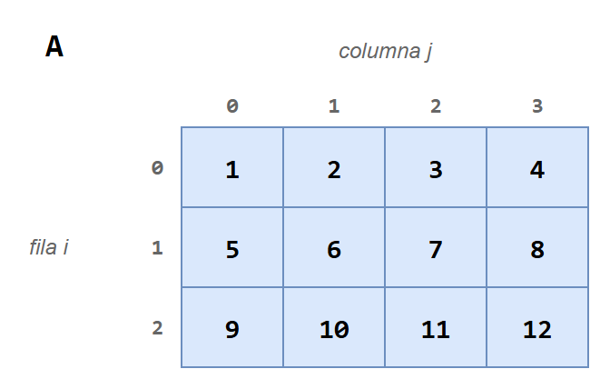
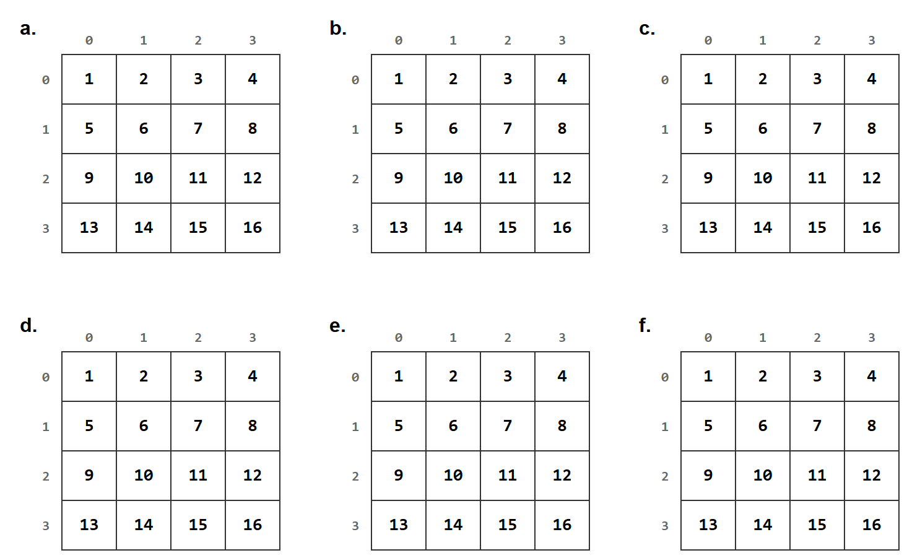
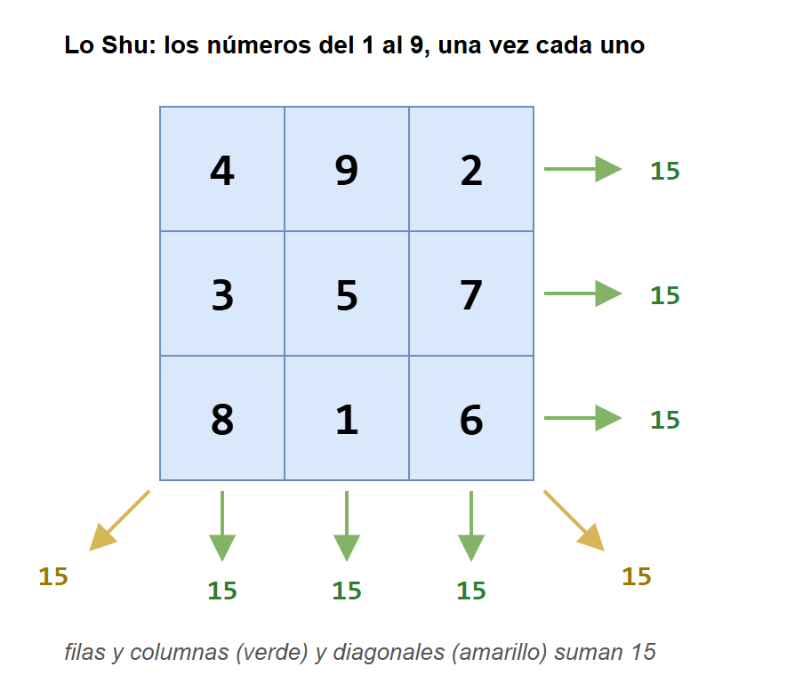
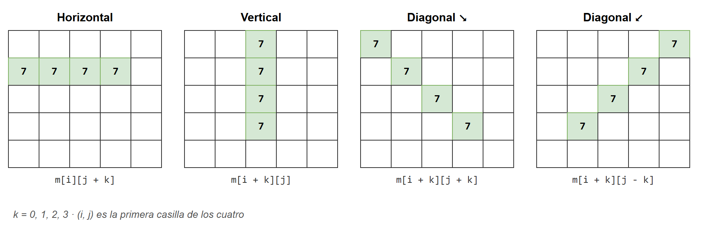
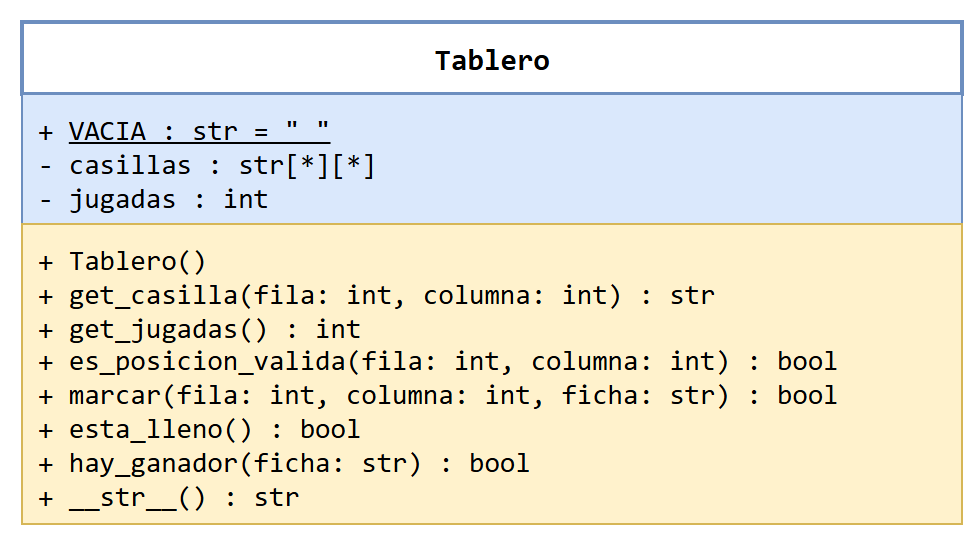
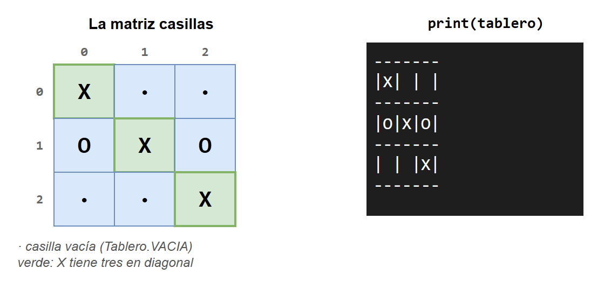
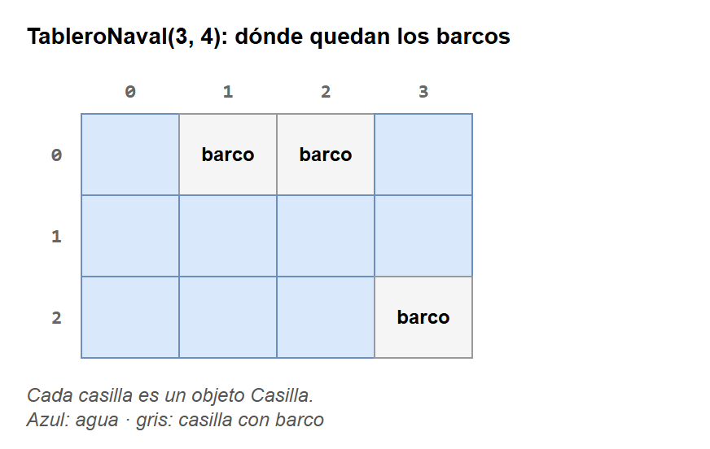
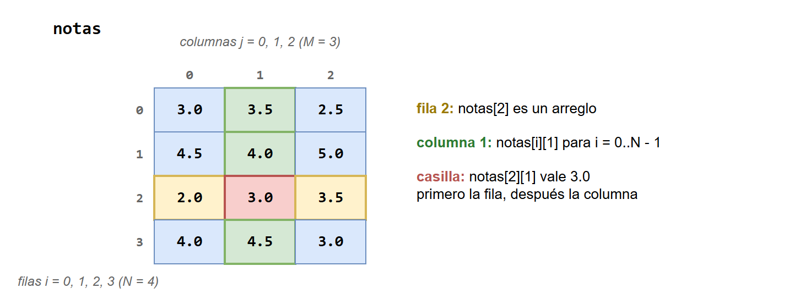
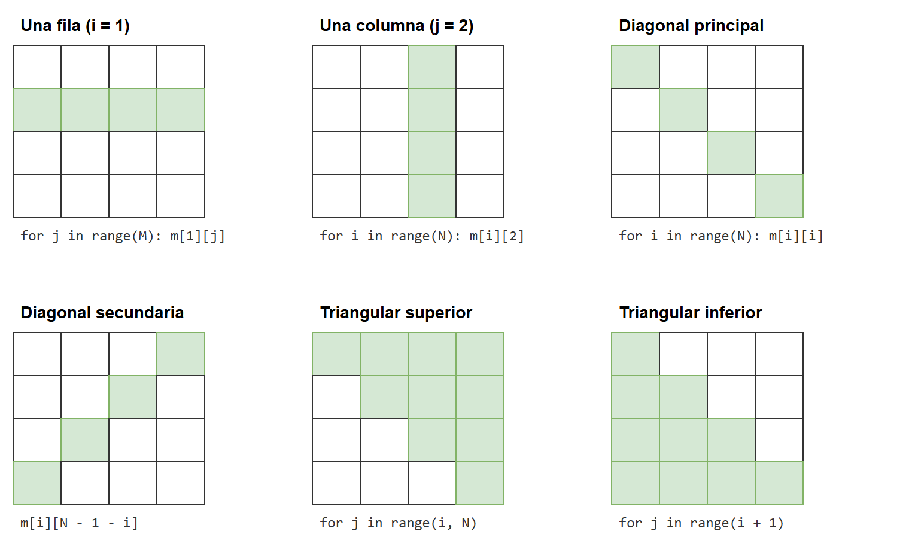
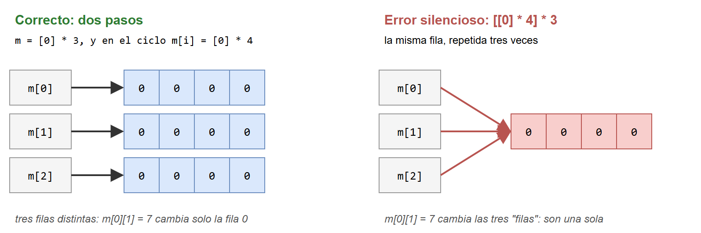

# Taller 6 — Matrices

Este taller sirve de repaso del tema de **arreglos bidimensionales (matrices)** de la [clase 14](../../clases/14/README.md). Cubre:

* Crear una matriz, guardar y leer casillas, y el índice como expresión.
* Recorrer por filas, por columnas, por las diagonales y por las triangulares.
* Acumular por fila y por columna, buscar el mayor con su posición y buscar un valor.
* Alias y copias de una matriz.
* Funciones con matrices en sus tres casos.
* Matrices dentro de una clase y matrices de objetos (bloque 2 de la clase).

Es la continuación del [Taller 4 — Arreglos](../arreglos/README.md): todo lo que allí se dijo de un arreglo vale para cada fila de una matriz.

> [!NOTE]
> **Autoría y fuentes:** varios ejercicios son adaptaciones de los capítulos de listas bidimensionales de dos libros de la bibliografía del curso:
>
> * **Y. Daniel Liang**, *Introduction to Programming Using Python* (Pearson, 2013), capítulo 11.
> * **Tony Gaddis**, *Starting Out with Python* (6a ed., Pearson, 2023), sección 7.9 y ejercicio 7.11.
>
> Los enunciados pertenecen a sus autores. Aquí se tradujeron y se adaptaron a las convenciones de la clase 14:
> * matrices creadas en dos pasos, sin `append`;
> * la posición se retorna como `[fila, columna]`;
> * búsquedas sin `break`;
> * datos fijos en lugar de aleatorios.
>
> También se agregaron casos de prueba y preguntas. Los demás ejercicios se escribieron para este taller. La tabla [Fuentes de los ejercicios](#fuentes-de-los-ejercicios) indica el origen de cada uno.

> [!NOTE]
> **La lista de listas usada como matriz.** En este curso, la lista de listas de Python se usa con las reglas de la matriz:
>
> * **Tamaño fijo:** `N` filas y `M` columnas, y todas las filas tienen `M` casillas. No crece ni se encoge.
> * **Se crea en dos pasos:** primero la lista de filas, `m = [0.0] * N`, y después, en un ciclo, una fila nueva por posición, `m[i] = [0.0] * M`. Nunca `[[0.0] * M] * N`, que repite la **misma** fila (ver el [anexo A.3](#a3-alias-y-copias)).
> * **Un solo tipo de dato** y acceso con dos índices, `m[i][j]`: **primero la fila, después la columna**.
> * **Sin métodos de listas** (`append`, `sort`, …). Todo se resuelve con recorridos.
> * Una posición se retorna como una lista de dos enteros, `[fila, columna]`.

## Cómo trabajar cada problema

1. **Entender:** identifique entradas, salidas y proceso. Antes de nada, responda **qué representan las filas y qué representan las columnas** (estudiantes y parciales, empleados y días…). Calcule a mano el resultado de un caso pequeño.
2. **Diseñar:** dibuje la matriz con sus índices y marque las casillas que el problema recorre. Escriba el recorrido en pseudocódigo con la notación de la clase 14, `notas = Matriz(N, M)` y dos ciclos `Para` anidados (ver el [anexo A.1](#a1-operaciones-básicas)). Si el problema pide funciones, escriba en Python la cabecera, el *Supone* y el *Garantiza* de cada una, y diga de qué **caso** es (ver el [anexo A.4](#a4-funciones-con-matrices)).
3. **Probar antes de integrar:** convierta los casos de prueba en `assert`. Pruebe casos **típicos**, **límite** (una matriz de 1 × 1, una sola fila, una sola columna) y **especiales** (valores repetidos, el valor no está, una matriz que no es cuadrada).
4. **Implementar y verificar:** escriba las funciones hasta que pasen todas las pruebas y después el programa principal. Si lo resuelve en el computador, organícelo en tres archivos, como en el [laboratorio 4](../../laboratorios/4/README.md):
   * un módulo con las funciones;
   * `test_<módulo>.py`;
   * `main.py` con la guarda `if __name__ == "__main__":`.

En los programas principales, la matriz se lee **casilla por casilla, una por línea**: primero `N` y `M`, y luego los valores fila por fila, como en `leer_notas(n, m)` de la clase 14.

---

## 1. Prueba de escritorio y predicción

Resuelva cada ejercicio **a mano, sin la ayuda del computador**. En la prueba de escritorio de una matriz:

* dibuje la cuadrícula con los índices de las filas a la izquierda y los de las columnas arriba;
* actualice las casillas a medida que cambian.

Al terminar, compruebe su respuesta ejecutando el código o simulándolo en [Python Tutor](https://pythontutor.com/). Python Tutor dibuja cada fila como una lista aparte y muestra con flechas qué variable apunta a cada una.

### 1.1 Crear, guardar y recorrer

**1.1.1** Considere la matriz:

```python
numeros = [[1, 2], [10, 20], [100, 200], [1000, 2000]]
```

* a. ¿Cuántas filas y cuántas columnas tiene? ¿Qué muestran `len(numeros)` y `len(numeros[0])`?
* b. ¿Qué muestran `numeros[2][1]`, `numeros[3][0] + numeros[0][1]` y `numeros[1]`?
* c. ¿Qué muestra `numeros[0][-1]`? ¿Y `numeros[4][0]`?
* d. Escriba dos ciclos anidados que muestren la matriz como una tabla, una fila por línea.
* e. Escriba las instrucciones que crean, en dos pasos, una matriz de 3 filas y 4 columnas con todas las casillas en 0.

**1.1.2** Con la matriz `A` de la figura, `i = 1` y `j = 2`, ¿qué valor tiene cada expresión?



| Expresión | Valor |
|---|---|
| `A[i][j]` | |
| `A[i + 1][j - 1]` | |
| `A[j][i]` | |
| `A[i - 1][j + 1]` | |
| `A[2 * i][3 * i]` | |
| `A[j][j + 1] - A[i][i]` | |

> **Pregunta para pensar:** `A[i][j]` y `A[j][i]`, ¿son la misma casilla? ¿Para qué valores de `i` y `j` sí lo son?

**1.1.3** Las seis porciones de código siguientes recorren la misma matriz de 4 × 4. Al empezar cada una, `total` vale 0:

```python
A = [[1, 2, 3, 4],
     [5, 6, 7, 8],
     [9, 10, 11, 12],
     [13, 14, 15, 16]]
N = 4
total = 0
```

En cada cuadrícula de la figura, sombree las casillas que se suman y calcule el valor final de `total`.



* a.
  ```python
  for i in range(N):
      for j in range(i, N):
          total = total + A[i][j]
  ```
* b.
  ```python
  for i in range(N):
      for j in range(i):
          total = total + A[i][j]
  ```
* c.
  ```python
  for i in range(N):
      total = total + A[i][N - 1 - i]
  ```
* d.
  ```python
  for i in range(1, N - 1):
      for j in range(1, N - 1):
          total = total + A[i][j]
  ```
* e.
  ```python
  for i in range(N):
      for j in range(N):
          if i == 0 or i == N - 1 or j == 0 or j == N - 1:
              total = total + A[i][j]
  ```
* f.
  ```python
  for i in range(N):
      for j in range(N):
          if (i + j) % 2 == 0:
              total = total + A[i][j]
  ```

> **Pregunta para pensar:** ¿qué nombre de la clase 14 tiene el recorrido de cada porción? Compare a. con b.: ¿por qué la diagonal está en una y no en la otra?

**1.1.4** (Respuesta múltiple) ¿Cuáles de los siguientes códigos crean una matriz de **3 filas y 4 columnas** de ceros en la que cada casilla se puede cambiar sin afectar a las demás? Para cada uno, diga qué muestra si después se ejecutan `m[0][1] = 7` y `print(m)`.

* a.
  ```python
  m = [0] * 3
  for i in range(3):
      m[i] = [0] * 4
  ```
* b.
  ```python
  m = [[0] * 4] * 3
  ```
* c.
  ```python
  m = [0] * 4
  for i in range(4):
      m[i] = [0] * 3
  ```
* d.
  ```python
  m = [[0, 0, 0, 0], [0, 0, 0, 0], [0, 0, 0, 0]]
  ```

> [!Tip]
> **Pista:** en la opción b, ¿cuántas listas de 4 ceros se crean? Dibuje las flechas desde `m[0]`, `m[1]` y `m[2]`.

### 1.2 Alias y copias

**Código 1.** ¿Qué muestra este código?

```python
a = [[1, 2], [3, 4]]
b = a
c = list(a)
d = [0] * 2
for i in range(2):
    d[i] = [0] * 2
    for j in range(2):
        d[i][j] = a[i][j]
a[0][0] = 9
c[1] = [5, 6]
print(a)
print(b)
print(c)
print(d)
```

> **Pregunta para pensar:**
> * ¿Cuántas listas de filas hay en la memoria al final?
> * ¿Cuántas filas distintas hay?
> * `c = list(a)` copia la lista de filas, pero ¿copia las filas?
>
> Dibuje las flechas como lo hace Python Tutor.

**Código 2.** ¿Qué muestra este código? ¿En qué se parece a la opción b del ejercicio 1.1.4?

```python
fila = [0] * 3
m = [0] * 2
for i in range(2):
    m[i] = fila
m[0][0] = 1
print(m)
```

### 1.3 Funciones con matrices

**1.3.1** (Respuesta única) ¿Qué muestra el siguiente código?

```python
def duplicar_columna(m, j):
    for i in range(len(m)):
        m[i][j] = 2 * m[i][j]

m = [[1, 2], [3, 4], [5, 6]]
print(duplicar_columna(m, 1))
print(m)
```

* a. `[[1, 4], [3, 8], [5, 12]]` y luego `[[1, 2], [3, 4], [5, 6]]`
* b. `None` y luego `[[1, 2], [3, 4], [5, 6]]`
* c. `None` y luego `[[1, 4], [3, 8], [5, 12]]`
* d. `[2, 4, 6]` y luego `[[1, 4], [3, 8], [5, 12]]`

> **Pregunta para pensar:** ¿de qué caso es `duplicar_columna`? ¿Qué debería decir su *Garantiza*?

**1.3.2** (Respuesta única) Considere la siguiente función:

```python
def misterio(m):
    total = 0
    n = len(m)
    for i in range(n):
        total = total + m[i][n - 1 - i]
    return total
```

¿Cuál es la mejor descripción para el *Garantiza* de `misterio`? ¿Qué retorna `misterio([[1, 2, 3], [4, 5, 6], [7, 8, 10]])`?

* a. Retorna la suma de la diagonal principal.
* b. Retorna la suma de la diagonal secundaria.
* c. Retorna la suma de la última columna.
* d. Retorna la suma de la última fila.

> **Pregunta para pensar:** ¿qué debe decir el *Supone* de `misterio`? ¿Qué pasa si se invoca con una matriz de 2 filas y 3 columnas?

**1.3.3** Un programador quería que la función `buscar` retornara la posición de la **primera** vez que aparece el valor, recorriendo por filas, o `[-1, -1]` si no aparece:

```python
def buscar(m, valor):
    fila = -1
    columna = -1
    for i in range(len(m)):
        for j in range(len(m[0])):
            if m[i][j] == valor:
                fila = i
                columna = j
                break
    return [fila, columna]

m = [[4, 7, 7],
     [7, 1, 0],
     [2, 7, 9]]
print(buscar(m, 7))
print(buscar(m, 0))
print(buscar(m, 5))
```

* a. ¿Qué muestra el programa? ¿Cuál de las tres respuestas no es la que quería el programador?
* b. ¿De qué ciclo sale el `break`? ¿Qué pasa después con el ciclo de `i`?
* c. Corrija la función **sin usar `break`**, como en la clase 14.

> [!Tip]
> **Pista:** basta con agregar una condición al `if` que diga "y todavía no lo había encontrado". ¿Qué variable lo indica?

**1.3.4** (Respuesta única) A la siguiente función le falta una línea:

```python
def transponer(m):
    """
    Garantiza:
        Retorna una matriz nueva cuyas filas son las columnas de m.
        Por ejemplo, transponer([[1, 2, 3], [4, 5, 6]]) retorna
        [[1, 4], [2, 5], [3, 6]]. No modifica m.
    """
    n = len(m)
    k = len(m[0])
    t = [0] * k
    for j in range(k):
        t[j] = [0] * n
    for i in range(n):
        for j in range(k):
            # FALTA CÓDIGO AQUÍ
    return t
```

¿Cuál de las siguientes líneas completa la función? Para las demás, diga qué ocurre con el ejemplo del *Garantiza*.

* a. `t[i][j] = m[i][j]`
* b. `t[j][i] = m[i][j]`
* c. `t[j][i] = m[j][i]`
* d. `m[j][i] = t[i][j]`

> **Pregunta para pensar:** ¿por qué la matriz `t` tiene `k` filas y `n` columnas, y no al revés? ¿Alguna de las opciones incorrectas funcionaría con una matriz cuadrada?

---

## 2. Problemas con matrices

**2.1 Suma por columnas.** Escriba una función que retorne la suma de los elementos de la columna `j` de una matriz:

```python
def sumar_columna(m, j):
```

Escriba un programa principal que lea una matriz de 3 × 4 y muestre la suma de cada columna.

```text
Suma de la columna 0: 16.5
Suma de la columna 1: 9.0
Suma de la columna 2: 13.0
Suma de la columna 3: 13.0
```

| `m` | `j` | `sumar_columna(m, j)` |
|---|---|---|
| `[[1.5, 2, 3, 4], [5.5, 6, 7, 8], [9.5, 1, 3, 1]]` | 0 | `16.5` |
| La misma | 1 | `9` |
| La misma | 3 | `13` |
| `[[1, 2], [3, 4]]` | 1 | `6` |
| `[[7]]` | 0 | `7` (límite: 1 × 1) |

> **Pregunta para pensar:** ¿qué ciclo de la clase 14 queda por fuera, el de `i` o el de `j`? ¿Quién lo hace ahora?

**2.2 Las dos diagonales.** Escriba dos funciones para una matriz **cuadrada**: una que sume la diagonal principal y otra que sume la diagonal secundaria.

```python
def sumar_diagonal_principal(m):
def sumar_diagonal_secundaria(m):
```

Escriba un programa principal que lea una matriz de 4 × 4 y muestre la suma de cada diagonal.

| `m` | Principal | Secundaria |
|---|---|---|
| `[[1, 2, 3, 4], [5, 6.5, 7, 8], [9, 10, 11, 12], [13, 14, 15, 16]]` | `34.5` | `34` |
| `[[1, 2, 3], [4, 5, 6], [7, 8, 9]]` | `15` | `15` |
| `[[1, 2], [3, 4]]` | `5` | `5` |
| `[[5]]` | `5` | `5` |

> [!Tip]
> **Pista:** en la diagonal principal, la columna es igual a la fila. En la secundaria, la columna "baja" mientras la fila "sube": revise el [anexo A.2](#a2-recorridos). Las dos funciones necesitan un **solo** ciclo.

**2.3 Horas trabajadas por semana.** Las horas que trabajó cada empleado en una semana están en una matriz: cada fila es un empleado y cada columna un día, de domingo a sábado.

| Empleado | Do | Lu | Ma | Mi | Ju | Vi | Sá |
|---|---|---|---|---|---|---|---|
| 0 | 2 | 4 | 3 | 4 | 5 | 8 | 8 |
| 1 | 7 | 3 | 4 | 3 | 3 | 4 | 4 |
| 2 | 3 | 3 | 4 | 3 | 3 | 2 | 2 |
| 3 | 9 | 3 | 4 | 7 | 3 | 4 | 1 |
| 4 | 3 | 5 | 4 | 3 | 6 | 3 | 8 |
| 5 | 3 | 4 | 4 | 6 | 3 | 4 | 4 |
| 6 | 3 | 7 | 4 | 8 | 3 | 8 | 4 |
| 7 | 6 | 3 | 5 | 9 | 2 | 7 | 9 |

Escriba un programa que muestre cada empleado con su total de horas, **de mayor a menor** total. Use dos funciones:

* `calcular_totales(horas)`, que retorna un arreglo **nuevo** con el total de cada empleado.
* `ordenar_descendente(totales, empleados)`, que ordena el arreglo de totales de mayor a menor y mueve **igual** el arreglo paralelo con los números de los empleados.

```text
Empleado 7: 41 horas
Empleado 6: 37 horas
Empleado 0: 34 horas
Empleado 4: 32 horas
Empleado 3: 31 horas
Empleado 5: 28 horas
Empleado 1: 28 horas
Empleado 2: 20 horas
```

| Caso | Resultado esperado |
|---|---|
| `calcular_totales` con la tabla | `[34, 28, 20, 31, 32, 28, 37, 41]` |
| `calcular_totales([[1, 1], [2, 3]])` | `[2, 5]` |
| Después de ordenar, `totales` | `[41, 37, 34, 32, 31, 28, 28, 20]` |
| Después de ordenar, `empleados` | `[7, 6, 0, 4, 3, 5, 1, 2]` (los empleados 5 y 1 empatan con 28; su orden depende del método de ordenamiento) |

> [!Tip]
> **Pista:** el arreglo `empleados` empieza como `[0, 1, 2, ..., 7]`. Use la selección de la clase 12 y la función `intercambiar(lista, i, j)`, y llámela **dos veces** en cada paso: una para `totales` y otra para `empleados`. Son arreglos paralelos.

> **Pregunta para pensar:** ¿por qué no se ordenan directamente las filas de la matriz? ¿Qué se perdería si se ordenara solo `totales`?

**2.4 Suma de matrices.** Escriba una función que sume dos matrices del mismo tamaño y retorne una matriz **nueva**, sin modificar las que recibe:

```python
def sumar_matrices(a, b):
```

Cada casilla del resultado es la suma de las casillas que están en la misma posición: $c_{ij} = a_{ij} + b_{ij}$.

| `a` | `b` | `sumar_matrices(a, b)` |
|---|---|---|
| `[[1, 2, 3], [4, 5, 6], [7, 8, 9]]` | `[[0, 2, 4], [1, 4.5, 2.2], [1.1, 4.3, 5.2]]` | `[[1, 4, 7], [5, 9.5, 8.2], [8.1, 12.3, 14.2]]` |
| `[[1, 2, 3]]` | `[[10, 20, 30]]` | `[[11, 22, 33]]` |

Después de sumar, `a` y `b` no cambian.

> [!Tip]
> **Pista:** la matriz resultado se crea en dos pasos, con `len(a)` filas y `len(a[0])` columnas. Al comparar reales en las pruebas, redondee: `assert round(c[1][2], 1) == 8.2`.

**2.5 Ubicar el mayor.** Escriba una función que retorne la posición del mayor elemento de una matriz como una lista `[fila, columna]`. Si el mayor está varias veces, retorna la **primera** posición, recorriendo por filas.

```python
def ubicar_mayor(m):
```

```text
Número de filas: 3
Número de columnas: 4
(se leen: 23.5, 35, 2, 10, 4.5, 3, 45, 3.5, 35, 44, 5.5, 11.6)
El mayor está en la fila 1, columna 2
```

| `m` | `ubicar_mayor(m)` |
|---|---|
| `[[23.5, 35, 2, 10], [4.5, 3, 45, 3.5], [35, 44, 5.5, 11.6]]` | `[1, 2]` |
| `[[1, 5], [5, 2]]` | `[0, 1]` (empate: la primera) |
| `[[-3, -1], [-2, -8]]` | `[0, 1]` (todos negativos) |
| `[[7]]` | `[0, 0]` |

> **Pregunta para pensar:** si el mayor se inicializa en `0` en lugar de usar la primera casilla, ¿qué caso de la tabla falla? (Vea el error 3.7).

**2.6 Filas y columnas con más unos.** Una matriz solo tiene ceros y unos. Escriba funciones para:

* `contar_unos_fila(m, i)` y `contar_unos_columna(m, j)`, que cuentan los unos de una fila o de una columna.
* `filas_con_mas_unos(m)` y `columnas_con_mas_unos(m)`, que retornan un arreglo **nuevo** con las posiciones de **todas** las filas (o columnas) que tienen la mayor cantidad de unos.

```text
0 0 1 1
0 0 1 1
1 1 0 1
1 0 1 0
Fila(s) con más unos: 2
Columna(s) con más unos: 2 3
```

| `m` | `filas_con_mas_unos(m)` | `columnas_con_mas_unos(m)` |
|---|---|---|
| `[[0, 0, 1, 1], [0, 0, 1, 1], [1, 1, 0, 1], [1, 0, 1, 0]]` | `[2]` | `[2, 3]` |
| `[[1, 0], [0, 1]]` | `[0, 1]` | `[0, 1]` |
| `[[0, 0], [0, 0]]` | `[0, 1]` (todas tienen 0 unos) | `[0, 1]` |

> [!Tip]
> **Pista:** primero se busca la mayor cantidad de unos. Después se crea el arreglo de posiciones **del tamaño justo**, sin `append`: se cuenta, se crea y se llena con un segundo índice `k`. Es el patrón de `posiciones_mayores_que` de la clase 11 y de `posiciones_iguales` de la clase 14 (ver el [anexo A.5](#a5-patrones-frecuentes)).

> **Para explorar:** el ejercicio original llena la matriz al azar. Pruébelo con `random.randint(0, 1)` en cada casilla. ¿Por qué las pruebas con `assert` se escriben con matrices fijas?

**2.7 Filas, columnas y diagonal constantes.** Escriba tres funciones que retornen `True` si **todas** las casillas son iguales:

* `es_fila_constante(m, i)`, en la fila `i`;
* `es_columna_constante(m, j)`, en la columna `j`;
* `es_diagonal_constante(m)`, en la diagonal principal de una matriz cuadrada.

Escriba un programa principal que lea una matriz cuadrada de ceros y unos y muestre qué filas tienen solo ceros o solo unos, y lo mismo para las columnas y la diagonal principal.

```text
0 1 1 1
0 0 0 0
0 1 0 0
1 1 1 1
Solo ceros en la fila 1
Solo unos en la fila 3
Ninguna columna tiene todos sus números iguales
La diagonal principal no tiene todos sus números iguales
```

| `m` | Resultado esperado |
|---|---|
| La matriz del ejemplo | Filas constantes: 1 y 3; columnas: ninguna; diagonal: `False` |
| `[[1, 0, 1], [1, 1, 0], [1, 0, 1]]` | `es_columna_constante(m, 0)` es `True`; `es_diagonal_constante(m)` es `True` |
| `[[5]]` | Las tres funciones retornan `True` |

> [!Tip]
> **Pista:** compare cada casilla con la **primera** de la fila (o de la columna, o de la diagonal), usando una bandera que empieza en `True`. No hace falta `break`.

**2.8 Cuadrado mágico Lo Shu.** El cuadrado Lo Shu es una matriz de 3 × 3 con dos propiedades:

* tiene los números del 1 al 9, **cada uno exactamente una vez**;
* cada fila, cada columna y cada una de las dos diagonales suman lo mismo: 15.



Escriba una función que reciba una matriz de 3 × 3 de enteros y retorne `True` si es un cuadrado Lo Shu:

```python
def es_lo_shu(m):
```

| `m` | `es_lo_shu(m)` | Por qué |
|---|---|---|
| `[[4, 9, 2], [3, 5, 7], [8, 1, 6]]` | `True` | El de la figura |
| `[[2, 7, 6], [9, 5, 1], [4, 3, 8]]` | `True` | Otro cuadrado válido |
| `[[5, 5, 5], [5, 5, 5], [5, 5, 5]]` | `False` | Todo suma 15, pero los números se repiten |
| `[[4, 9, 2], [3, 5, 7], [8, 6, 1]]` | `False` | Las filas suman 15, pero las columnas no |
| `[[1, 2, 3], [4, 5, 6], [7, 8, 9]]` | `False` | Las filas no suman 15 |
| `[[4, 9, 2], [3, 5, 7], [8, 1, 10]]` | `False` | El 10 está fuera del rango |

> [!Tip]
> **Pista:** para revisar que cada número del 1 al 9 está una sola vez, use un **arreglo de contadores**, como en el problema 2.7 del [Taller 4](../arreglos/README.md): `contadores = [0] * 10` y cada casilla de la matriz se usa como índice. Antes de usarla como índice, compruebe que está entre 1 y 9.

> **Pregunta para pensar:** el tercer caso suma 15 en todas las direcciones. ¿Por qué no basta con revisar las sumas?

**2.9 Cuatro iguales seguidos.** En el [Taller 4](../arreglos/README.md) se buscaron cuatro números iguales seguidos en un arreglo. Ahora se buscan en una matriz, en cualquiera de **cuatro direcciones**:



Escriba una función que retorne `True` si la matriz tiene cuatro números iguales seguidos en alguna dirección:

```python
def hay_cuatro_seguidos(m):
```

Para las pruebas, parta de esta matriz de 6 × 7, que **no** tiene cuatro seguidos:

```python
base = [[0, 1, 0, 3, 1, 6, 1],
        [0, 1, 6, 8, 6, 0, 1],
        [5, 6, 2, 1, 8, 2, 9],
        [6, 5, 6, 1, 1, 9, 1],
        [1, 3, 6, 1, 4, 0, 7],
        [3, 3, 3, 9, 4, 0, 7]]
```

| Cambio sobre `base` | Dirección | `hay_cuatro_seguidos` |
|---|---|---|
| Ninguno | — | `False` |
| `m[5][3] = 3` | Horizontal, en la fila 5 | `True` |
| `m[1][3] = 1` | Vertical, en la columna 3 | `True` |
| `m[1][1]`, `m[2][2]`, `m[3][3]` y `m[4][4]` en 9 | Diagonal ↘ | `True` |
| `m[0][6]`, `m[1][5]`, `m[2][4]` y `m[3][3]` en 6 | Diagonal ↙ | `True` |

Casos límite: `[[1, 1, 1, 1]]` y `[[2], [2], [2], [2]]` dan `True`; `[[1, 1, 1]]` da `False`.

> [!Tip]
> **Pista:** recorra todas las casillas `(i, j)` y, desde cada una, mire las tres casillas siguientes en cada dirección. Antes de mirar, compruebe que no se sale de la matriz: en la dirección horizontal, `j + 3 < M`; en la diagonal ↙, `i + 3 < N` y `j - 3 >= 0`. Para no modificar `base` en las pruebas, cree una copia de la matriz con dos ciclos (ver el [anexo A.3](#a3-alias-y-copias)).

### Para explorar por su cuenta

* **Multiplicación de matrices** (Liang, ejercicio 11.6). Para multiplicar `a` (de `n × k`) por `b` (de `k × m`), cada casilla del resultado es $c_{ij} = a_{i0} b_{0j} + a_{i1} b_{1j} + \cdots + a_{i,k-1} b_{k-1,j}$: la fila `i` de `a` "por" la columna `j` de `b`. Necesita **tres** ciclos anidados. Pruébela con `[[1, 2], [3, 4]]` por `[[5, 6], [7, 8]]`, que da `[[19, 22], [43, 50]]`.
* **Nueve caras y sellos** (Liang, ejercicio 11.11). Nueve monedas en una matriz de 3 × 3 se pueden representar con un número del 0 al 511 escrito en binario. Escriba un programa que lea el número y muestre la matriz con `C` (cara) y `S` (sello). Recuerde la conversión a binario del laboratorio 3.
* **Revisar un sudoku** (Liang, ejercicio 11.24). Una solución de sudoku es válida si cada fila, cada columna y cada bloque de 3 × 3 tiene los números del 1 al 9. Es el problema 2.8, repetido 27 veces.

---

## 3. Encontrar y corregir errores

Cada código tiene un error. Para cada uno:

* a. ¿El programa se detiene con un mensaje de error o corre sin avisar y da un resultado equivocado (error **silencioso**)?
* b. Si se detiene, ¿qué tipo de error muestra Python?
* c. ¿Por qué ocurre?
* d. ¿Cómo se corrige?

**3.1** Se esperaba `[[0, 1, 2], [10, 11, 12], [20, 21, 22]]`.

```python
N = 3
M = 3
m = [[0] * M] * N
for i in range(N):
    for j in range(M):
        m[i][j] = 10 * i + j
print(m)
```

**3.2** Mostrar las notas de 2 estudiantes en 3 parciales.

```python
N = 2
M = 3
notas = [[3.0, 3.5, 2.5],
         [4.5, 4.0, 5.0]]
for i in range(M):
    for j in range(N):
        print(notas[i][j], end="  ")
    print()
```

**3.3** El promedio de cada estudiante. Se esperaba `Ana 3.0`, `Beto 4.5` y `Carla 2.83`.

```python
nombres = ["Ana", "Beto", "Carla"]
notas = [[3.0, 3.5, 2.5],
         [4.5, 4.0, 5.0],
         [2.0, 3.0, 3.5]]
N = 3
M = 3
suma = 0.0
for i in range(N):
    for j in range(M):
        suma = suma + notas[i][j]
    print(nombres[i], round(suma / M, 2))
```

**3.4** Una función para mostrar la suma de cada columna. Pruébela a mano con las dos matrices.

```python
def sumar_columnas(m):
    for j in range(len(m)):
        suma = 0
        for i in range(len(m)):
            suma = suma + m[i][j]
        print("Columna", j, ":", suma)

sumar_columnas([[1, 2, 3, 4],
                [5, 6, 7, 8],
                [9, 10, 11, 12]])
sumar_columnas([[1, 2],
                [3, 4],
                [5, 6]])
```

> [!Tip]
> **Pista:** con la primera matriz el error es silencioso y con la segunda no. ¿Qué tienen las dos en común que la función supone sin decirlo? ¿Qué cambia si la matriz es cuadrada?

**3.5** Se quería cambiar una nota en la **copia**, sin tocar el original.

```python
notas = [[3.0, 3.5],
         [4.5, 4.0]]
copia = list(notas)
copia[0][0] = 5.0
print(notas)
```

**3.6** Se quería dejar toda la matriz en ceros.

```python
m = [[1, 2],
     [3, 4]]
for fila in m:
    for x in fila:
        x = 0
print(m)
```

**3.7** Buscar la temperatura más alta registrada en dos ciudades durante tres noches de invierno.

```python
temperaturas = [[-5.0, -2.5, -8.0],
                [-1.0, -3.5, -6.0]]
mayor = 0.0
for i in range(2):
    for j in range(3):
        if temperaturas[i][j] > mayor:
            mayor = temperaturas[i][j]
print("La temperatura más alta fue", mayor)
```

---

## 4. Matrices y objetos

En el bloque 2 de la clase 14 aparecieron dos formas de juntar matrices y objetos:

* una **clase que guarda una matriz** como atributo (la clase `Matriz`);
* una **matriz de objetos** (la `Sala` de cine, con una matriz de objetos `Silla`).

Los problemas de esta sección usan las dos. Siga las convenciones UML del [Taller 5](../POO/README.md):
* una matriz de un tipo se escribe `tipo[*][*]`;
* si los elementos son objetos, el tipo es la clase, en negrita.

**4.1 De UML a código: tres en línea.** En el juego de tres en línea, dos jugadores marcan por turnos una casilla vacía de un tablero de 3 × 3 con su ficha, `X` u `O`. Gana quien complete tres fichas suyas en una fila, una columna o una diagonal. Si se llenan las nueve casillas sin ganador, hay empate.



* El constructor crea la matriz de 3 × 3, en dos pasos, con todas las casillas en `Tablero.VACIA`, y deja `jugadas` en 0.
* `marcar(fila, columna, ficha)` pone la ficha y retorna `True` solo si la posición es válida **y** la casilla está vacía. En ese caso suma 1 a `jugadas`. Si no, no cambia nada y retorna `False`.
* `esta_lleno()` retorna `True` si ya se hicieron las nueve jugadas.
* `hay_ganador(ficha)` retorna `True` si esa ficha tiene tres en una fila, una columna o una diagonal.
* `__str__()` retorna el tablero como en la figura: una línea de siete guiones, y cada fila entre barras.



Escriba un programa principal para dos jugadores:
* empieza `X` y los turnos se alternan;
* en cada turno se muestra el tablero y se leen la fila y la columna (de 0 a 2), y si la casilla no se puede marcar, se vuelven a pedir;
* el juego termina con `Ganó X`, `Ganó O` o `Empate`.

| Instrucciones | Resultado esperado |
|---|---|
| `t = Tablero()` | `t.get_jugadas()` es `0`; `t.get_casilla(1, 1)` es `" "` |
| `t.marcar(1, 1, "X")` | `True`; `t.get_casilla(1, 1)` es `"X"` |
| `t.marcar(1, 1, "O")` | `False` (casilla ocupada) |
| `t.marcar(3, 0, "O")` y `t.marcar(0, -1, "O")` | `False` y `False` (fuera del tablero); `t.get_jugadas()` sigue en `1` |
| Marcar `O` en (1, 2), `X` en (0, 0), `O` en (1, 0) | `t.hay_ganador("X")` es `False` |
| Marcar `X` en (2, 2) | `t.hay_ganador("X")` es `True`; `t.hay_ganador("O")` es `False`; `str(t)` es el de la figura |
| Un tablero lleno: `X O X` / `X O O` / `O X X` | `esta_lleno()` es `True` y nadie gana |
| Tres `O` en la columna 2 | `hay_ganador("O")` es `True` y `esta_lleno()` es `False` |

> [!Tip]
> **Pista:** `hay_ganador` revisa ocho líneas: tres filas, tres columnas y dos diagonales. Las filas y las columnas se recorren con un ciclo cada una; las diagonales son dos condiciones fijas. ¿Por qué `marcar` debe llamar a `es_posicion_valida` **antes** de mirar la casilla?

> **Pregunta para pensar:** la fila y la columna que escribe el jugador empiezan en 0. Si el programa principal las pidiera de 1 a 3, ¿dónde se haría la conversión? Compare con `get_silla` de la sala de cine de la clase 14.

**4.2 De código a UML: batalla naval.** El siguiente código **funciona**. Un `TableroNaval` crea una matriz de objetos `Casilla`; algunas tienen barco. El jugador dispara a una posición y el tablero responde `"agua"`, `"tocado"`, `"repetido"` (si ya había disparado allí) o `"fuera"` (si la posición no existe).

```python
class Casilla:
    def __init__(self):
        self.__tiene_barco = False
        self.__disparada = False

    def tiene_barco(self):
        return self.__tiene_barco

    def fue_disparada(self):
        return self.__disparada

    def poner_barco(self):
        puesto = False
        if not self.__tiene_barco:
            self.__tiene_barco = True
            puesto = True
        return puesto

    def disparar(self):
        resultado = "repetido"
        if not self.__disparada:
            self.__disparada = True
            if self.__tiene_barco:
                resultado = "tocado"
            else:
                resultado = "agua"
        return resultado

    def __str__(self):
        simbolo = "~"
        if self.__disparada and self.__tiene_barco:
            simbolo = "X"
        elif self.__disparada:
            simbolo = "o"
        return simbolo


class TableroNaval:
    def __init__(self, filas, columnas):
        self.__filas = filas
        self.__columnas = columnas
        self.__casillas = [None] * filas
        for i in range(filas):
            self.__casillas[i] = [None] * columnas
            for j in range(columnas):
                self.__casillas[i][j] = Casilla()
        self.__barcos = 0
        self.__tocados = 0

    def es_posicion_valida(self, fila, columna):
        return 0 <= fila < self.__filas and 0 <= columna < self.__columnas

    def poner_barco(self, fila, columna):
        puesto = False
        if self.es_posicion_valida(fila, columna) and self.__casillas[fila][columna].poner_barco():
            self.__barcos = self.__barcos + 1
            puesto = True
        return puesto

    def disparar(self, fila, columna):
        resultado = "fuera"
        if self.es_posicion_valida(fila, columna):
            resultado = self.__casillas[fila][columna].disparar()
            if resultado == "tocado":
                self.__tocados = self.__tocados + 1
        return resultado

    def quedan_barcos(self):
        return self.__tocados < self.__barcos

    def __str__(self):
        texto = ""
        for i in range(self.__filas):
            for j in range(self.__columnas):
                texto = texto + str(self.__casillas[i][j]) + " "
            texto = texto + "\n"
        return texto


tablero = TableroNaval(3, 4)
print(tablero.poner_barco(0, 1), tablero.poner_barco(0, 2), tablero.poner_barco(2, 3))
print(tablero.poner_barco(0, 1), tablero.poner_barco(3, 0))
print(tablero.disparar(0, 1))
print(tablero.disparar(1, 1))
print(tablero.disparar(0, 1))
print(tablero.disparar(2, 3))
print(tablero.disparar(5, 5))
print(tablero.quedan_barcos())
print(tablero)
print(tablero.disparar(0, 2), tablero.quedan_barcos())
```



* a. Dibuje el UML de las dos clases, con la relación entre ellas, su multiplicidad y el atributo que la implementa. ¿Es composición o agregación? ¿Qué línea lo muestra?
* b. Prediga la salida del programa. Al dibujar el tablero, use la figura para saber dónde están los barcos.
* c. ¿Por qué el `__str__` de `Casilla` nunca muestra un barco que no ha sido tocado?
* d. `TableroNaval` no modifica nunca los atributos de una `Casilla`: le **pide** que se modifique. Señale dónde ocurre eso.
* e. ¿Qué pasaría si el constructor creara las casillas con `[Casilla()] * columnas` en cada fila? ¿Cuántos objetos `Casilla` habría por fila? (Compare con el anexo A.6).

**4.3 Problema de diseño: planilla de notas.** Diseñe una clase llamada `Planilla` que guarde las notas de un curso: los nombres de los estudiantes y una matriz de notas, con una fila por estudiante y una columna por parcial. La clase contiene:

* Las constantes `NOTA_MINIMA = 0.0`, `NOTA_MAXIMA = 5.0` y `NOTA_APROBATORIA = 3.0`.
* Un constructor que recibe el arreglo de nombres y la cantidad de parciales, y crea la matriz de notas con todas las casillas en 0.0.
* `get_cantidad_estudiantes()`, `get_parciales()`, `get_nombre(i)` y `get_nota(i, j)`.
* `set_nota(i, j, nota)`, que guarda la nota solo si la posición es válida **y** la nota está entre la mínima y la máxima. Retorna si la guardó.
* `calcular_promedio_estudiante(i)` y `calcular_promedio_parcial(j)`.
* `contar_aprobados_parcial(j)`, que cuenta las notas del parcial `j` que son mayores o iguales a la aprobatoria.
* `posicion_mejor_nota()`, que retorna `[fila, columna]` de la mejor nota (la primera, si hay empate).

Dibuje el UML, escriba las pruebas e implemente la clase. Escriba un programa principal que cree la planilla con los datos de la clase 14 y muestre el promedio de cada estudiante, el de cada parcial y quién sacó la mejor nota y en qué parcial.

| Estudiante | Parcial 1 | Parcial 2 | Parcial 3 |
|---|---|---|---|
| Ana | 3.0 | 3.5 | 2.5 |
| Beto | 4.5 | 4.0 | 5.0 |
| Carla | 2.0 | 3.0 | 3.5 |
| Dario | 4.0 | 4.5 | 3.0 |

| Instrucciones | Resultado esperado |
|---|---|
| `set_nota` con cada nota de la tabla | `True` las doce veces |
| `set_nota(0, 0, 7.0)` y `set_nota(0, 0, -1.0)` | `False` y `False`; la nota sigue en `3.0` |
| `set_nota(4, 0, 3.0)` y `set_nota(0, 3, 3.0)` | `False` y `False` (posición inválida) |
| `calcular_promedio_estudiante` de 0, 1, 2 y 3 | `3.0`, `4.5`, `2.83` y `3.83` (redondeados a 2 decimales) |
| `calcular_promedio_parcial` de 0, 1 y 2 | `3.375`, `3.75` y `3.5` |
| `contar_aprobados_parcial` de 0, 1 y 2 | `3`, `4` y `3` |
| `posicion_mejor_nota()` | `[1, 2]` (Beto, parcial 3) |
| `Planilla(["Solo"], 1)` sin notas | promedio `0.0`, aprobados `0`, mejor nota en `[0, 0]` |

> [!Tip]
> **Pista:** la `Planilla` hace lo mismo que las funciones de la clase 14, pero los datos dejan de ir sueltos: `nombres` y `notas` viajan juntos dentro del objeto. Compare con la clase `Matriz` de la clase 14: ¿dónde se valida la posición?

> **Pregunta para pensar:** si más adelante se necesitara guardar el correo de cada estudiante, ¿convendría agregar otro arreglo paralelo a `nombres`, o crear una clase `Estudiante` y que la planilla guarde un arreglo de objetos? Compare con la [aplicación del curso con objetos](../../clases/13/teoria/app_curso/README.md) de la clase 13.

### Para explorar por su cuenta

* Agregue a la clase `Matriz` de la clase 14 un método `multiplicar(otra)` que retorne un objeto `Matriz` nuevo. ¿Qué debe decir su *Supone* sobre el tamaño de `otra`?
* Convierta el juego del problema 4.1 en una partida contra la máquina: la máquina elige una casilla vacía al azar con `random.randint`. ¿En qué clase va esa decisión: en `Tablero` o en el programa principal?

---

## Anexo: Referencia rápida de matrices

### A.1 Operaciones básicas



| Operación | Pseudocódigo | Python |
|---|---|---|
| Crear | `notas = Matriz(N, M)` | `notas = [0.0] * N`<br>`for i in range(N):`<br>&nbsp;&nbsp;&nbsp;&nbsp;`notas[i] = [0.0] * M` |
| Crear con valores | `notas = [[3.0, 3.5], [4.5, 4.0]]` | `notas = [[3.0, 3.5], [4.5, 4.0]]` |
| Guardar un valor | `notas[2][1] = 3.0` | `notas[2][1] = 3.0` |
| Llenar por teclado | `Para (i = 0, N - 1, 1) Haga`<br>&nbsp;&nbsp;`Para (j = 0, M - 1, 1) Haga`<br>&nbsp;&nbsp;&nbsp;&nbsp;`Leer(notas[i][j])`<br>&nbsp;&nbsp;`Fin_Para`<br>`Fin_Para` | `for i in range(N):`<br>&nbsp;&nbsp;&nbsp;&nbsp;`for j in range(M):`<br>&nbsp;&nbsp;&nbsp;&nbsp;&nbsp;&nbsp;&nbsp;&nbsp;`notas[i][j] = float(input("Nota: "))` |
| Mostrar como tabla | `Para (i = 0, N - 1, 1) Haga`<br>&nbsp;&nbsp;`Para (j = 0, M - 1, 1) Haga`<br>&nbsp;&nbsp;&nbsp;&nbsp;`Escribir(notas[i][j], "  ")`<br>&nbsp;&nbsp;`Fin_Para`<br>&nbsp;&nbsp;`Escribir(salto de línea)`<br>`Fin_Para` | `for i in range(N):`<br>&nbsp;&nbsp;&nbsp;&nbsp;`for j in range(M):`<br>&nbsp;&nbsp;&nbsp;&nbsp;&nbsp;&nbsp;&nbsp;&nbsp;`print(notas[i][j], end="  ")`<br>&nbsp;&nbsp;&nbsp;&nbsp;`print()` |
| Acumular todo | `suma = 0`<br>`Para (i = 0, N - 1, 1) Haga`<br>&nbsp;&nbsp;`Para (j = 0, M - 1, 1) Haga`<br>&nbsp;&nbsp;&nbsp;&nbsp;`suma = suma + notas[i][j]`<br>&nbsp;&nbsp;`Fin_Para`<br>`Fin_Para` | `suma = 0`<br>`for i in range(N):`<br>&nbsp;&nbsp;&nbsp;&nbsp;`for j in range(M):`<br>&nbsp;&nbsp;&nbsp;&nbsp;&nbsp;&nbsp;&nbsp;&nbsp;`suma = suma + notas[i][j]` |

> Un índice demasiado grande produce `IndexError: list index out of range`. Un índice negativo **no** produce error en Python: `notas[i - 1][j]` con `i = 0` toma, sin avisar, la **última** fila. Si se intercambian `N` y `M` en los ciclos, el recorrido falla o, peor, queda incompleto sin avisar.

### A.2 Recorridos



| Recorrido | Python | Casillas (N = 4) |
|---|---|---|
| Por filas (toda la matriz) | `for i in range(N):` / `for j in range(M):` | Las N × M |
| Por columnas | `for j in range(M):` / `for i in range(N):` | Las N × M, columna por columna |
| Una fila `i` | `for j in range(M): ... m[i][j]` | M casillas |
| Una columna `j` | `for i in range(N): ... m[i][j]` | N casillas |
| Diagonal principal | `for i in range(N): ... m[i][i]` | (0, 0), (1, 1), (2, 2), (3, 3) |
| Diagonal secundaria | `for i in range(N): ... m[i][N - 1 - i]` | (0, 3), (1, 2), (2, 1), (3, 0) |
| Triangular superior | `for i in range(N):` / `for j in range(i, N):` | Las casillas con `j >= i` |
| Triangular inferior | `for i in range(N):` / `for j in range(i + 1):` | Las casillas con `j <= i` |

Las diagonales y las triangulares solo tienen sentido en una matriz **cuadrada** (N = M). Para acumular **por fila**, el acumulador se reinicia **dentro** del ciclo de `i`, antes del ciclo de `j`; para acumular **por columna**, dentro del ciclo de `j`.

### A.3 Alias y copias



| Instrucción | Qué hace |
|---|---|
| `copia = notas` | **No copia**: `copia` es otro nombre de la misma matriz. |
| `copia = list(notas)` o `copia = notas[:]` | Copia **solo la lista de filas**: las filas siguen siendo las mismas. Cambiar `copia[0][0]` cambia `notas[0][0]`. |
| Crear `copia` en dos pasos y copiar casilla por casilla con dos ciclos | Crea una matriz nueva (un clon): las dos matrices son independientes. |
| `[[0] * M] * N` | Crea **una** fila y la repite N veces: todas las "filas" son la misma. |

### A.4 Funciones con matrices

| | Caso 1 | Caso 2 | Caso 3 |
|---|---|---|---|
| Ejemplo (clase 14) | `calcular_promedio_fila(notas, i)` | `leer_notas(n, m)` | `aplicar_bonificacion(notas, j, puntos)` |
| Entra | una matriz (y un índice) | dos tamaños | una matriz (y valores) |
| Sale (`return`) | un valor | una matriz nueva | nada |
| ¿Modifica la matriz? | No | — (la crea) | Sí |
| El *Garantiza* dice | "No modifica notas" | "Retorna una matriz nueva" | "MODIFICA notas" |
| Se prueba | `assert` sobre el valor retornado | Ejecutando el programa (usa `input`) | Se llama y **después** se revisa la matriz |

* Dentro de la función, las filas son `len(m)` y las columnas, `len(m[0])`.
* Una función que retorna una matriz nueva la crea en dos pasos, del tamaño justo.
* Una función que retorna una posición retorna una lista de dos enteros, `[fila, columna]`.

### A.5 Patrones frecuentes

**El mayor y su posición:** se empieza con la primera casilla, no con 0.

```python
fila_mayor = 0
columna_mayor = 0
for i in range(N):
    for j in range(M):
        if m[i][j] > m[fila_mayor][columna_mayor]:
            fila_mayor = i
            columna_mayor = j
```

**Buscar la primera aparición, sin `break`:** `break` solo saldría del ciclo de `j`.

```python
fila = -1
columna = -1
for i in range(N):
    for j in range(M):
        if m[i][j] == buscado and fila == -1:
            fila = i
            columna = j
```

**Acumular por fila:** el acumulador se reinicia en cada fila.

```python
for i in range(N):
    suma = 0.0
    for j in range(M):
        suma = suma + notas[i][j]
    print(nombres[i], suma / M)
```

**Crear un arreglo de posiciones del tamaño justo (sin `append`):** primero se cuenta, luego se crea y por último se llena con un segundo índice `k`.

```python
cantidad = 0
for i in range(N):
    if cumple(m, i):
        cantidad = cantidad + 1
filas = [0] * cantidad
k = 0
for i in range(N):
    if cumple(m, i):
        filas[k] = i
        k = k + 1
```

### A.6 Matrices y objetos

**Una clase que guarda una matriz:** el constructor la crea en dos pasos y los métodos la protegen.

```python
class Matriz:
    def __init__(self, filas, columnas, valor=0.0):
        self.__filas = filas
        self.__columnas = columnas
        self.__datos = [0.0] * filas
        for i in range(filas):
            self.__datos[i] = [valor] * columnas

    def es_posicion_valida(self, i, j):
        return 0 <= i < self.__filas and 0 <= j < self.__columnas
```

**Una matriz de objetos:** se crea **un objeto por casilla**, dentro del ciclo de `j`. Es una composición: la clase que guarda la matriz crea los objetos.

```python
self.__sillas = [None] * filas
for i in range(filas):
    self.__sillas[i] = [None] * sillas_por_fila
    for j in range(sillas_por_fila):
        self.__sillas[i][j] = Silla(Sala.LETRAS[i], j + 1)
```

⚠️ `[Silla("A", 1)] * 4` crea **un** objeto y lo pone cuatro veces en la fila: vender una silla las vendería todas.

**Dos formas de contar:** si el usuario numera desde 1 (o con letras), la conversión a índices desde 0 se hace en **un solo método**, como `get_silla` de la sala de cine.

---

## Fuentes de los ejercicios

| Ejercicio(s) | Fuente |
|---|---|
| 1.1.1 | Gaddis, preguntas de repaso 7.22 a 7.24 (sección 7.9) |
| 1.1.2-1.1.4, 1.2, 1.3 | Escritos para este taller, a partir de la clase 14; 1.3.4 es la transpuesta de la clase 14 |
| 2.1 | Liang, ejercicio 11.1 (*Sum elements column by column*) |
| 2.2 | Liang, ejercicio 11.2 (*Sum the major diagonal*), con la diagonal secundaria |
| 2.3 | Liang, ejercicio 11.4 (*Compute the weekly hours for each employee*), con el ordenamiento por selección de la clase 12 |
| 2.4 | Liang, ejercicio 11.5 (*Add two matrices*) |
| 2.5 | Liang, ejercicio 11.13 (*Locate the largest element*) |
| 2.6 | Liang, ejercicio 11.10 (*Largest rows and columns*), con una matriz fija en lugar de una aleatoria |
| 2.7 | Liang, ejercicio 11.14 (*Explore matrix*), con una matriz fija en lugar de una aleatoria |
| 2.8 | Gaddis, ejercicio 7.11 (*Lo Shu Magic Square*) |
| 2.9 | Liang, ejercicio 11.19 (*Four consecutive equal numbers*), con datos propios |
| Para explorar (sección 2) | Liang, ejercicios 11.6 (*Multiply two matrices*), 11.11 (*Nine heads and tails*) y 11.24 (*Check Sudoku solution*) |
| 3.1-3.7 | Escritos para este taller, a partir de los errores típicos de la clase 14 |
| 4.1 | Liang, ejercicio 11.9 (*Play a tic-tac-toe game*), organizado en una clase con su diagrama UML |
| 4.2 | Escrito para este taller |
| 4.3 | Escrito para este taller, a partir del problema de las notas de la clase 14 |

---

> [!Important]
> Se usó IA generativa para seleccionar, traducir, adaptar y organizar los ejercicios de este taller a partir de los libros citados, del material de la clase 14 y de las indicaciones del docente. Las salidas y los casos de prueba se verificaron ejecutando el código. El docente revisa y valida la versión final.
